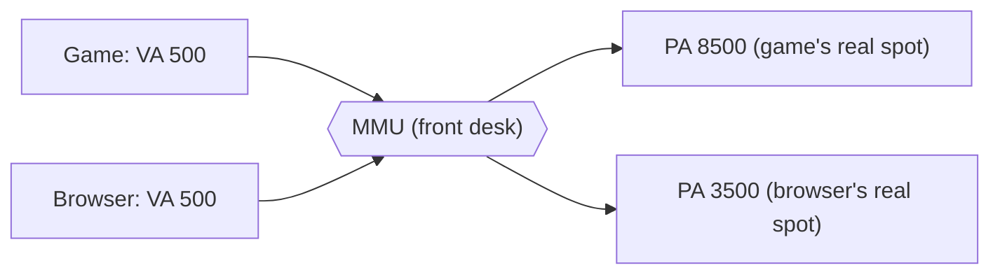
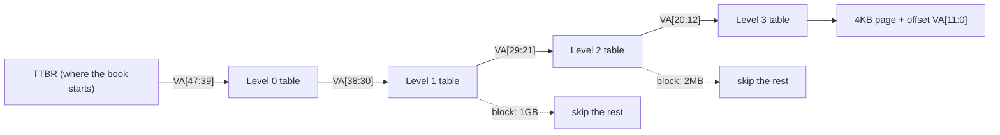
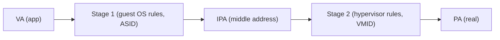
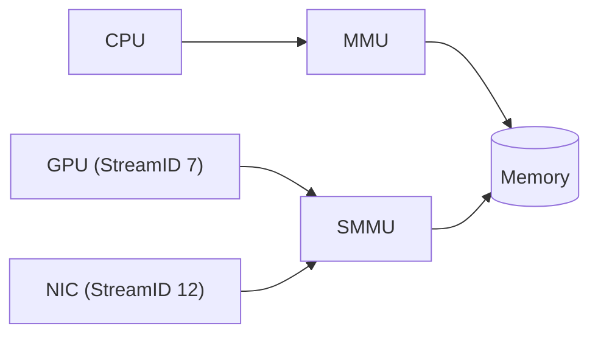
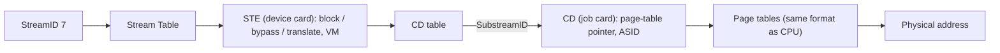

# 01 · MMU From Zero (fresher level)

No background needed. Fourteen small steps from "what is an address" to "how a verification engineer tests an SMMU".
Each level: **the story** (something you already know) → **the real thing** → **one line to remember**.

Interactive version with toys (address splitter, "be the MMU", TLB simulator, quiz): [`html/mmu-from-zero.html`](html/mmu-from-zero.html)

---

## Level 1 · Memory is a long street of numbered houses

**Story.** Every house has a number. Each house holds one small thing. To fetch it, say the number.

**Real thing.** RAM is a huge list of bytes. Each byte has an **address**. The CPU says "read address 2" or "write 13 into address 4".

> An address is a house number for one byte of memory.

## Level 2 · The problem: many programs, one street

A game writes its score to house 500. The browser also picks house 500 for a password. They overwrite each other, and a bad app could read the password.

| Problem | What goes wrong |
|---|---|
| Collisions | Two programs pick the same address by accident |
| Snooping | A program reads or changes someone else's memory |
| Messy space | Free memory is scattered in small holes |

> If everyone uses real addresses directly, nobody is safe.

## Level 3 · Pretend addresses and a translator at the gate

**Story.** A hotel. Every guest's key card says "Room 1". The front desk looks you up and sends you to your real room (say 714). Two guests can both hold "Room 1" and land in different rooms, and the desk refuses rooms that aren't yours.

**Real thing.** Programs use **virtual addresses (VA)**. The **MMU** (Memory Management Unit) turns each VA into a **physical address (PA)** and checks permission. The OS writes the rules.



> MMU = translator + security guard.

## Level 4 · Pages: translate in boxes

**Story.** Group houses into blocks of 100. Address **523** = block **5**, house **23**. Only remember where each block moved; the position inside the block never changes.

**Real thing.** Memory is cut into **pages**, usually 4096 bytes (4KB = 2¹²). The low 12 bits are the **offset**, the rest is the **page number**. Only the page number is translated.

```
VA 0x0000_7F12_3456_7ABC  (4KB page)
   page number = 0x7F1234567      offset = 0xABC
```

> Address = page number + offset. Translate the page number, keep the offset.

## Level 5 · The page table: the desk's notebook

| Virtual page | → Physical page | Allowed |
|---|---|---|
| 0 | 3 | read + write |
| 1 | 7 | read only |
| 2 | — | nothing (fault) |
| 3 | 1 | read + write |

With pages of 100: VA **345** → page 3 → physical page 1 → PA **145**. Writing VA 120 → permission fault. Reading VA 250 → translation fault.

**Real thing.** The OS builds a **page table** in memory. Each **page table entry (PTE)** has the physical page plus permission bits. The MMU reading it is a **page table walk**.

> Page table = the rule book.

## Level 6 · Levels: a notebook with an index

A flat table for billions of pages would be huge and mostly empty. Use an index: top level → chapter → section → the real line. Empty chapters are never created.



Each table is 4KB = 512 entries × 8 bytes, so each level uses 9 VA bits.

> Multi-level tables save space; the price is up to 4 memory reads per translation.

## Level 7 · The TLB: sticky notes

**Story.** The clerk sticks a few notes on the desk: "page 3 → 1". Next time she reads the note instantly. Only 4 notes fit; the least recently used one is thrown away.

**Real thing.** The **TLB** (Translation Lookaside Buffer) caches recent translations. **Hit** = fast. **Miss** = walk the tables, then fill the TLB.

Try it: the loop `1 3 1 3 1 5 1 3` with 4 notes gives 3 misses and 5 hits.

> TLB = a cache of translations.

## Level 8 · Faults: when the desk says "no"

| Fault | Meaning |
|---|---|
| Translation | No valid entry. Often normal: OS loads the page and retries |
| Permission | Entry exists, but write to read-only, user access to kernel page, or executing data |
| Access flag | Page marked "not used yet" so the OS can track usage |
| Address size | Address bigger than the system supports |

> A fault is the MMU refusing and asking the OS to decide.

## Level 9 · Name tags and cleaning up old notes

* **ASID** (Address Space ID): each TLB entry carries the program's name tag, so programs never share entries by mistake. **VMID** does the same for virtual machines.
* **TLB invalidation (TLBI)**: after changing the page table, software must throw away old TLB entries and wait until that is finished. Forgetting this is one of the most common real bugs.

> Tag cached answers with their owner; throw them away when the rules change.

## Level 10 · Two translators: virtual machines



Even the guest's page tables live at IPAs, so each stage-1 step also needs a stage-2 lookup. A cold 4-level × 4-level walk = **(4+1)(4+1) − 1 = 24** memory reads.

> Virtual machines add a second translation stage owned by the hypervisor.

## Level 11 · Devices need a guard too: the SMMU

Delivery trucks (GPU, network card, SSD) write memory directly: **DMA**. Without a gate, a buggy or hacked device could write anywhere.

The **SMMU** (System MMU, Arm's IOMMU) is the MMU for devices. Every device transaction carries:

* **StreamID**: which device (the truck's badge)
* **SubstreamID** (PCIe **PASID**): which job or process inside that device



> SMMU = the MMU for devices. StreamID tells it who is asking.

## Level 12 · How the SMMU finds each device's rules



* **STE** = Stream Table Entry, 64 bytes, one per device.
* **CD** = Context Descriptor, 64 bytes, one per process context.
* They live in normal memory. The SMMU caches them, so software must send "forget" commands after editing.

## Level 13 · Mailboxes

| Queue | Direction | Carries |
|---|---|---|
| Command queue | Software → SMMU | "invalidate TLB", "re-read STE 7", `CMD_SYNC` = "tell me when all of that is done" |
| Event queue | SMMU → software | Fault reports: bad STE, translation fault for StreamID 12 at address X |
| PRI queue | SMMU → software | PCIe devices asking "please bring this page into memory" |

Each queue is a ring with a **PROD** pointer (writer) and a **CONS** pointer (reader). PROD == CONS means empty.

## Level 14 · What a verification engineer does

| Step | Name | What it means |
|---|---|---|
| 1 | Reference model | A simple program that predicts the right answer |
| 2 | Stimulus | Random and planned traffic, page tables, commands |
| 3 | Scoreboard | Compares the chip's output with the prediction, every time |
| 4 | Coverage | Records which situations you actually tried |

Starter tests:

| Try this | What could break |
|---|---|
| Change a PTE, invalidate, send traffic | TLB still uses the old answer |
| Write to a read-only page | Write goes through |
| Same VA, different ASIDs | One program gets the other's translation |
| Fill the event queue | Reports lost or overwritten |
| StreamID with no STE | Device let through instead of blocked |
| Invalidate while a walk is running | Late walk puts a stale entry back |

> Verification = predict, poke hard, compare every result, measure coverage.

---

## Word list

| Word | One line |
|---|---|
| VA / PA | Virtual (pretend) / physical (real) address |
| MMU | Translates VA → PA and checks permission for the CPU |
| Page / offset | Fixed-size block (4KB) / position inside it |
| Page table / PTE | Rule book in memory / one line of it |
| Table walk | MMU reading the page table level by level |
| TLB | Cache of recent translations |
| ASID / VMID | Name tag for a program / a VM |
| TLBI | Command to throw away stale TLB entries |
| Stage 1 / Stage 2 / IPA | Guest translation / hypervisor translation / address in between |
| DMA | A device accessing memory by itself |
| SMMU | MMU for devices |
| StreamID / SubstreamID | Device badge / job inside the device |
| STE / CD | Device card / job card |
| CMD_SYNC | "Tell me when everything before this is finished" |

Next: [02 · SMMUv3 deep dive](02-smmuv3-deep-dive.md)
