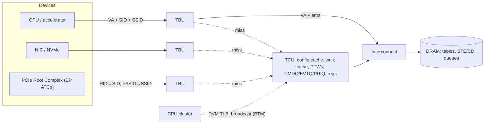
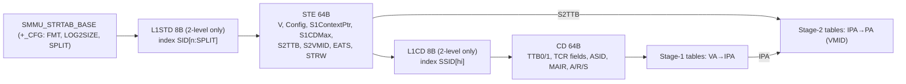
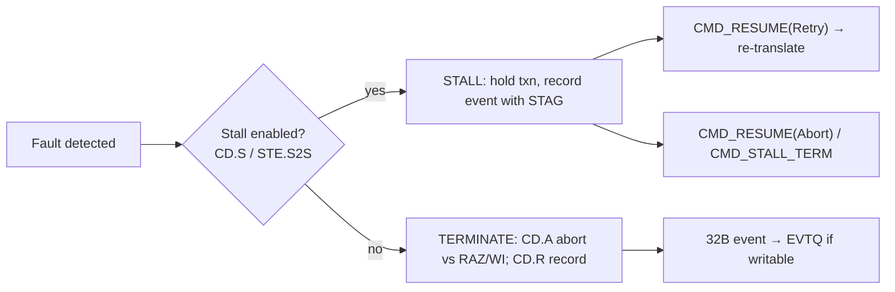
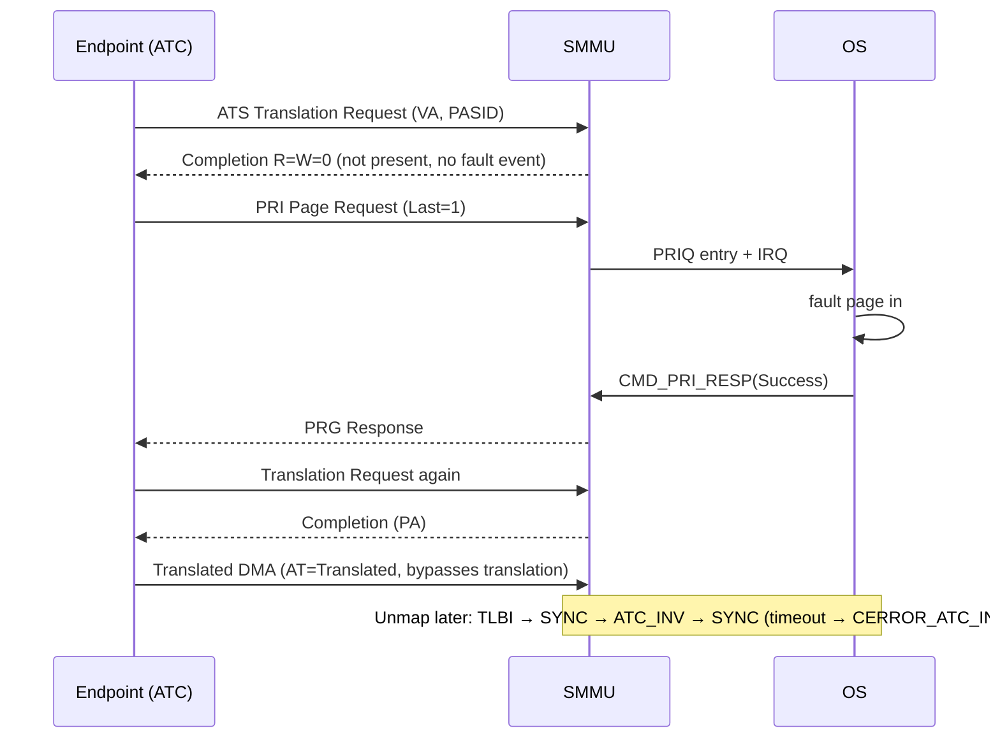
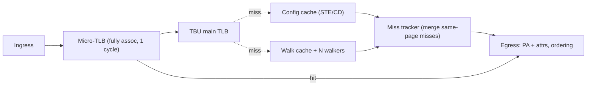

# 02 · SMMUv3 Deep Dive (senior level)

Source: Arm IHI 0070 H.a, *System Memory Management Unit Architecture Specification* (SMMUv3.0–v3.5).
Visual version: [`html/smmuv3-field-guide.html`](html/smmuv3-field-guide.html). Runnable model: [`code/`](code/).

---

## 1. One-line answer

> SMMUv3 is Arm's IOMMU. It maps a transaction's **StreamID** to an **STE**, optionally its **SubstreamID** to a **CD**, then performs a stage-1 (VA→IPA) and/or stage-2 (IPA→PA) walk with Armv8/v9 page tables. Configuration lives in memory, and software talks to it through queues.

Three ideas that make v3 different from SMMUv1/v2:

| Idea | Why |
|---|---|
| "Who is asking" arrives with each transaction (StreamID, SubstreamID, SEC_SID) | A CPU gets context from system registers; a device has no registers of its own in the SMMU |
| Configuration in memory (Stream Table → STE → CD) | v2's register "context banks" capped live streams; v3 scales to thousands. **Not backward compatible with v2** |
| Queue-based software interface | Command queue in, Event queue and PRI queue out, all circular buffers in memory |

## 2. Where it sits



The TBU/TCU split (linked by the DTI protocol) is how Arm CoreLink MMU-600/700 are built. **It is an implementation choice, not part of the architecture**, but interviewers expect you to know it.

| Inputs per transaction | Outputs |
|---|---|
| StreamID (`SMMU_IDR1.SIDSIZE`, ≤ 32 bits) | Translated PA + PA space |
| SubstreamID + SSV (`SSIDSIZE`, ≤ 20 bits) | Transformed attributes, shareability, MPAM PARTID/PMG |
| SEC_SID (Secure / Non-secure / Realm) | Or: abort, RAZ/WI, or **stall** |
| Address, R/W/X, privilege, attributes | Event records, PRI requests, IRQs/MSIs |

## 3. Versions (`SMMU_AIDR[7:0]` = 0x00 … 0x05)

| Version | Tracks | Headline features |
|---|---|---|
| v3.0 | Armv8.1 | In-memory STE/CD, S1/S2/nested, 16-bit ASID/VMID, 49-bit VA, ATS, PRI, BTM, HTTU, PMCG |
| v3.1 | Armv8.2 | 52-bit VA/IPA/PA (64K), PBHA, S2 XN for EL0/EL1, stash and destructive-read transactions |
| v3.2 | Armv8.4 | MPAM, Secure EL2 / Secure S2, range TLBI + level hint, BBML1/2, VMS, S2FWB, small tables |
| v3.3 | Armv8.5 + RME | ECMDQ, E0PD, MTE rules, ATS config-error recording, RME (Root, GPC), RME DA (Realm, DPT, MEC) |
| v3.4 | Armv8.7 / 8.9 | LPA2, S1/S2 permission indirection, S2 POE, translation hardening, D128 / 56-bit PA, HAFT, PASID on Translated |
| v3.5 | Armv9.5 | HDBSS, HACDBS, direct-mode ECMDQ, vSID→pSID, GPC2/3, GDI, MTCOMB |

**Verification angle:** every optional feature has an `SMMU_IDRn` bit. A configurable testbench reads ID registers and gates stimulus, checks and coverage on them.

## 4. Configuration walk: STE and CD



Linear stream table: `STE = BASE + SID × 64`. Two-level: `SPLIT` = 6, 8 or 10. When nested, CD and S1 table addresses are IPAs and go through stage 2 too.

### STE.Config

| Encoding | Stage 1 | Stage 2 | Typical use |
|---|---|---|---|
| `0b000` | Abort, **no event recorded** | | Quarantined / unassigned device |
| `0b100` | Bypass | Bypass | Trusted device, identity map |
| `0b101` | Translate | Bypass | Host DMA API, bare-metal SVA |
| `0b110` | Bypass | Translate | Device assigned to a VM, no vIOMMU |
| `0b111` | Translate | Translate | Nested: guest S1 (vIOMMU), hypervisor S2 |

### Fields that come up

| STE | Meaning |
|---|---|
| `V` | Invalid → **C_BAD_STE** |
| `S1Fmt`, `S1CDMax` | CD table format, number of SSIDs (2^S1CDMax) |
| `S1DSS` | Transactions *without* SSID when substreams are on: terminate (F_STREAM_DISABLED), bypass S1, or use CD 0 |
| `STRW` | StreamWorld (NS-EL1, EL2, EL2-E2H, Secure, EL3); tags TLB entries |
| `EATS` | ATS off / full ATS / split-stage |
| `S1STALLD`, `S2S`, `S2R` | Stall disable / stage-2 stall / stage-2 record |
| `SHCFG`, `MTCFG`, `INSTCFG`, `PRIVCFG` | Incoming attribute overrides |

| CD | Meaning |
|---|---|
| `TTB0/TTB1`, `T0SZ/T1SZ`, `TG0/TG1`, `IPS` | Same as CPU `TTBRn_EL1` / `TCR_EL1` |
| `ASID`, `ASET` | TLB tag; ASET excludes the ASID from broadcast TLBI |
| `MAIR`, `AA64`, `ENDI`, `HA/HD` | Attributes, format, endianness, HTTU |
| `A`, `R`, `S` | On terminate: abort vs RAZ/WI; record events; stall on fault |
| `V=0` / illegal | **C_BAD_CD**; SSID ≥ 2^S1CDMax → **C_BAD_SUBSTREAMID** |

## 5. Translation and nesting

VA slicing (VMSAv8-64):

| Granule | 48-bit VA levels | Block sizes |
|---|---|---|
| 4KB | L0[47:39] L1[38:30] L2[29:21] L3[20:12], offset [11:0] | 1GB (L1), 2MB (L2) |
| 16KB | L0[47] L1[46:36] L2[35:25] L3[24:14], offset [13:0] | 32MB (L2) |
| 64KB | L1[47:42] L2[41:29] L3[28:16], offset [15:0] | 512MB (L2) |

Nested cold walk cost: **(n+1)(m+1) − 1** memory reads. 4×4 → 24. Each of the *n* S1 descriptor addresses, plus the final output IPA, needs an *m*-level S2 walk. The CD fetch also needs an S2 walk when nested.

> A stale walk-cache entry gives a wrong PA **without any fault**. Cover invalidation of each cache type independently.

## 6. Queues and commands

```
Index = {WRAP, IDX[LOG2SIZE-1:0]}
empty : PROD == CONS
full  : IDX equal, WRAP bits differ      → all 2^N slots usable
Entry sizes: command 16B, event 32B, PRI 16B
Overflow (EVTQ/PRIQ): PROD.OVFLG toggles; software copies it to CONS.OVACKFLG
```

| Opcode | Command | What it does |
|---|---|---|
| 0x01 / 0x02 | `PREFETCH_CONFIG` / `_ADDR` | Hint. Errors found while prefetching are **never** reported |
| 0x03 / 0x04 | `CFGI_STE` / `_STE_RANGE` | Invalidate cached STE(s) |
| 0x05 / 0x06 | `CFGI_CD` / `_CD_ALL` | Invalidate cached CD(s) |
| 0x10–0x13 | `TLBI_NH_ALL / ASID / VA / VAA` | Non-hyp stage-1 invalidation (scoped by VMID) |
| 0x20–0x23 | `TLBI_EL2_*` | EL2 / EL2-E2H StreamWorld |
| 0x28 / 0x2A | `TLBI_S12_VMALL` / `TLBI_S2_IPA` | All of a VMID / one IPA |
| 0x30 | `TLBI_NSNH_ALL` | All NS non-hyp entries |
| 0x40 | `ATC_INV` | ATS Invalidate to the endpoint's ATC |
| 0x41 | `PRI_RESP` | Reply to a Page Request Group |
| 0x44 / 0x45 | `RESUME` / `STALL_TERM` | Retry or abort stalled transactions |
| 0x46 | `CMD_SYNC` | Completes when all earlier commands and their side effects are done (including ATC invalidations). Signals by MSI, SEV, or CONS moving past it |
| 0x50–0x60 | `TLBI_S_*` | Secure variants |
| 0x70 / 0x73 | `DPTI_ALL` / `DPTI_PA` | Device Permission Table invalidation |

### Canonical sequences

```
Change an STE   : write STE → CMD_CFGI_STE → CMD_SYNC (wait)
Change a CD     : write CD  → CMD_CFGI_CD  → CMD_SYNC
Unmap a page    : invalid PTE + DSB → CMD_TLBI_NH_VA → CMD_SYNC → CMD_ATC_INV → CMD_SYNC
```

ATC invalidation **after** the SMMU TLBI, or the device can refill its ATC from a stale SMMU TLB.

Command errors: SMMU stops consuming, `CMDQ_CONS.ERR` = `CERROR_ILL` / `CERROR_ABT` / `CERROR_ATC_INV_SYNC`, `GERROR.CMDQ_ERR` set, CONS points at the bad command. Software fixes and acknowledges via `GERRORN`.

## 7. Faults, events, stall model

Each transaction causes **at most one** event: a configuration error (`C_*`) or, if config is valid, one translation fault (`F_*`). Errors are found only when a real transaction uses the structure, never on prefetch.



`SMMU_IDR0.STALL_MODEL`: both supported / terminate only / stall forced. **Never stall PCIe** (posted writes can deadlock the fabric); PCIe uses ATS + PRI.

| ID | Event | Typical cause |
|---|---|---|
| 0x01 | F_UUT | Unsupported upstream transaction type |
| 0x02 | C_BAD_STREAMID | SID out of range or L1STD invalid |
| 0x03 | F_STE_FETCH | External abort fetching STE |
| 0x04 | C_BAD_STE | V=0, reserved Config, illegal combos |
| 0x05 | F_BAD_ATS_TREQ | ATS Translation Request not allowed |
| 0x06 | F_STREAM_DISABLED | Non-substream txn with S1DSS = terminate |
| 0x07 | F_TRANSL_FORBIDDEN | ATS Translated txn where not allowed |
| 0x08 | C_BAD_SUBSTREAMID | SSID out of range / SSID with substreams off |
| 0x09 | F_CD_FETCH | External abort fetching CD |
| 0x0A | C_BAD_CD | Invalid or illegal CD |
| 0x0B | F_WALK_EABT | External abort on a table read |
| 0x10 | F_TRANSLATION | Invalid descriptor / out of TxSZ range |
| 0x11 | F_ADDR_SIZE | Output beyond IPS/OAS |
| 0x12 | F_ACCESS | AF=0 and HTTU not updating it |
| 0x13 | F_PERMISSION | RO write, XN exec, privilege |
| 0x20 | F_TLB_CONFLICT | Multiple TLB hits (BBM violated) |
| 0x21 | F_CFG_CONFLICT | Conflicting config cache entries |
| 0x24 | E_PAGE_REQUEST | Speculative page request hint |
| 0x25 | F_VMS_FETCH | Abort fetching the VMS |

Event queue full → non-stall events dropped, overflow flagged. Stall events are not dropped. `GERROR` vs `GERRORN`: a bit is active when they differ. While `EVENTQ_ABT_ERR` is unacknowledged the queue is not writable.

## 8. TLBs, tagging, invalidation

| Topic | Key point |
|---|---|
| Tag | StreamWorld + VMID + ASID (or global) + VA. **Not StreamID.** All SMMU translations are Common (no CnP) |
| BTM | SMMU snoops CPU TLBIs over DVM; enables SVA without driver commands. `CR2.PTM` opts out; `CD.ASET` excludes ASIDs |
| Caches to invalidate | Config (CFGI_*), TLB + walk cache (TLBI_*), ATC (ATC_INV), GPT/DPT |
| Leaf | TLBI by VA also clears walk-cache entries unless `Leaf=1` |
| BBM | Changing size/output/attrs of a live mapping: invalid → TLBI → SYNC → new. Else F_TLB_CONFLICT / unpredictable. BBML1/2 relax it |
| HTTU | SMMU sets AF / clears RO for DBM pages by atomic RMW on the descriptor. v3.5 HDBSS logs dirty pages for live migration |

**Trap:** "Is TLBI enough before reusing a freed page?" No: TLBI → SYNC → ATC_INV → SYNC. Until SYNC completes, in-flight transactions may use the old translation.

## 9. PCIe: ATS, PRI, PASID



* `STE.EATS=0b10` **split-stage**: ATS returns IPA only; SMMU still applies stage 2 to Translated traffic.
* `CR0.ATSCHK` makes the SMMU check Translated traffic against `STE.EATS`.
* PRI queue overflow → SMMU auto-responds so the device is not left waiting.

## 10. Security, virtualization, RME

| Area | Key point |
|---|---|
| Security states | `SEC_SID` picks the interface. Secure has own registers (`SMMU_S_*`), stream table, queues. NS faults never create Secure events and vice versa |
| Virtualization | Hypervisor owns S2 + STE; guest owns S1 + CDs. VMS (v3.2), ECMDQ (v3.3), vSID→pSID + direct ECMDQ (v3.5) reduce trapping |
| RME / GPC | Root interface (`SMMU_ROOT_*`, `GPCEN`). Every output PA checked against the GPT. A GPC fault on a client access returns like an **external abort and is not written to the Event queue**; details in `SMMU_ROOT_GPF_FAR`. ATS request hitting GPC → Completer Abort |
| RME DA | Realm interface; **DPT** checks PA granules against VMIDs for ATS Translated traffic; `CMD_DPTI_*` |

Isolation bugs that matter most: NS stream reaching Secure PA, stale TLB entry crossing VMID/StreamWorld, untrusted Translated ATS traffic bypassing checks, GPC applied to the wrong address.

## 11. Inside the design



| Performance levers | Hazards | Integration |
|---|---|---|
| TLB reach (large pages, contiguous hint) | Invalidation racing an in-flight walk (stale fill after TLBI) | Clocks / power / TLB retention |
| Hit-under-miss, miss-under-miss | CMD_SYNC must drain transactions using now-invalid entries | Coherent vs non-coherent walks (`CR1`) |
| Miss coalescing | Same-ID ordering when hits pass misses | MSI path through the SMMU |
| Walk cache, S2 caching | HTTU RMW atomicity vs CPU writes | RAS: ECC, error records, poison |
| Prefetch commands | Stall + queue full + SMMUEN off | PMCG counters |

## 12. CPU MMU vs SMMU vs GPU MMU

| | CPU MMU | SMMU | GPU MMU (vendor-specific) |
|---|---|---|---|
| Context | System registers (TTBR, TCR, ASID, VMID) | IDs on each transaction → STE/CD in memory | Per-channel/context tables |
| Faults | Synchronous, precise exception | Asynchronous, Event queue; stall or terminate | Often replayable faults via a fault buffer |
| Maintenance | TLBI + DSB + ISB | Commands + CMD_SYNC, or broadcast TLBI (BTM) | Driver-managed invalidates |
| Scale | One context at a time per core | Thousands of streams concurrently | Huge parallel miss rates, large pages |

Next: [03 · Verification playbook](03-verification-playbook.md)
