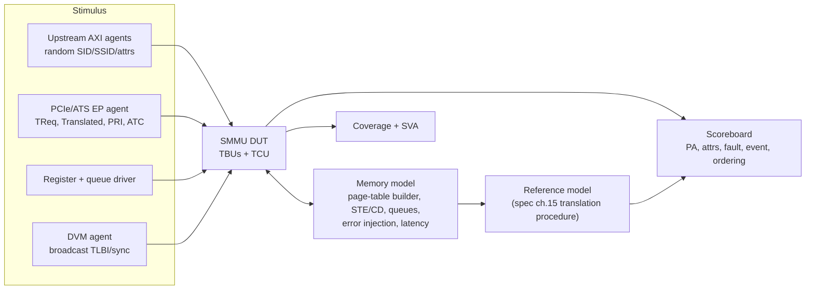

# 03 · SMMU Verification Playbook

How a senior DV engineer would plan, build and sign off SMMU verification. Code for each idea is in [`code/`](code/).

---

## 1. Testbench architecture



The hard part: **caching makes outcomes non-deterministic.** Between a page-table change and the `CMD_SYNC` that follows its TLBI, the DUT may legally use the old *or* the new mapping. The reference model must return the **set of legal outcomes**, and the scoreboard passes if the DUT is inside the set.

Implementation: [`code/sv/smmu_dv_pkg.sv`](code/sv/smmu_dv_pkg.sv) (`smmu_scoreboard` keeps per-page mapping versions with "written" and "dead" times) and [`code/smmu_model/`](code/smmu_model/) (Python reference model).

## 2. Checkers

| Checker | Rule |
|---|---|
| Translation | Every egress beat uses a mapping that was alive between the transaction's arrival and egress, and permits this access |
| **Invalidation** | After `CMD_SYNC` completes, nothing may use a mapping invalidated before it. *The single most valuable check* |
| Event | Exact record contents, at most one event per transaction, correct stage/CLASS, no event for prefetch or `Config=abort` |
| Queue SVA | PROD/CONS step by one, wrap, full/empty exclusive, overflow flag, CONS stops on `CERROR_*` — see [`smmu_queue_ptr.sv`](code/sv/smmu_queue_ptr.sv) |
| Isolation | Output PA space vs SEC_SID, GPC, DPT; no cross-VMID or cross-StreamWorld TLB hit |
| Ordering | Same-ID ordering preserved when hits pass misses |

## 3. Coverage model (crosses that find bugs)

| Cross | Why |
|---|---|
| STE.Config × Security state × StreamWorld × EATS | Every translation regime |
| Granule × levels × block/page/contiguous × TxSZ edges | Walker corner cases |
| Fault type × stage × terminate/stall × A/R bits | Every fault-delivery path |
| Command × scope (VA, range, Leaf, TTL) × concurrent traffic in that scope | Invalidation races |
| Queue: empty, full, wrap, overflow, error at each slot | Pointer logic |
| Linear vs 2-level stream table at SPLIT boundaries | Indexing bugs |
| Each optional IDR feature on/off | Configurability |

Covergroup example: `smmu_coverage` in [`smmu_dv_pkg.sv`](code/sv/smmu_dv_pkg.sv).

## 4. High-value scenarios

| Scenario | Bug it finds |
|---|---|
| TLBI while a walk for the same VA is in flight | Late walk fills a stale entry after the invalidate |
| STE swapped live with traffic | Torn 64B read, stale config cache, mixed fields |
| Nested walk where an S1 table address faults at S2 | Wrong stage, wrong IPA, wrong CLASS |
| Event queue full + stalls + `CMD_STALL_TERM` | Lost stall records, hung transactions |
| Block ↔ page remap without BBM | Missing F_TLB_CONFLICT or silent multi-hit |
| ATC_INV timeout inside CMD_SYNC | `CERROR_ATC_INV_SYNC` at the wrong command |
| SMMUEN 1→0→1 with traffic and stalls | GBPA, stall termination, caches reused |
| HTTU dirty update racing CPU write to same PTE | Non-atomic RMW loses the CPU's update |
| Broadcast TLBI with ASET / PTM variations | Too little invalidated (security) or too much (performance) |
| External abort on queue, STE, CD, walk, MSI | Every error path + GERROR recovery |

## 5. Methods

| Method | Best for |
|---|---|
| Constrained-random UVM | Translation, caching, faults, commands under traffic |
| Formal | Queue pointers, GERROR/GERRORN handshake, TLB multi-hit freedom, miss-tracker deadlock freedom, ordering |
| System / emulation | Linux `arm-smmu-v3` driver, VFIO passthrough, SVA with real device models; driver-visible ordering + performance |
| Performance | Miss latency, walks/cycle, TLB hit rate on real traffic profiles, PMCG counters |

## 6. Prove your checkers can fail

A checker that never fires might be checking nothing. Inject bugs and confirm they are caught:

```bash
# from 33-mmu-smmu/code
verilator --binary --assert --timing -Wno-fatal +define+BUG_NO_WRAP_BIT \
  --top-module tb_smmu_queue_ptr sv/tb_smmu_queue_ptr.sv sv/smmu_queue_ptr.sv
./obj_dir/Vtb_smmu_queue_ptr     # → "Assertion failed ... full mismatch"
```

In the Python model, `test_tlb_hit_and_stale_entry` shows the stale-TLB behaviour that the invalidation checker exists to catch.

## 7. Sign-off

* Code + functional coverage closed **per IDR configuration**.
* Zero open waivers on the invalidation checker.
* Every event type and every command error observed at least once with a passing check.
* Performance targets met on traffic from real workloads.
* System-level boot with the production driver on emulation.

Next: [04 · Interview drill](04-interview-drill.md)
