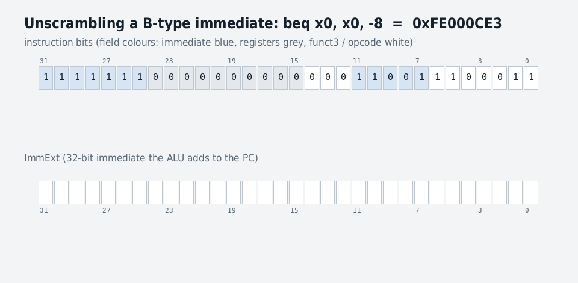

# Ch 2 · Introduction to RISC-V

This chapter is the contract every later chapter implements: what a RISC-V program can see (registers, memory, privilege, traps), exactly how each instruction is encoded in 32 bits, and a first look at how hardware — a toy single-cycle core, a 5-stage pipeline, then Wally — keeps that contract.

## RISC-V at a glance

RISC-V is a load/store ISA with 32-bit instructions, 32 registers of width XLEN and an XLEN-bit PC; the base comes in two sizes, RV32I and RV64I, and everything else is an optional extension.

### The vital statistics

| Item | RV32I | RV64I |
| --- | --- | --- |
| XLEN (register and address width) | 32 bits | 64 bits |
| Address space | 4 GiB | 16 EiB |
| Registers | x0–x31 (x0 always 0) + PC | same, 64 bits wide |
| Instructions | 37 essential + `fence`, `ecall`, `ebreak` = 40 | RV32I + 12 (64-bit loads/stores, 32-bit "W" ops) |
| Typical use | Embedded processors (KB of code) | Application processors running an OS |

### Architectural state and context (first principles)

- **Architectural state** = the minimum information that decides what a program does next: **memory, PC, registers, and CSRs**. Everything else in a chip is there to make it faster.
- A program's **context** = its PC and registers. Threads share memory but each has its own context.
- **Context switch**: the OS saves one thread's context to memory and loads another's, every few milliseconds, so many threads appear to run at once.
- The same idea explains power states: **sleep** saves the context to memory and powers off the core (fast wake-up); **hibernate** saves all architectural state, including memory, to disk (slow wake-up, zero power).

### Application vs embedded processors

- **Application processors** run apps on a multitasking OS with a screen — phones, PCs, servers. They usually use RV64 because 4 GiB isn't enough address space.
- **Embedded processors** are invisible: a window motor in a car, a toy, or the power and clock manager inside a phone SoC. RV32 is ample.

### Where the official definition lives

- **Unprivileged Specification**: base ISA and standard extensions. The book calls it one of the best-written architecture specs in existence, with commentary explaining *why* each choice was made — worth reading in full before senior interviews.
- **Privileged Specification**: privilege modes, traps, CSRs (Chapter 8). Longer and more complex.

For verification this split matters: the unprivileged spec is mostly deterministic per instruction; the privileged spec is where the ambiguity, the legal-choice WARL fields and the hard corner cases live.

## 2.1 Assembly language

Every RV32I instruction is one of six types, defined by how many registers it reads and writes and what kind of constant it carries; learn the six and you can read any RISC-V program.

| Type | Sources | Destination | Immediate | Instructions |
| --- | --- | --- | --- | --- |
| R (register) | 2 | 1 | none | add sub and or xor sll srl sra slt sltu |
| I (immediate) | 1 | 1 | 12-bit signed | addi andi ori xori slli srli srai slti sltiu, loads, jalr |
| S (store) | 2 | 0 | 12-bit signed | sb sh sw |
| B (branch) | 2 | 0 | 13-bit signed offset (bit 0 implied) | beq bne blt bge bltu bgeu |
| J (jump) | 0 | 1 | 21-bit signed offset (bit 0 implied) | jal |
| U (upper) | 0 | 1 | 20-bit upper | lui auipc |

### First principle: one adder for signed and unsigned

In two's complement, the most significant bit has *negative* weight. The 4-bit pattern 1110 is 14 unsigned but –2 signed (−8 + 4 + 2). The key fact: **addition and subtraction give the right bits under either interpretation** — 1110 + 0001 = 1111 is 15 unsigned and –1 signed, both correct. So one adder serves both, and only comparisons and right shifts need signed/unsigned versions.

### R-type: register-register

- **Arithmetic** `add`, `sub`; **logical** `and`, `or`, `xor`.
- **Shifts** by k multiply or divide by 2^k: `sll` fills zeros at the bottom; `srl` fills zeros at the top (unsigned divide); `sra` copies the sign bit (signed divide). Example on 1110 by 1: `sll` → 1100, `srl` → 0111 (14 → 7), `sra` → 1111 (–2 → –1).
- **Compare** `slt` (signed) and `sltu` (unsigned) write 1 or 0: `slt 1110, 0001` = 1 (–2 < 1) but `sltu` = 0 (14 ≥ 1).

### I-type: one register and a 12-bit constant

- The immediate is **sign-extended** to XLEN first; there's no `subi` because `addi` with a negative constant does it.
- **Loads** `lb lh lw` sign-extend the loaded value; `lbu lhu` zero-extend. Address = rs1 + immediate.
- **jalr** jumps to rs1 + immediate and writes PC+4 to rd ("linking") — the basis of function returns and indirect calls.
- **Shift immediates** use only the low 5 bits (RV32) as an unsigned amount.
- **Trap for the unwary:** `sltiu` sign-extends its immediate *then* compares unsigned. `sltiu rd, rs, 1` sets rd when rs == 0 (the `seqz` idiom).

### S-type stores and B-type branches

- Stores add the immediate to rs1 and write rs2 there: `sw`, `sh`, `sb`.
- Branches compare rs1 and rs2 and, if true, add the offset to the PC. Offsets are always even (instructions are on 2-byte boundaries because of compressed instructions), so bit 0 isn't stored → reach is **–4096 to +4094 bytes**.

### J-type and U-type

- `jal rd, label`: PC-relative jump, rd = PC+4; reach **±1 MiB**. `j label` is just `jal x0, label` (return address discarded).
- `lui rd, imm20` puts the immediate in the upper 20 bits, zeros below. With `addi` it builds any 32-bit constant — **but `addi` sign-extends**, so if bit 11 of the constant is 1, add 1 to the upper part. The book's example, loading 0x00003800:

```
lui  x1, 0x00004        # x1 = 0x00004000
addi x1, x1, -2048      # + 0xFFFFF800 = 0x00003800
```

(The "obvious" `lui x1, 0x3; addi x1, x1, 0x800` gives 0x00002800.)

- `auipc rd, imm20` adds the shifted immediate to the PC: `auipc rd, 0` copies the PC; with `jalr` it reaches any 32-bit PC-relative target:

```
auipc x1, 0x10002       # x1 = 0x80001000 + 0x10002000 = 0x90003000
jalr  x1, 0x456(x1)     # jump to 0x90003456, x1 = return address
```

### Other instructions

`ecall` (system call) and `ebreak` (debugger breakpoint) trap to the execution environment; `fence` orders memory accesses (a simple in-order core can treat it as a no-op; Chapter 17).

### RV64I: why the "W" instructions exist

RV64 adds `ld`, `sd`, `lwu`, 6-bit shift amounts, and **W versions** (`addw`, `subw`, `sllw`, `srlw`, `sraw`, `addiw`, `slliw`, `srliw`, `sraiw`) that compute on 32 bits and sign-extend the result. Why: C's `int` stays 32 bits on 64-bit machines, stored sign-extended. Adding 0x80000000 + 0x80000000 as 32-bit ints should give 0, but on a 64-bit ALU the sign-extended inputs 0xFFFF\_FFFF\_8000\_0000 sum to 0xFFFF\_FFFF\_0000\_0000. `addw` discards bits above 31 and sign-extends → 0. Without W ops, compilers would need masking sequences everywhere.

### Register conventions (the ABI)

| Register | ABI name | Use | Preserved across calls? |
| --- | --- | --- | --- |
| x0 | zero | Constant 0 | — |
| x1 | ra | Return address | No |
| x2 | sp | Stack pointer | Yes |
| x3 / x4 | gp / tp | Global / thread pointer | — |
| x5–x7, x28–x31 | t0–t6 | Temporaries | No |
| x8–x9, x18–x27 | s0–s11 | Saved (s0 = frame pointer) | Yes |
| x10–x17 | a0–a7 | Arguments; a0 = return value | No |

The odd ordering is deliberate: RV32E has only x0–x15, and it still gets some registers of every kind.

### Endianness

RISC-V is **little-endian**: the least significant byte sits at the lowest address. Storing 0x1234F0E0 at address 8 puts 0xE0 at 8 and 0x12 at 11, so `lb t0, 8(x0)` returns 0xE0 (a big-endian machine would return 0x12). Instructions are always fetched little-endian; data can optionally switch to big-endian via a status register (Chapter 8).

### Pseudoinstructions

The assembler expands convenient names into real instructions:

| Pseudo | Real instruction(s) |
| --- | --- |
| `li rd, imm` | `addi rd, x0, imm` (or `lui` + `addi`) |
| `mv rd, rs` | `addi rd, rs, 0` |
| `j label` | `jal x0, label` |
| `ret` | `jalr x0, 0(ra)` |
| `ble rs1, rs2, L` | `bge rs2, rs1, L` |
| `la rd, label` | `auipc rd, hi` + `addi rd, rd, lo` |
| `nop` | `addi x0, x0, 0` |

**Check yourself**

- Why does RISC-V need `sltu` and `sra` but not an unsigned `add`?
- Build 0xDEADBEEF with `lui`/`addi`. What goes in each?
- What does `sltiu t0, t1, -1` compute? (Hint: –1 sign-extends to 0xFFFFFFFF.)

## 2.1.12 From C to assembly

A compiler turns every C construct into a small fixed pattern of RISC-V instructions; knowing the patterns lets you read disassembly during debug — the skill Chapter 5's failing-test walkthrough depends on.

### The patterns

| C construct | Assembly pattern | Key idea |
| --- | --- | --- |
| `a = b + c` | `add s0, s1, s2` | One R-type op |
| `a = a + b - c` | `add t0, s0, s1` then `sub s0, t0, s2` | Temporaries hold intermediates |
| `if (i == j) a = 1;` | `bne s3, s4, done` … body … `done:` | **Branch on the opposite condition** to skip the body |
| `if / else` | `bne … else`; body; `j done`; `else:` body | One extra jump past the else |
| `while (i <= 10)` | test at top with `bgt` (opposite of `<=`), body, `j while` | Loop back with an unconditional jump |
| `for (init; cond; post)` | init; label; opposite-branch to done; body; post; `j` label | Four parts in a fixed order |
| `grades[i]` (int) | `slli t1, s3, 2`; `add t1, s5, t1`; `lw t2, 0(t1)` | Index × 4 bytes + base address |
| `while (name[i])` (string) | `add t0, s6, s3`; `lb t1, 0(t0)`; `beq t1, zero, done` | C strings end in a 0 byte; chars are 1 byte |
| Function call | args in a0–a7, `jal fn`, result in a0, `ret` | The ABI from 2.1 |

### Example: the array loop (book Code Example 2.9)

```
# for (i = 0; i < 100; i++) grades[i] = grades[i] + 14;
      li   s3, 0          # i = 0
      li   t0, 100
for:  bge  s3, t0, done   # opposite of i < 100
      slli t1, s3, 2      # t1 = i * 4
      add  t1, s5, t1     # t1 = &grades[i]
      lw   t2, 0(t1)
      addi t2, t2, 14
      sw   t2, 0(t1)
      addi s3, s3, 1      # i++
      j    for
done:
```

Notice the pipeline hazards hiding in plain sight: `lw t2` followed immediately by `addi t2` is a **load-use** hazard; `slli t1` → `add t1` → `lw …(t1)` is a chain of RAW dependencies at distance 1. Real code is full of exactly the cases the Labs' bug hunt exercised.

### Functions and the stack

- The stack grows **down**: a function makes room with `addi sp, sp, -8`, saves the s-registers it will change (`sw s0, 0(sp)`), restores them at the end, and puts sp back.
- The book's factorial shows three versions: saving s0/s1 on the stack; an **optimized** leaf version that uses temporaries instead (no calls inside, so nothing to protect); and a **recursive** version that must save `ra` and `n` before calling itself, because `jal` overwrites `ra`.

```
factr: li   t0, 1
       bgt  a0, t0, else    # n > 1 ?
       li   a0, 1           # return 1
       ret
else:  addi sp, sp, -8
       sw   ra, 0(sp)       # save return address
       sw   a0, 4(sp)       # save n
       addi a0, a0, -1
       jal  factr           # factr(n-1), overwrites ra
       lw   t0, 4(sp)       # restore n
       lw   ra, 0(sp)
       addi sp, sp, 8
       mul  a0, t0, a0      # n * factr(n-1)  (M extension)
       ret
```

**Verification angle:** a return-address stack (RAS) predictor in Chapter 13 learns exactly this `jal`/`ret` pairing; deep recursion overflows it, which is a classic coverage point.

**Check yourself**

- Why does the `if` pattern branch on the *opposite* condition?
- In the recursive factorial, what breaks if you forget to save `ra`?
- Translate `if (a < b) c = a; else c = b;` into RISC-V.

## 2.2 Machine language

Each assembly instruction is exactly one 32-bit word; the encoding was designed so the hardware can start reading registers and building the immediate *before* it knows which instruction it has.

&#91;embedded content: RV32I instruction formats · after book Figs. 2.3 and I.1\]

### How the decoder reads a word

1. **opcode (bits 6:0)** always says the type — R-type is 0x33 (0110011), loads 0x03, stores 0x23, branches 0x63, I-type ALU 0x13.
2. **funct3 and funct7** pick the exact operation within the type (e.g. funct7 = 0100000 turns `add` into `sub`).
3. **rs1, rs2, rd sit in the same bits in every format**, so they wire straight to the register file's address ports with no multiplexer — saving delay on the critical path compared with other ISAs.

### Why the immediates are scrambled

- Keeping register fields fixed leaves the immediate bits wherever space remains, so they are split into pieces.
- The pieces are arranged so each **immediate bit comes from the same instruction bit in as many formats as possible**. The extend unit then needs only small muxes: ImmExt\[31\] is always Instr\[31\]; ImmExt\[20\] is Instr\[20\] for U-type and Instr\[31\] otherwise; ImmExt\[0\] is Instr\[20\] (I), Instr\[7\] (S) or 0 (B, J, U).
- **The sign bit is always instruction bit 31.** Sign extension is the slow part, because one bit must drive 20 or more outputs (high fanout). Putting it in a fixed place lets it start immediately, in parallel with register reads. On RV64, bit 31 is also copied into bits 63:32.
- The swizzling costs no time: it is just wiring, done while the register file is being read.

Watch it happen on the book's own branch, `beq x0, x0, -8`:



### Worked examples (book Examples 2.1 and 2.2)

**Assemble `sub x3, x4, x5`.** R-type: op = 0110011, funct3 = 000, funct7 = 0100000; rs1 = 4, rs2 = 5, rd = 3.

```
funct7  rs2   rs1   f3  rd    op
0100000 00101 00100 000 00011 0110011   = 0x405201B3
```

**Disassemble 0x03E90523.** Binary 0000 0011 1110 1001 0000 0101 0010 0011. Low 7 bits 0100011 → S-type; funct3 = 000 → `sb`.

```
imm[11:5] rs2   rs1   f3  imm[4:0] op
0000001   11110 10010 000 01010    0100011
```

rs1 = x18 (s2), rs2 = x30 (t5), immediate = 0000001\_01010 = 42 → **`sb t5, 42(s2)`**.

**Practice:** the interactive encoder in the companion page (link at the end of this chapter) colours each field as you type.

**Check yourself**

- Encode `addi x5, x6, -1`. (Hint: the immediate is 0xFFF.)
- Why does fixing the register fields save hardware *and* time?
- What does ImmExt\[11\] come from in each of I, S, B and J formats?

## 2.3 Have a hart

A **hart** (hardware thread) is RISC-V's name for anything that runs one instruction stream with its own PC, registers and CSRs — physical, virtual or simulated, the program can't tell the difference except by speed.

### Privilege modes and CSRs

- **M-mode (machine)**: highest privilege; every hart **boots** here; full control. Required on every RISC-V core.
- **S-mode (supervisor)**: where an OS such as Linux runs; controls virtual memory.
- **U-mode (user)**: applications. Can't touch the OS or other programs' memory.
- **CSRs (control and status registers)** belong to privilege levels: floating-point flags, which extensions are enabled, where to jump on a trap, and **performance counters** such as cycles and *instructions retired* (finished successfully). Lower modes can't read higher modes' CSRs.
- Moving up in privilege only happens through a **trap**: a user program asks the OS for a service with `ecall`, and the OS validates every request (for example, refusing to open a file the program lacks permission for).

&#91;embedded content: Linux-based execution environments · after book Fig. 2.7\]

### Processes, threads, cores, harts

| Term | What it is |
| --- | --- |
| **Process** | A running program with its own memory space; the OS switches processes every few ms |
| **Software thread** | One of several flows inside a process sharing its code and memory (e.g. pthreads) |
| **Core** | A processor on the chip: at least one context plus the functional units to run it |
| **Multithreaded core** | One core with several hardware copies of PC + registers, sharing execution units |
| **Physical hart** | One hardware context. 4 cores × 2-way multithreading = **8 physical harts** |
| **Virtual hart** | A software thread the OS time-multiplexes onto physical harts, saving and loading its context on timer interrupts |
| **Simulated hart** | A hart inside a simulator (Spike, QEMU) running on a different ISA |
| **Uncore** | Everything on the chip that isn't a core: shared caches, peripherals, external interfaces |

### Exceptions, interrupts and traps

- **Exception**: caused by the program — illegal instruction, access to nonexistent memory, `ecall`, `ebreak`. Synchronous: always at the same instruction.
- **Interrupt**: an asynchronous outside event — a timer reaching its trip point, new data on a serial port.
- **Trap**: the transfer of control that both cause. On a trap to M-mode the hardware saves the PC in **mepc**, a cause code in **mcause**, extra information (the bad address or the illegal instruction) in **mtval**, switches to M-mode and jumps to **mtvec**. The handler finishes with **mret**, which returns to mepc and restores the previous mode. S-mode has the same set: sepc, scause, stval, stvec, sret.

### Execution environments

- **Bare metal**: the simplest EE. Everything runs in M-mode, no OS, no protection; physical harts are the cores.
- **Linux EE** (diagram above): apps in U-mode talk to the kernel through the **ABI** (system calls); the kernel in S-mode talks to M-mode firmware through the **SBI** (timer, hart start/stop, peripherals). Because of the SBI, the same OS image runs on different RISC-V chips; only the firmware changes.
- **Mixed hardware/software EE**: a core without an FPU traps on a floating-point instruction as illegal; the handler does the math in software and returns. The program never knows.
- **Pure software EE** (simulators):

| Simulator | Speed | Method | What it's for |
| --- | --- | --- | --- |
| QEMU | \~1 billion instructions/s | Binary translation to the host ISA | Fast software development, Linux boot |
| Spike | \~100 million instructions/s | Interprets one instruction at a time | Reference model, golden behavior |
| Sail | \~1 million instructions/s | Executable formal spec | Provable correctness; the official model |

Strictly, a *simulator* models harts and RAM, while an *emulator* also models devices (UART, timer, interrupt controller). Spike runs without peripherals; QEMU and Sail model the CLINT, PLIC and UART needed to boot Linux.

### Why this matters for CPU verification

- Traps are the richest bug source in a core: every exception type × every privilege mode × delegation settings, plus interrupts arriving in any pipeline state. mepc, mcause and mtval must be exactly right.
- Lock-step (Chapter 5) compares per hart, and interrupts must be injected into the reference model at the same instruction boundary.
- Spike and Sail from the table above are exactly the reference models used to check RTL.

**Check yourself**

- What is the difference between an exception and an interrupt? Give two of each.
- A 6-core chip with 2-way multithreading runs 300 Linux threads. How many physical harts? Virtual harts?
- Why does Linux call into firmware through the SBI instead of touching the timer directly?

## 2.4 Memory map

The memory map, part of the execution environment, fixes where memory and each peripheral live in the address space; software finds a device simply by reading or writing its address (memory-mapped I/O).

&#91;embedded content: Wally default memory map · book Fig. 2.8, Table A.2\]

### Key points

- **Memory-mapped I/O**: peripherals are controlled with ordinary loads and stores to their addresses — no special I/O instructions. A store to the UART's address sends a character.
- **CLINT** (Core Local Interruptor) provides the machine timer and software interrupts; **PLIC** (Platform-Level Interrupt Controller) funnels many external interrupt sources to the harts (both in Chapter 20).
- Configurations without external RAM place the on-chip **DTIM** (data) and **IROM** (instructions) at 0x80000000 instead; the program starts there and data follows.
- Wally's map matches the SiFive FU540 chip and QEMU's `virt` machine (except the FU540 UART sits at 0x10010000), so the same Linux image and tools work on all three.
- The map is set in Wally's configuration files (Section 4.4), so peripherals can be added, removed or moved.

### The reset vector

At reset the PC starts at the **reset vector**, which must hold instructions. It is platform-dependent:

| Platform | Reset vector | What's there |
| --- | --- | --- |
| Most Wally configurations | 0x80000000 | The testbench preloads the test program into RAM |
| Buildroot Linux config, QEMU | 0x1000 | Boot loader in boot ROM, which loads the OS from the SD card |
| SiFive FU540 | 0x1004 | Boot loader |

**Verification angle:** accesses to unmapped gaps must raise access faults (checked by the PMA checker, Chapter 12). Each region boundary — last byte in a region, first byte of a gap — is a natural coverage point, and the reset vector is one of the first things a boot test checks.

**Check yourself**

- Why do RISC-V systems not need special I/O instructions?
- What happens if a load targets 0x30000000 on this map?
- Why does a Linux system reset to a boot ROM instead of RAM?

## 2.5 Extensions and profiles

RISC-V is a small mandatory base plus optional extensions, each named by a letter or a Z/S-prefixed name; **profiles** bundle a standard set so software knows what it can rely on.

### The common extensions

| Extension | Adds | Why it exists |
| --- | --- | --- |
| **M** | Multiply, divide, remainder | Far faster than software routines |
| **A** | Atomic read-modify-write | Synchronization between harts (Chapter 17) |
| **F / D / Q** | Single / double / quad floating point | Hardware FP (Chapter 16) |
| **C** | 16-bit compressed encodings of common instructions | Cuts instruction bits fetched by up to 25–30%; program memory is often the most expensive part of an embedded chip (like ARM Thumb) |
| **E** | Only x0–x15 | The register file is about half a minimal core, so halving it saves about a quarter of the core area |
| **B** = Zba + Zbb + Zbs | Bit manipulation | Fewer instructions for address math and bit tricks (Chapter 18) |
| **Zicsr** | CSR instructions | Needed for traps, privilege modes, configuration |
| **Zifencei** | `fence.i` | Make newly written code visible to instruction fetch (OS program loading) |
| **V** | Vectors | Data parallelism |
| **U / S / H** | User, supervisor, hypervisor modes | OS, virtual memory, multiple guest OSes |
| **G** | I + M + A + F + D + Zicsr + Zifencei | Shorthand for a general-purpose core |

- **RV64GC** = RV64IMAFDC\_Zicsr\_Zifencei, the usual application-processor baseline.
- **misa CSR**: software reads it to discover which letter extensions exist, then either uses them or calls an emulation routine.
- **RV128I** exists on paper (unratified) for future 128-bit addresses; 64-bit already reaches 16 exabytes.
- Many more are ratified: Zk\* cryptography, Zicbo\* cache management, Sstc supervisor timer and so on.
- **Custom extensions** are allowed. They can be a competitive advantage, but vendors have an incentive to standardize them so software actually uses them. Accelerators usually talk to cores through shared memory instead.

### Profiles

ISA strings got unwieldy (RV64IMAFDC\_Zicsr\_Zifencei\_Zicclsm\_Zba\_Zkt\_Svnapot…), so RISC-V International defines profiles:

| Profile | Meaning |
| --- | --- |
| RVI20U32 / RVI20U64 | Basic unprivileged RV32I / RV64I |
| RVA20U64 / RVA20S64 | Application processor RV64GC, user / with supervisor |
| RVA22U64 / **RVA22S64** | Adds bit manipulation (B); **Wally rv64gc supports RVA22S64** |
| RVA23U64 / RVA23S64 | Adds vectors (V); the S version also hypervisor (H) |
| RVB23U64 / RVB23S64 | Customized processors (no V) |

- All profiles are **little-endian** and strongly recommend an **illegal-instruction exception on unimplemented opcodes**.
- Profiles standardize U- and S-mode behavior only; M-mode firmware is small and platform-specific.
- Minor optional behaviors now have names so platforms can rely on them, e.g. whether hardware sets page-table dirty bits (Svade) or cache blocks are 64 bytes (Zic64b).

**Verification angle:** every extension multiplies the configuration space. A configurable core like Wally must be verified per configuration (Chapter 5's TRL3 on all configs, TRL5 on rv64gc), and the reference model must be configured to exactly the same extension set and legal options.

**Check yourself**

- Why would an embedded vendor choose RV32EC over RV32I?
- What does an RVA22S64 core have that an RVA20S64 core may not?
- Why do profiles recommend trapping on unimplemented opcodes rather than leaving behavior undefined?

## 2.6 Comparison with other architectures

RISC-V's biggest strength is that it's open; its technical strength is that it skipped the "clever" features that helped one generation of hardware and hurt every generation after.

| ISA | Feature that aged badly | Why it hurts later implementations | Status |
| --- | --- | --- | --- |
| **ARMv7** (32-bit) | Conditional execution, optional shift before the ALU, 3-source ALU and store instructions | Encoding space left room for only 16 registers; shifter sits on every instruction's critical path; predication and a third register-file port make superscalar out-of-order cores expensive | Largely fixed by **ARMv8** (2013): 32 64-bit registers, RISC-V-like, but an irregular encoding |
| **MIPS** | Branch delay slot (instruction after a branch always executes) | Saved a flush on the original 5-stage pipeline but complicates deeper and out-of-order designs and compilers | Negligible market share now |
| **SPARC** | Register windows (hardware rotates registers on calls) | Unneeded with good compilers; slows context switches; costly in high-performance cores | Mainly Oracle servers |
| **x86** (CISC) | Variable-length legacy instructions, few registers | Since the Pentium Pro decoded into RISC-like micro-ops; the decoder and micro-op cache add hundreds of thousands of transistors | Nearly all Windows PCs; Intel/AMD duopoly |
| **RISC-V** | — | Fixed register fields and sign-bit position shorten decode | Open; drawbacks are ecosystem maturity |

### The business side

- **ARM** doesn't make chips: it licenses synthesizable cores and *architecture licenses* (so Apple, Qualcomm and others design their own cores). Apple's M1 and successors showed ARM can match or beat x86 performance at much lower power. ARM's revenue is royalties, so it controls access tightly.
- **x86** is a two-company duopoly with high prices.
- **RISC-V's current drawbacks**, per the book: no binary compatibility with x86/ARM software, and less mature software, *verification* ecosystem and implementations — all improving fast. The book calls this "a new golden age to be a processor designer".

**Interview tip:** if asked "why RISC-V over ARM?", give the technical answer (no condition codes, no delay slots, fixed fields, modular) *and* the business answer (no license fees, customizable, open verification tools), then acknowledge the ecosystem gap honestly.

**Check yourself**

- Why did MIPS's branch delay slot become a liability once pipelines got deeper?
- Why does a third register-file read port make an out-of-order core more expensive?

## 2.7 Microarchitecture: the toy cores

The book builds two toy cores for a 12-instruction subset (add sub and or slt addi andi ori slti lw sw beq jal) to show the whole method — block diagram, truth tables, SystemVerilog, test — before doing it for real in Chapter 7. You rebuilt both, extended to all of RV32I, in the Labs tab.

Every microarchitecture must hold the **architectural state** (PC, registers, memory) and may add **non-architectural state** (pipeline registers, caches, branch history) that could be flushed without breaking correctness. Performance follows the iron law: time = instructions × CPI × Tc.

### The single-cycle core (CPI = 1, long Tc)

Partitioned like Wally: **IFU** (PC, IROM, next-PC logic), **IEU** (register file with read ports A1/A2 and write port A3, extend, ALU, comparator, controller), **LSU** (DTIM).

&#91;embedded content: Single-cycle datapath as a flow · simplified from book Fig. 2.9\]

### Cycle by cycle: the book's sample program

Start: x1 = 0x2000, x2 = 7, memory\[0x2004\] = 0x2A; program at 0x1000.

| Cycle | PC | Instruction | What the datapath does | State change |
| --- | --- | --- | --- | --- |
| 1 | 0x1000 | `lw x3, 4(x1)` (0x0040A183) | R1 = 0x2000; ImmExt = 4; ALUSrc picks ImmExt; IEUAdr = 0x2004; DTIM returns 0x2A; ResultSrc picks ReadData | x3 ← 0x2A; PC ← 0x1004 |
| 2 | 0x1004 | `sub x5, x3, x2` (0x402182B3) | SrcA = 0x2A, SrcB = 7; ALU subtracts → 0x23; DTIM also reads that address but the result mux ignores it | x5 ← 0x23; PC ← 0x1008 |
| 3 | 0x1008 | `beq x0, x0, 0x1000` (0xFE000CE3) | Comparator sees 0 == 0 → Eq = 1; ImmExt = 0xFFFFFFF8 (−8); IEUAdr = 0x1000; PCSrc = 1 | No register write; PC ← 0x1000 (loops forever) |

### The controller as two truth tables

**Main decoder** (book Table 2.4), driven by op:

| Instruction | RegWrite | ImmSrc | ALUSrc | ALUOp | ALUResultSrc | MemWrite | ResultSrc | Branch | Jump |
| --- | --- | --- | --- | --- | --- | --- | --- | --- | --- |
| lw | 1 | 00 | 01 | 0 | 0 | 0 | 1 | 0 | 0 |
| sw | 0 | 01 | 01 | 0 | 0 | 1 | 0 | 0 | 0 |
| R-type | 1 | xx | 00 | 1 | 0 | 0 | 0 | 0 | 0 |
| I-type ALU | 1 | 00 | 01 | 1 | 0 | 0 | 0 | 0 | 0 |
| beq | 0 | 10 | 11 | 0 | 0 | 0 | 0 | 1 | 0 |
| jal | 1 | 11 | 11 | 0 | 1 | 0 | 0 | 0 | 1 |

ALUSrc is two bits: one picks SrcA (rs1 or PC), one picks SrcB (rs2 or ImmExt). That's how `beq` and `jal` use the ALU's adder for PC + offset.

**ALU control** (book Table 2.3): ALUControl = {Sub, ALUOp}. With ALUOp = 0 the ALU just adds (address and target arithmetic). With ALUOp = 1, funct3 picks the operation: 000 add (or sub when Sub = 1), 110 or, 111 and, 010 slt (Sub = 1, because slt is computed by subtracting). The book's decoder is deliberately **lazy** — it checks only enough bits to tell its 12 instructions apart. Wally's real decoder is precise and raises an illegal-instruction exception for anything else, which is what the profiles in 2.5 recommend.

**PCSrc** = Jump | (Branch & Eq).

### The pipelined core (preview of Chapter 7)

Add registers between five stages — **Fetch, Decode, Execute, Memory, Writeback** — so five instructions overlap:

&#91;embedded content: 5-stage pipeline space-time diagram · ideal case, no hazards\]

- Every signal gets a **stage suffix** (PCF, InstrD, ALUResultE, RdM, ResultW), and control signals and **rd** travel down the pipe with their instruction.
- The register file **writes in the first half of a cycle and reads in the second**, so W can hand a value to D in the same cycle.
- Each stage does one major operation, so Tc can approach 5× shorter — minus register overhead and stage imbalance.
- **Hazards**: *data hazards* (an instruction needs a result not yet written) are fixed by **forwarding** or, when that's too late, **stalling**; *control hazards* (the next PC isn't known yet) are fixed by **predicting** and **flushing** wrong guesses. The hazard unit drives forwarding muxes, stalls and flushes. Full treatment in Chapter 7; you've already built and broken it in Lab 3.

### Verifying the toy cores (book 2.7.3)

The ad-hoc test program (`riscvtest.s`, the one in your Labs) uses every instruction type and both taken and not-taken branches. It should store **7 to address 96**, then **25 to address 100**; the testbench prints success on the second store and failure on any other store. As the book's margin puts it, an inexperienced engineer expects their code to work the first time.

**Check yourself**

- In cycle 2 the DTIM reads from address 0x23 even though `sub` doesn't need memory. Why is that harmless, and when would it *not* be (Chapter 12 hint: memory-mapped I/O)?
- Fill in the main-decoder row for `addi`.
- Why does `slt` need Sub = 1?

## 2.8 The Wally SoC

Wally (CORE-V Wally, `cvw`) is the book's real processor: the same 5-stage pipeline as the toy core, but configurable from a tiny RV32E microcontroller up to an RV64GC application processor with caches, branch prediction and virtual memory that boots Linux.

### What it is and isn't

- **Configurable** (book Table 2.5): XLEN 32/64; extensions A, B, C, D, E, F, M, Q, Zk\*, Zfh, Zfa, Zicond, Zicbo\*, misaligned access and more; M/S/U modes, PMP, Sv32/39/48 virtual memory, TLB and cache sizes, gshare or not-taken branch prediction; CLINT, PLIC, UART, GPIO, SPI, SD card; DTIM/IROM.
- **Not supported**: superscalar, out-of-order, multithreading, multicore, clock gating, the V, H and vector-crypto extensions, debug and trace.
- It's an **OpenHW Foundation** core, alongside CVA6 (6-stage application core from Ariane), CV32E40Pv2 (4-stage microcontroller from RI5CY) and CV32E20 (from lowRISC Ibex). Licensed under **Solderpad**, an open-hardware flavor of Apache that also covers patents.

### Its units (module `wallypipelinedcore`)

| Unit | Contains | Chapter |
| --- | --- | --- |
| **ifu** | I$ or IROM, MMU, branch predictor, decompressor, PC logic | 13, 14 |
| **ieu** | Register file, result mux, controller (with forwarding), ALU | 7 |
| **mdu** | Multiplier, divider | 15 |
| **fpu** | FP register file, FMA, divide/sqrt, convert, compare | 16 |
| **lsu** | D$ or DTIM, MMU, hardware page-table walker | 10–12 |
| **ebu** | External bus unit (AHB) | 9 |
| **hazard** | All stalls and flushes | 7 |
| **privileged** | CSRs, trap unit | 8 |

You can open every one of these in your cloned `cvw/src` (see the Labs tab's source map).

### Latencies — memorize these, they're the hazard rules

| Event | Cost |
| --- | --- |
| Integer instruction | 1-cycle latency, 1 per cycle throughput |
| Load, multiply, most FP | 2-cycle latency, 1 per cycle throughput (a dependent instruction right after stalls once) |
| Load right after a store | 1-cycle stall |
| Divide, cache miss | Long latency; the pipeline stalls |
| Mispredicted branch | Discovered in Execute → flush the next 2 instructions |
| CSR write | Flushes the pipeline for consistency |

Big arrays (caches, branch predictor) are single-ported edge-triggered RAMs; small multi-ported structures (register files, TLB CAMs) are built from flip-flops or latches, because many FPGA and ASIC libraries lack special cells for them.

### Configurations

| Config | Role |
| --- | --- |
| rv32e | Smallest, fastest embedded core; no on-chip memories |
| rv32i, rv64i | Integer only, small memories — e.g. a controller inside an SoC |
| rv32imc | Microcontroller: bus, peripherals, privilege modes, compressed |
| rv32gc, rv64gc | Application processors: all extensions, caches, branch prediction, S-mode, virtual memory; **rv64gc supports RVA22S64** and boots Linux |

Complex configs run slower because trap and floating-point logic sit on the critical path, and area grows sharply with memories, FP and branch prediction.

### Verification (book Table 2.7)

| Suite | Shows |
| --- | --- |
| riscv-arch-test | Each instruction works in isolation (RISC-V International) |
| wally-riscv-arch-test | What arch-test misses, especially MMU and privileged behavior |
| Coverage tests | Code coverage of the RTL (functional coverage in progress) |
| TestFloat | Comprehensive FPU testing (Berkeley) |
| Linux boot | 550 million instructions in simulation and on FPGA: privilege, CSRs, interrupts, peripherals, virtual memory |

The authors say plainly that the suites can't cover every corner case, especially in the privileged architecture, so bugs surely remain — exactly the gap a CPU DV engineer is hired to close.

### Benchmarks

&#91;embedded content: Book Table 2.8 · 5 embedded cores\]

One CoreMark = one benchmark iteration per second; scores are normalized per MHz. On **Embench** (size and speed normalized to the best ARM Cortex-M4 results), Wally has similar code density and is about 9% faster than the M4 at the same clock. The gap to VeeR-EH2 shrinking from \~2× to \~22% is the book's argument that Embench is more realistic and harder to game.

### Implementation

- Synthesized in 130, 90 and 28 nm CMOS and on three FPGAs; tuned by balancing logic across stages and fixing cycle-limiting paths (Chapters 6, 23).
- In TSMC 28 nm: **2.99 GHz (rv32e) down to 0.8 GHz (rv64gc)**. With a fanout-of-4 inverter delay (FO4) of 11.6 ps, that's **29–108 FO4 per cycle**, versus roughly 50 FO4 for aggressive high-performance pipelines — a process-independent way to compare clock rates.
- The rv32gc core placed in 28 nm is about 0.7 mm on a side, dominated by the cache SRAM arrays (each 16 KiB, 4-way cache = four ways of four 1 KiB 64 × 128 data arrays plus a 64 × 22 tag array). The core is so small it's dwarfed by the chip's I/O pads.

**Check yourself**

- Using the latency table, how many cycles does `lw t0, 0(a0)` followed immediately by `add t1, t0, t0` take on Wally?
- Why are register files built from flip-flops instead of SRAM?
- What does "108 FO4 per cycle" tell you about how aggressive Wally's rv64gc pipeline is?

## 2.9 The RISC-V market

RISC-V cores now span everything from 2-stage microcontrollers to 15-issue out-of-order server cores, and several high-performance designs are open source — which makes them the best free study material for the out-of-order questions in senior CPU interviews.

### The market in numbers (as of the book's writing)

- More than **12 billion** RISC-V cores shipped by the end of 2021.
- SHD Group (2023) forecast about **40% annual growth through 2030**: hard drives, modems, TVs, AI, IoT, game consoles, data centers, phones.
- Intel joined RISC-V International as a premier member in 2022 and set up a $1 billion fund for chip innovation, including RISC-V chips.
- Most cores are sold as **IP blocks** (HDL licensed to SoC teams) or released open source. Vendors include Alibaba, Andes, Codasip, Esperanto, Microchip, Rivos, Semidynamics, SiFive, Synopsys, Tenstorrent and Ventana.
- Big designs: Esperanto's ET-SoC-1 has **1,088** RV64 cores with vector units and 160 MiB of SRAM for machine learning; Ventana's Veyron V2 server chip has up to **192** RV64GCV cores.
- Pattern: **RV32** for low-power embedded cores, **RV64** for multicore application processors running Linux or Android.

### Selected cores compared (book Tables 2.10–2.12)

| Core | Source | Issue width / order | Pipeline stages | CoreMark/MHz |
| --- | --- | --- | --- | --- |
| Ventana Veyron V2 | Commercial | Up to 15-issue, out-of-order | — | — |
| SiFive P650 | Commercial | 4-issue, out-of-order | 13 | — |
| SiFive P550 | Commercial | 3-issue, out-of-order | 13 | — |
| T-Head C910 | Open | 3-issue, out-of-order | 12 | 7.1 |
| Berkeley BOOMv3 | Open | 4-issue, out-of-order | \~14 | 6.2 |
| Andes AX45MP | Commercial | 2-issue, in-order | 8 | — |
| OpenHW CVA6 (Ariane) | Open | 1-issue, pipelined | 6 | 2.5 |
| SiFive U54 | Commercial | 1-issue, pipelined | 5 | — |
| Wally rv64gc | Open (this book) | 1-issue, pipelined | 5 | 3.06 |

### What to take from this for interviews

- **Out-of-order RISC-V cores you can read**: BOOM (Chisel, very well documented) and C910 (Verilog) show rename, reorder buffers, issue queues and load/store queues in real code. Reading one before an NVIDIA, AMD or Intel loop turns abstract OoO answers into specific ones.
- **Typical numbers worth knowing**: 64-byte cache lines, 32 KiB L1 I/D caches, Sv39/Sv48 virtual memory, TAGE or gshare branch predictors, multiplier latency 1–3 cycles, dividers up to \~64 cycles.
- **The verification challenge scales with the microarchitecture**: an in-order 5-stage core has a handful of hazard rules; a 4-issue out-of-order core has thousands of interacting corner cases — which is why lock-step compare and constrained-random generation (Chapter 5) are standard there.

**Check yourself**

- Why do RV32 cores dominate embedded and RV64 cores dominate application processors?
- Name two open-source out-of-order RISC-V cores and one thing you'd look for in each.

## Chapter 2 recap and interview drill

### The chapter in six sentences

1. RISC-V is a small, frozen base ISA (RV32I/RV64I: about 40 instructions, 32 registers, x0 hardwired to 0) plus optional extensions grouped into profiles, so a design picks exactly what it needs.
2. Every instruction is 32 bits in one of six formats (R, I, S, B, U, J); rs1, rs2, rd and the sign bit always sit in the same place so decode and register read can start before the opcode is fully decoded, and the immediate bits are scrambled to make that possible.
3. Software sees the machine through the ABI (register roles, calling convention) and runs inside an execution environment: user code in U-mode, the OS in S-mode, firmware in M-mode, reached via ecall and the SBI.
4. Traps (exceptions and interrupts) save the PC in mepc, the reason in mcause and extra detail in mtval, switch to M-mode and jump to mtvec; mret returns.
5. The single-cycle core splits into IFU, IEU and LSU, with one adder producing IEUAdr for both load/store addresses and branch targets; the 5-stage pipeline raises throughput but needs forwarding, a load-use stall and a flush on taken branches.
6. Performance follows the iron law (instructions x CPI x cycle time), and Wally's configurations trade area and power against CoreMark score across a wide range.

### Interview questions with model answers

**Q1. Why are RISC-V immediates scrambled across the instruction word?** So that rs1, rs2 and rd never move and the immediate's sign bit is always bit 31. The register file can be read and sign extension can begin in parallel with decode, which takes the opcode decoder off the critical path. The cost is a few extra multiplexers in the Extend unit, which is cheap.

**Q2. Walk me through what the hardware does on an ecall from U-mode.** The hart writes the ecall's PC to mepc, writes mcause = 8, writes mtval = 0, saves U in mstatus.MPP, switches to M-mode and jumps to mtvec. The handler services the call, adds 4 to mepc so it does not re-execute the ecall, and executes mret, which restores the mode from MPP and jumps to mepc. As a DV engineer I check each of those CSR writes against the reference model at retirement.

**Q3. What is the difference between an exception and an interrupt, and how would you verify both?** An exception is synchronous and caused by the instruction itself, so mepc points at the faulting instruction. An interrupt is asynchronous, so mepc points at the next instruction that has not executed yet, and the top bit of mcause is 1. Exceptions are easy to target with directed and random tests. Interrupts need the testbench to inject them at controlled and random points, including during stalls and flushes, and the reference model must be told exactly when the interrupt was taken so lock-step comparison still works.

**Q4. Why does the single-cycle core have a comparator separate from the ALU?** A branch needs two results in the same cycle: whether the condition holds (comparing rs1 and rs2) and the target address (PC + immediate). The ALU's adder computes the target, so a separate comparator evaluates the condition. Wally reuses the same adder output, IEUAdr, for load/store addresses too.

**Q5. Name the three pipeline hazards in a 5-stage RISC-V pipeline and how each is handled.** A RAW dependency on an ALU result is resolved by forwarding from the Memory or Writeback stage. A load followed immediately by a consumer of the loaded value cannot be forwarded in time, so the hazard unit stalls Fetch and Decode for one cycle and inserts a bubble in Execute. A taken branch or jump is resolved in Execute, so the two younger instructions in Fetch and Decode are flushed. Each one is a coverage point: every forwarding path, a load-use with every consumer type, and a branch taken with each class of instruction behind it.

**Q6. What is the iron law of performance and how do you use it?** Execution time = instruction count x CPI x clock period. Each design choice moves one term and usually hurts another: deeper pipelines shorten the clock period but raise CPI through hazards, and compressed instructions do not change instruction count but improve instruction-cache hit rate. Quoting CoreMark per MHz separates CPI effects from frequency.

**Q7. What is a RISC-V profile and why does it matter to a verification team?** A profile such as RVA22S64 fixes a set of mandatory extensions so that operating systems and binaries can rely on them. For verification it defines the scope: every mandatory extension needs compliance tests (riscv-arch-test) and functional coverage, and optional ones need configuration-aware testbenches.

**Q8. Why is x0 hardwired to zero, and what bug does it cause in pipelines?** It gives a free zero source and a discard destination, which lets many pseudoinstructions (mv, nop, j, beqz) reuse real instructions. In a pipeline, the forwarding logic must never forward a write to x0; a missing x0 check is a classic bug, and in the labs the book's own test missed it while random lock-step caught it every time.

### Try it

The [Bits to Datapath Lab](https://claude.ai/artifact/7GAEBtKrXYMuRKjw6mBKoK) has three interactive pieces: an encoder/decoder for any RV32I instruction, the book's lw / sub / beq program stepping through the single-cycle datapath one phase at a time, and a trap walkthrough for ecall, illegal instruction, load fault and timer interrupt.

### How Chapter 2 connects forward

| Ch 2 idea | Where the book develops it |
| --- | --- |
| Toolchain, ABI, assembly and linking | Ch 3 (software tool flow) |
| Six instruction formats, single-cycle and pipelined datapath, hazards | Ch 7 (pipelined core) |
| Privilege modes, CSRs, traps | Ch 8 (privileged operations) |
| Memory map, buses | Ch 9 (bus interface) |
| Caches, virtual memory | Ch 10 and Ch 11 |
| Load/store details, instruction fetch and branch prediction | Ch 12 and Ch 13 |
| Extensions (C, M, F/D, A, B/K) | Ch 14 to Ch 19 |
| CLINT, PLIC, UART and other peripherals | Ch 20 |
| CoreMark and performance | Ch 21 (benchmarking) |
| Verification and reference models | Ch 5 |

## Book coverage check (Ch 2 audit)

This tab was checked against every section of the book's Chapter 2 (2.1–2.10). Everything below is material the book has that the tab above was missing or only touched on. With it, the tab covers the whole chapter.

### 2.1.12 The rest of the C → assembly examples (Code Examples 2.1–2.13)

The book's register allocation for all of these is: a, b, c in s0–s2; i, j in s3, s4; grades\[\] base in s5; name\[\] base in s6.

| Code Ex. | C | RISC-V | Point being made |
| --- | --- | --- | --- |
| 2.1 | a = b + c; | add s0, s1, s2 | One R-type op |
| 2.2 | b = c & 0xFF; | andi s1, s2, 0xFF | Logical op with a hex immediate |
| 2.3 | a = a + b − c; | add t0, s0, s1 / sub s0, t0, s2 | A temporary holds the intermediate |
| 2.4 | if (i == j) a = 1; | bne s3, s4, done / li s0, 1 / done: | Branch on the opposite condition |
| 2.5 | if/else a = 1 or 2 | bne s3, s4, else / li s0, 1 / j done / else: li s0, 2 | One jump past the else |
| 2.6 | while (i <= 10) {a += i; i += 2;} | li t0, 10 / while: bgt s3, t0, done / add / addi s3, s3, 2 / j while | Even numbers 0..10; bgt is the opposite of <= |
| 2.7 | a = 1; for (i = 1; i <= b; i++) a \*= 2; | for: bgt s3, s1, done / slli s0, s0, 1 / addi s3, s3, 1 / j for | Multiply by 2 is a shift; a for loop has 4 parts |
| 2.8 | grades\[1\] = grades\[0\] + 17; | lw t0, 0(s5) / addi t0, t0, 17 / sw t0, 4(s5) | Fixed elements use constant offsets; int = 4 bytes |
| 2.10 | i = 0; while (name\[i\]) i++; | add t0, s6, s3 / lb t1, 0(t0) / beq t1, zero, done | C strings end in a NULL byte; 0 is FALSE |
| 2.11 | fact() with result in s0, i in s1 | addi sp, sp, −8 / sw s0, 0(sp) / sw s1, 4(sp) … mv a0, s0 / restore / ret | Callee saves the s registers it uses |
| 2.12 | Same, optimized | Uses t0/t1, so no stack frame | A leaf function needs no saves |
| 2.13 | Recursive factr() | Saves ra and n | jal overwrites ra |

The stack in Fig. 2.2: sp starts at 0x80001000. fact moves sp down to 0x80000FF8 and stores s0 at 0x80000FF8 and s1 at 0x80000FFC, then moves sp back up. The stack grows toward lower addresses.

### 2.2 / 2.3 Small facts the tab skipped

- The book points to an online assembler, riscvasm.lucasteske.dev. Type assembly, including pseudoinstructions, and it shows the machine code and the disassembly. Use it to check your hand encodings.
- Fig. I.1 adds a seventh format, R4. It is used by the floating-point fused multiply-add instructions (Ch 16), which need three source registers (rs3 is in bits 31:27).
- Execution Environment Interface (EEI): defines the initial program state, the number and type of harts (privilege modes and ISA), the memory map and how traps are handled. ABI and SBI are two examples of an EEI.
- System-call convention: arguments go in a0–a7, then ecall. ebreak hands control to a debugger. Both are exceptions that vector to mtvec or stvec.
- Hypervisors (side note; the book doesn't cover H further): a hypervisor time-multiplexes physical harts into guest harts for each guest OS (VirtualBox is the example). Each guest OS then multiplexes its own virtual harts. Software cannot tell whether a hart is physical, virtual or simulated except by its performance.
- Fig. 2.5: two processes, each with two threads (a word processor's printing and editing threads, a video editor rendering frames i and i+1). Only one thread runs on the core at a time. pthreads is the POSIX API for creating, destroying and synchronizing threads.

### 2.5 Extension details

- Zihpm names the optional hardware performance-monitor counters (the profiles give these minor behaviours names, alongside Svade and Zic64b).
- RV128I adds quadword loads and stores and operations on the bottom 64 bits. The margin quote is from Bell (1975): the one design mistake that is hard to recover from is not providing enough address bits.
- The standard way to discover named Z extensions (for example Zifencei) was still being defined when the book was written. misa covers only the single-letter extensions.
- Accelerators: either fixed-function (an H.265 decoder) or programmable (a GPU). They usually talk to the cores through shared memory.

### 2.6 One more business fact

ARM sued Qualcomm, one of its biggest customers, in a licensing dispute. The book uses it as evidence of how tightly ARM controls access. This is a useful line if an interviewer asks why companies are hedging with RISC-V.

### 2.7 The book's toy-core SystemVerilog (Code Example 2.15): details asked in interviews

- The toy core differs from DDCA (Digital Design and Computer Architecture), whose design it adapts, in two ways: the ALU and the branch comparator are reorganized to save hardware, and the hierarchy is split IFU/IEU/LSU so it can grow into Wally.
- **Harvard vs von Neumann** (margin note): separate instruction and data memories, like the toy core's IROM and DTIM, is the Harvard style (Harvard Mark I, programs on paper tape). One unified memory is von Neumann (the EDVAC report). Modern cores use a unified main memory with split I$ and D$, which is why fence.i is needed after code is modified (Section 10.4.2.6).
- **Why "tightly integrated"**: the DTIM connects directly to the IEU address and data buses, with no bus protocol in between.
- **Register file**: `logic [31:0] rf[31:1]` has no x0 storage at all. Reads are `RD1 = (A1 != 0) ? rf[A1] : 0`, which is how x0 is hardwired to zero. Writes happen at the clock edge (write enable WE3, data WD3, address A3).
- **Lazy Sub decode**: `Sub = ALUOp & ((Funct3 == 000) & Funct7b5 & Op[5] | (Funct3 == 010))`. Op\[5\] matters because it is 1 for R-type and 0 for I-type. An addi whose immediate has bit 30 set (in the funct7b5 position) must not subtract. **Interview trap:** forgetting Op\[5\] turns some addi instructions into subtracts.
- **ALU**: `CondInvb = Sub ? ~SrcB : SrcB`; `Sum = SrcA + CondInvb + Sub` (two's-complement subtract with one adder). The adder output drives IEUAdr directly. SLT comes from the subtraction: `Overflow = (SrcA[31]^SrcB[31]) & (SrcA[31]^Sum[31])`, `LT = Sum[31] ^ Overflow`. `ALUFunct = Funct3 & {3{ALUOp}}` forces add when ALUOp = 0.
- **Memories** are word-indexed: `ROM[a[7:2]]` and `RAM[IEUAdr[7:2]]`, 64 words each. riscvtest.memfile is loaded with $readmemh.
- **Test program details**: jal x3, end writes x3 = 0x44. In the waveform (Fig. 2.12) the PC jumps from 0x20 to 0x28 at 110 ns (beq around). At 45 ns, addi computes 12 + (−9) = 3, with SrcB = 0xFFFFFFF7. The write of 25 (0x19) to address 100 (0x64) happens at 195 ns.
- **Testbench**: reset held for 22 time units (two cycles), 10-unit clock, writes checked on the negative edge. Writes to address 96 are ignored, 25 → 100 is success, anything else is failure. **DV critique:** the testbench hangs if no store ever happens, because it has no timeout. That is a classic review comment, and the cpu-from-scratch bench adds a watchdog for exactly this reason.
- **Pipeline (Fig. 2.11) naming**: signals carry stage suffixes (InstrD, SrcAE/SrcBE, ResultSrcE→M→W, RegWriteE→M→W, MemRWE→M, Funct3E→M, ReadDataW, ImmExtE). The hazard unit's outputs are StallF/StallD/StallW, FlushD/FlushE/FlushM/FlushW and the ForwardAE/ForwardBE mux selects. The IEU spans the Decode, Execute and Writeback stages.
- Run the toy core yourself: `cd cvw/examples/verilog/riscvsingle; vsim -do riscvsingle.do`.

### 2.8 Wally facts the tab skipped

- Wally is named after Wally Wart, the Harvey Mudd mascot. The book describes **Wally 1.0**; check out that tag to see the code exactly as the book shows it. Repository: github.com/openhwgroup/cvw (layout in Fig. A.1).
- About five people wrote most of it, part time, over three years. The authors say many optimizations are still possible and that it is meant as a baseline to improve on.
- Licences (margin note): GNU is copyleft, so derivative works must use the same terms. Apache, BSD and MIT require only attribution and no warranty, and Apache also addresses patents. SolderPad, an Apache flavour for hardware stewarded by the FOSSi Foundation, is the OpenHW standard.
- Table 2.5 also lists these configurable items: Zmmul (multiply without divide), Zbc (carry-less multiply), Zcb/Zcd extra compressed instructions, Zicond (conditional zero), M/S modes at privileged spec v1.12, Sstc, the reset vector (0x1000 or 0x80000000), and ITLB/DTLB sizes.
- Implementation: synthesis results were reviewed to catch grossly inefficient structures caused by poor coding. In the rv32gc placement, the IFU, LSU and privileged unit grow "tentacles" toward the **16 PMP checkers**, and the FPU sits in a corner because it talks to few other blocks. The placement differs on every run. FO4 = 11.6 ps is for typical silicon at 0.9 V and 25 °C (TSMC 28hpc+).
- Embench: Wally was compiled with GCC 13.2.0 -ffunction-sections, ARM with GCC 9.2. The book flags RI5CY's speed result as suspicious because its -Os and -O2 scores are identical, which is a nice example of reading a benchmark critically.

### 2.9 Cores in Tables 2.10–2.13 that the tab skipped

| Class | Cores (book tables) |
| --- | --- |
| Commercial RV64 | SiFive P650/P550/U54, Andes AX45MP, Synopsys ARC-V RPX-100, Ventana Veyron V2. Bus support ranges over ACE/CHI/AXI4. |
| Commercial RV32 | SiFive E31/E20, Andes N25F, Synopsys ARC-V RHX-100/RMX-100. Typical predictor: 512-entry BHT, 28-entry BTB, 6-entry RAS. |
| Open RV64 | CVA6, T-Head C910 (TAGE-style predictor), BOOM, Shakti C-class (BlueSpec), lowRISC Muntjac, BlackParrot (multicore, U. Washington + Boston U.) |
| Open RV32 | CV32E40P (RI5CY), Ibex (zero-riscy, now CV32E20), VeeR EH2 (dual-issue and dual-threaded, ex-WD SweRV), VeeR EL2, Shakti E-class, VexRiscv (SpinalHDL) |

The book also names three well-known open-source families: Cadence VeeR (originally Western Digital SweRV), Alibaba XuanTie and OpenHW CORE-V.

### 2.10 The book's framing to quote in interviews

"Logic verification is the most difficult and time-consuming part of processor design, so each feature begins with a test plan." Every later chapter follows the same structure: principle, then RISC-V specifics, then a test plan, then the Wally implementation. The authors close by saying they are confident bugs remain undetected, which makes a good opening line for why CPU DV exists.


---

Interactive companion page for this chapter: [`companion-pages/ch02-lab.html`](../companion-pages/ch02-lab.html) (download and open in a browser).
