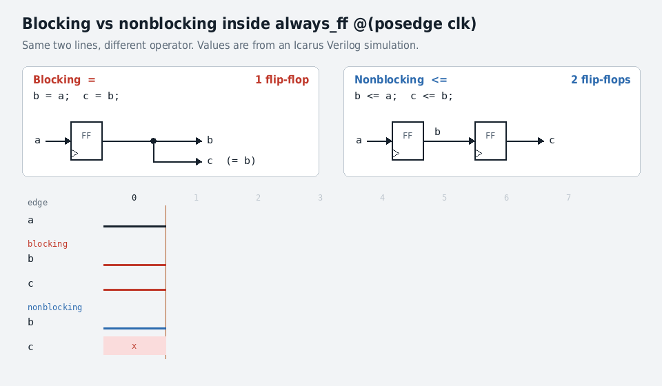

# Chapter 4 · HDL Design Practices

## At a glance

This chapter teaches the small subset of SystemVerilog that describes hardware, and the coding rules Wally follows. It reads like a designer's chapter, but for a verification engineer it is the code you read every day. When you debug a failure you are reading someone's RTL, and the bugs come from the idioms here: an inferred latch, a blocking assignment in a flop, an X that escaped, a parameter that is wrong in one configuration only.

The chapter's one idea: **an HDL is not a program.** You are describing hardware that exists all at once, not steps that run in order. A good designer pictures the registers, muxes and memories first and then writes the idiom that implies each one. "If you aren't sure what hardware you intend to imply with some code, you are unlikely to get good results from that code."

&#91;embedded content: The design path from specification to SystemVerilog, and the three kinds of hardware an idiom can imply\]

Some background terms:

- **HDL** (hardware description language): a textual description of hardware. A **logic simulator** (Questa, VCS, Xcelium, Verilator) runs it to check function. **Synthesis** (Design Compiler, Vivado, Quartus) maps it onto standard cells for an ASIC or onto lookup tables in an FPGA.
- **RTL** (register transfer level): describing registers and the datapath blocks between them (adders, shifters, muxes) rather than gates. You write `+`, and synthesis picks a ripple-carry, lookahead or prefix adder that meets timing at the lowest cost.
- **Languages:** SystemVerilog (what Wally uses; it fixes Verilog annoyances such as `reg`, which may or may not be a register), VHDL (declining; about 50% more code for the same hardware), SystemC (a C++ class library), and newer options such as Chisel, SpinalHDL and Bluespec with little market share. The standard does not say what is synthesizable, which is why teams agree on idioms.

## 4.1 Design methodology

### Design strategies

- **Write a specification first** (functions, hierarchy) so the team agrees on where each feature lives, and getting the partitioning right early saves repartitioning later. The spec is a means, not the goal; startups often skip it and bet on a few people keeping the design in their heads.
- **Design top-down with block diagrams.** Draw the top level and its major input and output buses (control signals can come later), then the sub-blocks and how they connect, and repeat until each block is simple. Blocks owned by different people talk through interfaces agreed early.
- **Then think in hardware parts** (registers, muxes, ALUs, memories, combinational blocks) and write the standard idiom for each. The book warns that the most common beginner mistake is writing HDL like a program, and the more programming experience you have, the easier the mistake is to make.

**Waterfall versus agile.** Waterfall freezes each stage (concept, design, build, test, deploy) before the next, so system-level testing happens late, when flaws are most expensive. Agile iterates with working prototypes and early feedback, so problems are found early. Except for minor updates to an existing product, agile suits SoC design better, and Wally was built that way. For DV, agile means a regression that runs from the first day, not a test phase at the end.

### Version control

Git keeps every change in a repository. `main` stays stable while features are built on branches and merged after review, merges can combine edits to different parts of the same file, and a bad change is easy to find and roll back. Wally uses Git and GitHub (Appendix C). For verification this is what makes `git bisect` possible: when a regression starts failing, a binary search over commits finds the change that broke it. The book also notes that a public GitHub history of real contributions gives a candidate a substantial edge in an interview.

### Reuse

The cheapest way to control design cost is to reuse proven parts. An SoC team licenses cell, memory and I/O libraries from the foundry, then adds processor cores, peripherals (DDR and flash controllers, radios, Ethernet, timers, data converters) and accelerators, which are typically about two orders of magnitude better in performance and energy than a general-purpose core for their task. Most of these come from third parties or the company's own library; the team adds its "special sauce" blocks, integrates, verifies and writes software. Over 30 billion ARM cores shipped in 2023, and an estimated 10 billion RISC-V cores had shipped by 2022.

The DV consequence: most of the work at SoC level is **integration verification** of IP you did not write. The IP vendor verified the block, and your job is the connections, configuration, clocks, resets and the interactions between blocks.

## 4.2.1–4.2.2 Modules and combinational logic

### Modules: hardware you place, not functions you call

```systemverilog
module fulladder(input  logic a, b, c,
                 output logic s, cout);
  assign s    = a ^ b ^ c;
  assign cout = (a & b) | (a & c) | (b & c);
endmodule
```

All synthesizable signals are type `logic`, which has four values: 0, 1, z (floating) and x (unknown). Synthesis chooses the cheapest implementation that meets timing: plain gates, an optimized gate network, or FPGA lookup tables (book Fig. 4.1).

**Instantiating is not calling.** In C a called function builds a stack frame, runs and vanishes. A module instance exists permanently on the chip, working whether or not its inputs change. `mux4` built from three `mux2` instances means three real muxes in silicon.

**Parameterized modules** make one description serve every width:

```systemverilog
module mux2 #(parameter WIDTH = 8) (
  input  logic [WIDTH-1:0] d0, d1,
  input  logic             s,
  output logic [WIDTH-1:0] y);
  assign y = s ? d1 : d0;
endmodule

mux2       muxa(d0, d1, s, y);              // default 8 bits
mux2 #(12) muxb(data0, data1, sel, yout);   // 12 bits
```

The book shows a 4:1 mux four ways: three `mux2` instances (structural), nested `?:`, `case` in `always_comb`, and an `if/else` chain. **Wally prefers the structural style for datapaths**: build them from flops, muxes and memories, so the hardware is visible in the code. Behavioral style is fine for control logic and for experienced designers who can see the hardware behind it.

### Combinational logic with assign

- **Every assign runs in parallel**, like the hardware, so their order in the file doesn't matter. This is the biggest difference from software.
- **Bitwise versus reduction:** `y = a & b` ANDs bit by bit (1010 & 0111 = 0010). `w = &a` ANDs all the bits of a together into 1 bit. The equality comparator `eq = &(a ~^ b)` is XNOR each column, then reduction-AND.
- **Logical operators** `&&`, `||` treat a whole bus as true if it is nonzero. Wally's style uses only the bitwise operators and never treats a multi-bit value as true or false.

Precedence, highest first: `~`; `* / %`; `+ -`; `<< >>`; `<<< >>>`; relational; `== !=`; `& ~&`; `^ ~^`; `| ~|`; `?:`. Use parentheses when in doubt.

**Every operator has a hardware cost**, and good RTL is written with it in mind:

| Operation | Hardware | Relative cost |
| --- | --- | --- |
| Constant shift, `x * 4`, `x / 8` | Wires | Free |
| `==` | N XNORs + an N-input AND | Cheap |
| `+`, `-` | At least N full adders | Moderate |
| `<`, `>` | Almost a subtraction | Moderate |
| Variable shift | Many layers of muxes | Fairly costly |
| `*` | Partial-product array + adders | Costly |
| `/`, `%` by non-powers of two | Iterative divider | Avoid when possible |

### always\_comb, case and casez

`always_comb` holds `if` and `case` statements that describe combinational logic. Unlike classic Verilog's `always @(...)`, it needs no hand-written sensitivity list, and tools warn if the block is not really combinational. A wrong sensitivity list was a classic cause of simulation-versus-synthesis mismatch.

**The latch trap.** In the seven-segment decoder, the `default` line is essential. Without it, an unlisted input such as 1111 leaves `segments` unassigned, the block must "remember" the old value, and synthesis infers a **latch**. I ran Verilator lint on a version with only two cases and no default:

```text
%Warning-CASEINCOMPLETE: latch.sv:3:5: Case values incompletely covered (example pattern 0x2)
```

The rule: in `always_comb`, **every path must assign every output**. A `default` branch, or default assignments at the top of the block, guarantees it.

`casez` allows `?` don't-cares, which makes priority logic read like its truth table:

```systemverilog
always_comb
  casez (a)
    4'b1???: y = 4'b1000;   // highest set bit wins
    4'b01??: y = 4'b0100;
    4'b001?: y = 4'b0010;
    4'b0001: y = 4'b0001;
    default: y = 4'b0000;
  endcase
```

The equivalent `if / else if` chain implies the same priority hardware.

### X and Z: what 4-state simulation really does

- **z** means floating, driven by nobody.
- **x** means unknown. Causes: no driver, conflicting drivers, a flop or memory never written, or a gate that cannot decide its output (`1 & z = x`, but `0 & z = 0`).

An x in simulation usually means a bug and should be chased. I ran these in Icarus Verilog (a 4-state simulator):

| Expression with an unknown | 4-state result | Why it matters |
| --- | --- | --- |
| `1'b1 & 1'bz` / `1'b0 & 1'bz` | x / 0 | An AND with 0 is decided whatever the other input is |
| `1'b1 \| 1'bx` | 1 | An OR with 1 is decided too |
| `if (s) y = 1; else y = 0;` with s = x | **0** | **X-optimism:** `if` treats x as false and quietly takes the else branch, so the bug is hidden |
| `y = s ? 1 : 0` with s = x | x | `?:` propagates the unknown |
| `s ? 4'b1010 : 4'b0110` with s = x | xx10 | Bits where both inputs agree survive; the rest become x |
| `x == x` / `x === x` | x / 1 | `==` is logical equality; `===` compares the four states literally (testbench only) |

That x-optimism row is the reason \[Sutherland13\] advises against relying on x to flag errors: the same bug can be hidden (optimism) or reported when nothing is wrong (pessimism), depending on how the code is written.

**`bit` versus `logic`.** `bit` is 2-state: x and z become 0. Wally declares RAM arrays as `bit` so uninitialized memory reads as 0 instead of x, which halves simulator memory and stops an x from an unwritten location spreading (for example through the page-table walker until the simulation hangs). The register file deliberately stays `logic`, so a program that reads an uninitialized register shows x.

**Verilator is 2-state too.** I checked: an unassigned 8-bit `logic` prints `xx` in Icarus but `00` in Verilator. With `--x-initial unique` and `+verilator+rand+reset+2` it prints a random value (`f0` in my run). Randomizing initial values across seeds is how a 2-state flow catches missing resets. Wally's regressions run on Verilator as well as Questa, so this is worth knowing.

### Tristates: only at the pins

A tristate driver outputs z when disabled, so several can share a `tri` net: if one drives, the bus takes its value; if none drive, it floats; if two disagree, the result is x. Inside a chip they are slow, risk contention while drivers switch, and many cell libraries do not have them. Use muxes internally and keep tristates for shared or bidirectional pins such as GPIO:

```systemverilog
module gpio #(parameter WIDTH=16) (
  input  logic [WIDTH-1:0] GPIOOutVal, GPIOEn,
  output logic [WIDTH-1:0] GPIOInVal,
  inout  tri   [WIDTH-1:0] GPIOPin);
  assign GPIOInVal = GPIOPin;
  tristate #(1) ts[WIDTH-1:0](GPIOOutVal, GPIOEn, GPIOPin);   // one enable per bit
endmodule
```

This is the structure behind GPIO pin muxing. In verification, the checks are that each pad is driven by exactly one source, that the enable has the right polarity, and that the read-back path works when the pin is an input.

## 4.2.3 Sequential logic

Sequential logic remembers: its outputs depend on past inputs as well as current ones. Wally follows the **synchronous sequential discipline**: the only state elements are edge-triggered flip-flops and memories, all clocked by the same `clk`.

### The flip-flop idiom, and blocking versus nonblocking

```systemverilog
module flop #(parameter WIDTH = 3) (
  input  logic             clk,
  input  logic [WIDTH-1:0] d,
  output logic [WIDTH-1:0] q);
  always_ff @(posedge clk)
    q <= d;          // nonblocking: "q gets d"
endmodule
```

The rule:

- **`<=` (nonblocking) in `always_ff`.** Every right-hand side is sampled first, then all the left-hand sides update together, the way flip-flops do.
- **`=` (blocking) in `always_comb`.** Each line sees the line before it. `<=` would also give the right answer there, but the block may be re-evaluated more often, which slows simulation.



I simulated the book's synchronizer example in Icarus Verilog. With blocking assignments, `b = a; c = b;` copies a into b and then the *new* b into c in the same edge, so c is just b and the circuit has **one** flop. With nonblocking assignments, c gets the *old* b and there are **two** flops: a real two-stage synchronizer. A subtler trap: if you swap the two blocking lines (`c = b; b = a;`), the result has two flops again. With `=` the order of lines changes the hardware; with `<=` it never does. Verilator's lint catches the misuse:

```text
%Warning-BLKSEQ: blk.sv:2:36: Blocking assignment '=' in sequential logic process
                            : ... Suggest using delayed assignment '<='
```

The failure for a DV engineer to recognize: a pipeline that loses a stage, or a synchronizer that does nothing, can still pass simple directed tests.

### Resets

```systemverilog
always_ff @(posedge clk, posedge reset)   // flopr: asynchronous reset
  if (reset) q <= 0; else q <= d;

always_ff @(posedge clk)                  // flopc: synchronous reset ("clear")
  if (reset) q <= 0; else q <= d;
```

|  | Asynchronous reset | Synchronous reset (clear) |
| --- | --- | --- |
| Takes effect | As soon as reset rises | At the next clock edge |
| Works without a running clock | Yes, even if clocks are gated or not started | No: gated clocks may not fire during reset |
| Cost | Substantially more transistors, plus a reset tree that reaches every flop at nearly the same time; reset must be glitch-free | Cheaper: reset is just more data logic |
| Typical use | FPGAs (every flop has a built-in async reset) | ASICs; also flushing a pipeline stage |

Some flops can skip reset entirely if they are always written before being read (the register file, for example). **Wally resets every flip-flop anyway**, because an unreset flop starts as x, and x can spread through other logic or hide the clue to a real bug.

### Enables, and the full flop

```systemverilog
module flopenrc #(parameter WIDTH = 8) (
  input  logic             clk, reset, clear, en,
  input  logic [WIDTH-1:0] d,
  output logic [WIDTH-1:0] q);
  always_ff @(posedge clk, posedge reset)
    if (reset)    q <= 0;          // async reset wins
    else if (en)
      if (clear)  q <= 0;          // sync clear, only when enabled
      else        q <= d;
endmodule
```

These map straight onto the pipeline:

- **en = \~Stall**: a stalled stage holds its value.
- **clear = Flush**: a flushed stage becomes a bubble.

The pipeline registers in Wally and in the labs are `flopenrc` instances. Note the priority in this version: `clear` acts only when `en` is high, so a stall overrides a flush. Interviewers like to ask what happens when stall and flush arrive together.

**Latches** (`always_latch if (clk) q <= d;`) are transparent while clk is high. They are avoided in synchronous design and used only in special circuits such as clock gaters.

### Finite state machines

An FSM has a state register, next-state logic and output logic. In a **Moore** machine the outputs depend only on the state; in a **Mealy** machine they also depend on the inputs.

&#91;embedded content: Two-bit branch predictor state diagram, the FSM example of Section 4.2.3.2\]

```systemverilog
typedef enum logic [1:0] {SNT, WNT, WT, ST} statetype;
statetype state, nextstate;

always_ff @(posedge clk, posedge reset)        // state register
  if (reset) state <= WT; else state <= nextstate;

always_comb                                    // next-state logic
  case (state)
    SNT: if (t) nextstate = WNT; else nextstate = SNT;
    WNT: if (t) nextstate = WT;  else nextstate = SNT;
    WT:  if (t) nextstate = ST;  else nextstate = WNT;
    ST:  if (t) nextstate = ST;  else nextstate = WT;
    default:    nextstate = WT;
  endcase

assign p = (state == WT) | (state == ST);      // Moore output logic
```

The `typedef enum` gives readable state names in waveforms. This is the exact counter Chapter 13 uses in Wally's branch predictor.

The divider controller (Code Example 4.17) is the compact style: next-state logic merged into `always_ff`, with a 6-bit step counter in the same block. Assigning nothing in a branch is legal there (it holds the value, which is what a flop does), but it would infer a latch in `always_comb`. Testing `step[5]` instead of `step == 32` uses a 1-bit check instead of a 6-bit compare. The book's advice is to avoid this style until you can picture the hardware it implies.

**What DV checks on an FSM:** every state visited, every legal transition taken (both arcs out of each state), the reset state, no illegal or unreachable states, and the `default` branch. Most coverage tools pull these out of an enum-typed state register automatically as FSM coverage (Chapter 5).

### Memories

An array has 2^M words of N bits. **Reads** can be asynchronous (data follows the address after a propagation delay) or synchronous (address set up before the clock edge, data valid after clock-to-Q). **Writes** are always synchronous. Wally uses synchronous-read memories from Chapter 7 on, because for all but tiny memories they are smaller and faster.

**Naming convention:** ports and their kind, then `b` for byte enables and `e` for a chip enable:

| Name | Meaning |
| --- | --- |
| `rom1p1r` | 1 port, read only |
| `ram1p1rw` | 1 port, read/write |
| `ram1p1rwb` / `ram1p1rwbe` | plus byte enables / plus byte and chip enables |
| `ram2p1r1w` | 2 ports: one read, one write |
| `ram2p2rw` | 2 ports, both read/write |
| `rf3p2r1w` | register file: 2 asynchronous reads, 1 write |

```systemverilog
module ram1p1rwbe #(parameter M = 6, N = 32) (
  input  logic           clk, ce,
  input  logic [N/8-1:0] we,            // one write enable per byte
  input  logic [M-1:0]   a,
  input  logic [N-1:0]   wd,
  output logic [N-1:0]   rd);
  bit [N-1:0] mem[2**M];               // bit: unwritten words read as 0, not x
  genvar i;
  always_ff @(posedge clk) if (ce) rd <= mem[a];             // synchronous read
  for (i = 0; i < N/8; i++)                                   // generate loop: byte columns
    always_ff @(posedge clk)
      if (ce & we[i]) mem[a][i*8 +: 8] <= wd[i*8 +: 8];      // +: indexed part-select
endmodule
```

- **Byte enables** let a `sb` or `sh` update part of a word without a read-modify-write cycle. In a test, look for stores of every size at every byte offset, checking that the neighbouring bytes don't change.
- **`wd[i*8 +: 8]`** means 8 bits starting at bit i×8, so i = 2 gives `wd[23:16]`.
- **Chip enable** saves energy: when off, the RAM ignores everything and `rd` keeps its last value.
- **ROM** contents are loaded with `initial $readmemh("romfile.dat", mem);`, one hex word per line. Lines the file doesn't cover stay 0.

**Library considerations:** in an ASIC these idioms synthesize to flip-flops. Real SRAM needs an explicit macro instance (Section 6.5.3); on an FPGA the idioms map to block RAM. Fast SRAM arrays top out around 128 rows × 256 bits, so larger memories are built from subarrays. Rough density: SRAM is about 10× denser than flops, and DRAM about 10× denser than SRAM, but DRAM needs refresh and a complex DDR controller that teams usually buy as IP.

## 4.2.4–4.2.5 Syntax you must read fluently, and configurable hardware

### Numbers

The format is `N'Bvalue`: N bits, base b, d, h or o. The value is zero-padded to N bits, and underscores are ignored.

| Literal | Bits | Value | Stored |
| --- | --- | --- | --- |
| `3'b101` | 3 | 5 | 101 |
| `8'b1010_1011` | 8 | 171 | 10101011 |
| `8'b11` | 8 | 3 | 00000011 |
| `3'd6` | 3 | 6 | 110 |
| `8'hAB` | 8 | 171 | 10101011 |

Always give the size; unsized literals cause subtle bugs \[Sutherland06\]. The exception is the fill literals `'0`, `'1`, `'x` and `'z`, which fill the whole destination at any width, which is ideal when the width is a parameter. Verilator flags size mistakes: `assign z = 8'd300;` gives `%Warning-WIDTHTRUNC: Value too large for 8 bit number: 300`.

### Bit swizzling

```systemverilog
assign s64      = {64{s}};                       // replicate
assign entire   = {upper, lower};                // concatenate 32+32 -> 64
assign y        = {{2{a[2]}}, b, a[1:0], 3'b101}; // mix of all three
assign csignext = {{4{c[3]}}, c};                 // sign-extend 4 -> 8
assign czeroext = {4'b0, c};                      // zero-extend
assign {cout, sum} = a + b;                      // 33-bit result: carry out for free
```

Sign extension by replicating the top bit is exactly what Chapter 2's Extend unit does to immediates.

**Gating many bits with one:** `y = reset ? '0 : a;` or `y = {N{~reset}} & a;`. Both are N AND gates, not an N-bit mux.

### Delays

`#2` delays exist only in simulation; synthesis ignores them, because real delay depends on the physical implementation, voltage and temperature. Use them in testbenches (clock generation), never in RTL. Some simulators, Verilator in particular, run much faster when everything changes on clock edges.

### Port connections, from risky to readable

```systemverilog
flopr #(1) f0(clk, reset, x[0], y[0]);                         // by order: brief, breaks if ports are reordered
flopr #(1) f1(.clk(clk), .reset(reset), .d(x[1]), .q(y[1]));  // by name
flopr #(1) f2(.clk, .reset, .d(x[2]), .q(y[2]));               // implicit .name when names match
flopr #(1) f3(.d(x[3]), .q(y[3]), .*);                         // .* connects all matching names
```

Wally connects by order only for simple generic modules (flops, muxes), uses `.name` / `.name(sig)` everywhere else, and keeps `.*` for wrappers and testbenches. Leaving a port off a by-name list (`.outsig()`) discards that output.

**DV hazard:** a typo in a by-name connection to a signal that was never declared silently creates a new 1-bit wire. Verilator catches it: `%Warning-IMPLICIT: Signal definition not found, creating implicitly: 'yy'`. That is why `default_nettype none` exists, and why lint is the first gate in any regression (Chapter 5).

### Preprocessor and assertions

- `` `define XLEN 32 `` does text substitution. Wrap expressions in parentheses: `` `define PPN_BITS (`XLEN==32 ? 22 : 44) ``.
- `` `include "config.vh" `` pastes a header in.
- **The catch:** SystemVerilog doesn't define the order in which files are preprocessed, so a macro defined twice with different values is nondeterministic. That is fatal for an SoC with two differently configured cores, and it is why Wally moved to a parameter struct.
- Immediate assertions check properties as simulation runs: ``assert (`U_SUPPORTED | (`S_SUPPORTED == 0)) else $error("S supported only if U is too");``. Use `$warning` for something less serious. Chapter 5 covers concurrent assertions.

### Configurable hardware

Wally makes almost everything configurable, from RV32E to RV64GC, in one code base. The tools for it:

**1. Disable a signal with a constant.** Synthesis removes the logic when the constant is 0:

```systemverilog
assign WriteMSTATUSHM = CSRMWriteM & (CSRAdrM == MSTATUSH) & (P.XLEN == 32);  // mstatush exists only on RV32
```

**2. Values of configurable width.** `(XLEN-1)'b0` is illegal, so use replication or fill literals: `{{(XLEN-12){Instr[31]}}, Instr[31:20]}` to sign-extend, `{{(XLEN-1){1'b0}}, LT}` for slt's result, and `'0` / `'1` to fill.

**3. Conditional generate.** The hardware exists or not, decided at elaboration:

```systemverilog
if (P.M_SUPPORTED) begin: mdu
  mdu #(P) mdu(.clk, .reset, ..., .MDUResultW, .DivBusyE);
end else begin
  assign MDUResultW = 0;     // keep the interface, tie outputs off
  assign DivBusyE  = 0;
end
```

Name the block (`begin: mdu`) so the hierarchy path stays stable, for example `top.mdu.mdu`; otherwise the tool invents a name such as `genblk1`. That matters for every testbench probe, bind and coverage path. Wally prefers this to `` `ifdef `` because the signals always exist, so testbenches don't need a different wiring per configuration.

**4. Generate loops** build N copies of hardware. `genvar i` is a counter at elaboration time, not a signal:

```systemverilog
assign y[0] = ~a[0];
for (i = 1; i < N; i++) begin: therm
  assign y[i] = y[i-1] & ~a[i];      // thermometer mask below the lowest set bit
end
```

This describes a ripple chain of N−1 AND gates, but synthesis such as Design Compiler recognizes the pattern and builds a log2(N)-deep tree when timing needs it.

**5. Arrays of instances**, for identical copies: `tlbramline #(W) tlbramline[TLB_ENTRIES-1:0](.re(Matches), ..., .q(RamRead));`. Each instance gets one bit of `Matches`. The TLB reads through a **one-hot AND-OR mux**: each line ANDs its data with its match bit, and `or_rows` ORs all the lines together. Wally's caches read the same way (Section 10.4.5.1). Its correctness depends on the select being truly one-hot: two hits OR two entries into garbage. A good assertion for any AND-OR mux is `$onehot0(Matches)`.

**6. Parameter struct.** `` `define `` breaks as soon as two cores need different settings, so Wally passes one packed struct, `cvw_t P`, down the hierarchy (diagram in Section 4.4). Every module is declared `module x import cvw::*; #(parameter cvw_t P) (...)` and uses `P.XLEN`, `P.M_SUPPORTED` and so on. A five-core SoC with four rv64gc cores and one rv32e controller just builds two different P structs.

## 4.3 Wally style guidelines

The 44 guidelines apply to synthesizable code only; testbenches look more like software. Two other public guides worth knowing are lowRISC's (Ibex, OpenTitan) and Freescale's.

### Names: read a signal and know where it lives

| Rule | Convention | Example |
| --- | --- | --- |
| 4.1 | flatcase for clock and reset | `clk`, `reset` |
| 4.2 | UpperCamelCase for signals | `RegWrite`, `PCNextF` |
| 4.3 | MACRO\_CASE for constants and parameters | `XLEN`, `M_SUPPORTED` |
| 4.4 | **Suffix = pipeline stage** F, D, E, M, W | `InstrD`, `ALUResultE`, `ReadDataW` |
| 4.5 | **Prefix = source unit** (IEU, IFU, LSU, FPU, MDU, SC) | `IEUResultM` vs `MDUResultW` vs `SCResultW` |

Signals outside the pipeline (bus interface, page-table walker) get no suffix. Some units span stages and are named carefully: the register file (read in D, written in W), the bus interface (requests from F and M), and the hazard unit. The rule is that a signal produced in the pipeline takes the suffix of the stage that **produces** it, while one produced outside (by the hazard unit) takes the suffix of the stage that **uses** it, as in `StallD`, `FlushE`.

Why it matters for debug: in a waveform, `RdM` and `RdW` are the same instruction's destination register one cycle apart. If a mux selects `ResultW` while a forwarding path expects `ALUResultM`, the names show the stage mismatch before you trace a single wire. The book notes that **components spanning several stages are a common source of bugs**, so they deserve extra review and extra assertions.

### Declarations and connections

- 4.6: declare every internal signal, even 1-bit ones (an implicit wire is a bug waiting to happen).
- 4.7: `inout tri` only at the top-level chip pins; internally use unidirectional buses and muxes.
- 4.8: everything else is `logic`. Never `wire` or `reg`.
- 4.9: little-endian buses, `[31:0]`.
- 4.10: avoid passing arrays through ports; if you must, declare them `input var logic [7:0] PMPCFG_ARRAY_REGW[P.PMP_ENTRIES-1:0]`.
- 4.11 to 4.15: connect simple generic modules by order and everything else by name; keep a signal's name the same across module boundaries (so `.PrivilegeModeM` just works); use `.*` only in wrappers; pack several connections per line.

### Layout

Spaces, not tabs, indented two per level (4.16–4.17). Align declarations (4.18), put spaces around operators (4.19), use `begin`/`end` only when needed and on the same line (4.21–4.22), keep lines to 95 characters (4.23), and use blank lines and banner comments sparingly (4.24–4.25).

### Synchronous design (4.26–4.28)

- One clock, `clk`, positive-edge flops, standard memories and combinational logic. **No latches, negative-edge flops or asynchronous logic**, except where essential (an asynchronous peripheral interface), and then commented and reviewed.
- Multiple clock domains are inevitable in an SoC (core, Wi-Fi, GPU, DRAM controller); keep each domain synchronous. Clock-domain crossings are outside the book's scope, but they are a classic SoC verification topic in their own right, with dedicated CDC tools.
- Instantiate flops and memories as **modules** (`flopenr`, `ram1p1rwbe`), so the state is easy to count and reset, scan or low-power variants can be swapped in one place. The exception is enum-typed FSM state registers.
- No `#` delays outside testbenches.

### Modules (4.29–4.36)

One module per file, with the file named after the module. Write parameters, `(` and ports in the compact Wally layout; group ports by direction and width. Describe **leaf cells and control behaviorally and datapaths structurally**, with non-trivial control pushed into its own module. Use hierarchy so modules stay small, though too much hierarchy also hurts: the book mentions a commercial processor with about 200 modules averaging about 4,000 lines each. **No functions or tasks in synthesizable code**, because they hide the hardware being implied.

### Configuration (4.37–4.42)

Write generic modules where they fit (mux, flop, MMU and cache pieces). Pass the parameter struct from the top; use `#(parameter ...)` for module-local knobs. **Keep a module's interface identical whether or not a feature is enabled**, tying unused outputs to 0 rather than `` `ifdef ``-ing them away. Omit `generate`/`endgenerate` (a controversial choice; some teams require them). Name every generate block that contains instances or signals.

### Comments (4.43–4.44)

Start each file with a banner: file name, author and email, date, purpose, license. Comment the big picture, not the obvious:

```systemverilog
// Bad
assign ab = ~a;          // Flip the bits
assign minusa = ab + 1;  // Add one
// Good
assign minusa = ~a + 1;  // Take the 2's complement to negate a
```

**Why a DV engineer should care about RTL style:** your checkers, assertions and coverage bind to these names and hierarchy paths. Consistent names and named generate blocks make `bind` files, probes and coverage stable across configurations. A team that follows a style guide is easier to verify.

## 4.4 Wally configuration

&#91;embedded content: How a Wally configuration reaches the RTL (Code Examples 4.36–4.43, checked against today's cvw repo)\]

One code base scales from a tiny rv32e core through rv32/64i, an rv32imc microcontroller with peripherals, up to rv32/64gc application processors with floating point, branch prediction, caches and virtual memory. The repo has seven base configurations (`config/rv32e`, `rv32i`, `rv32imc`, `rv32gc`, `rv64i`, `rv64gc`, plus `shared`), each a `config.vh` of localparams.

**Derived configurations** are variations of the base ones, used to test optional features: caches on or off, branch-predictor table sizes, combinations of floating-point formats, and so on. `config/derivlist.txt` lists them (the current file has about 360 `deriv` entries), and `bin/derivgen.pl` generates `config/deriv/<name>/config.vh`; `make deriv` in `sim` regenerates them. Two notable ones are `buildroot` and `fpga`: rv64gc variants whose reset vector points at a boot ROM at 0x1000 holding a zero-stage boot loader, for booting Linux in simulation and on an FPGA.

**A difference from the book:** the book derives `M_SUPPORTED` from the `MISA` bits (`(MISA >> 12) % 2 == 1`). In today's repo it is the other way round: each `config.vh` sets flags such as `localparam logic M_SUPPORTED = 1;`, and `config-shared.vh` builds `MISA` from them. The idea is the same; only the direction changed.

**`riscvassertions`** (in `testbench/common`) checks that P is legal before anything runs, for example:

```systemverilog
assert (P.PMP_ENTRIES == 0 | P.PMP_ENTRIES==16 | P.PMP_ENTRIES==64) else $fatal(1, "Illegal number of PMP entries...");
assert (P.F_SUPPORTED | !P.D_SUPPORTED) else $fatal(1, "Can't support double fp (D) without supporting float (F)");
```

Other checks cover the cache organization, such as a way size no bigger than a virtual-memory page.

**For verification, configurability is a coverage dimension.** A bug can exist only in rv32, only with caches off, or only with some predictor size. Wally's regression therefore runs many configurations and derived configurations, not just rv64gc. When you join a project with configurable IP, one of the first questions to ask is: which configurations does the regression actually run, and which configuration does the customer use?

## Chapter 4 recap and interview drill

### The chapter in six sentences

1. Design top-down from a specification and block diagrams down to hardware parts, then write the standard SystemVerilog idiom for each part. Writing HDL like software is the classic mistake.
2. Combinational logic is `assign` or `always_comb` with blocking `=`, and every path must assign every output or a latch is inferred.
3. Sequential logic is `always_ff @(posedge clk)` with nonblocking `<=`; flops come in reset, clear and enable variants, and an enabled, clearable flop is exactly a stallable, flushable pipeline register.
4. FSMs are a state register plus next-state and output logic; memories are named by ports (`ram1p1rwbe`, `rf3p2r1w`), and `bit` arrays avoid x from unwritten locations.
5. Configurability uses parameters, conditional generates (interfaces stay fixed, outputs tied to 0) and generate loops. Wally passes one `cvw_t P` struct down the hierarchy, because `` `define `` breaks with differently configured cores.
6. Wally's style (UpperCamelCase, F/D/E/M/W stage suffixes, unit prefixes, structural datapaths, a single synchronous clock) exists to make hardware visible and bugs findable.

### Interview questions with model answers

**Q1. What is the difference between blocking and nonblocking assignments, and what goes wrong if you mix them up?** A blocking `=` updates immediately, so later statements in the block see the new value. A nonblocking `<=` samples every right-hand side first and updates all the left-hand sides together at the end of the time step, which is how flops behave. In `always_ff`, `b = a; c = b;` makes c a copy of b, so one flop instead of two; with blocking the line order changes the hardware, while with `<=` it never does. In `always_comb`, nonblocking still gives correct results but costs simulation speed. I simulated both versions in Icarus and Verilator lint flags it as BLKSEQ.

**Q2. How can an `always_comb` block create a latch, and how do you prevent it?** If some path through the block leaves an output unassigned (a `case` without `default`, an `if` without `else`), the output has to hold its old value, which is storage, so synthesis infers a latch. Prevent it with default assignments at the top of the block, or a `default`/`else` on every branch. Lint reports it (Verilator gave CASEINCOMPLETE in my test), and synthesis reports inferred latches too.

**Q3. What is X-optimism, and why should a verification engineer worry about it?** In 4-state simulation, `if (sel)` with sel = x takes the else branch, as if x were 0, so an unknown control value vanishes and the design looks fine. `sel ? a : b` instead produces x where a and b differ. Real silicon gives either 0 or 1, so the simulation hides a real bug: a missing reset, or an uninitialized enable. Mitigations: reset every flop (Wally does), assertions that control signals are never unknown (`!$isunknown(sel)`), write muxes with `?:` or case statements that propagate x, and in 2-state Verilator, randomize initial values across seeds.

**Q4. Verilator is 2-state. What does that mean for your testbench?** x and z don't exist: an unassigned flop starts at 0, or at a random value with `--x-initial unique` and `+verilator+rand+reset+2`. Bugs that 4-state simulation shows as x, such as a missing reset or a read of uninitialized memory, can pass silently. I'd run the same regression on a 4-state simulator, or run Verilator with randomized reset values across many seeds, and add explicit reset-state assertions.

**Q5. Synchronous or asynchronous reset: which, and why?** Asynchronous reset acts without a clock, which is good when clocks are gated or not yet running. It is standard on FPGAs, which have it built in, but it costs area and needs a glitch-free reset tree that reaches every flop at nearly the same time. Synchronous reset is cheaper in an ASIC and doubles as a pipeline flush, but needs the clock to be running. Either way, reset deassertion must be synchronized to the clock; Wally's top level has a reset synchronizer. Verification checks the reset values of every register, and reset in the middle of operation.

**Q6. In `flopenrc`, what happens when en and clear are both 1? When clear is 1 but en is 0?** In the book's version the clear is nested inside the enable. en = 1 with clear = 1 clears; en = 0 holds the value even if clear = 1. In pipeline terms, a stall (en = 0) beats a flush. That priority has to match what the hazard unit expects. It is a classic corner case to cover: stall and flush in the same cycle.

**Q7. Why does Wally use a parameter struct instead of `` `define `` for configuration?** `` `define `` macros are global, and the order in which files are compiled is undefined, so an SoC with two differently configured cores (say rv64gc plus an rv32e controller) gets whichever definition is processed last. A packed struct `cvw_t P`, passed as a module parameter, lets each instance carry its own configuration. Conditional generates such as `if (P.M_SUPPORTED) begin: mdu` keep the interfaces fixed and tie outputs to 0 when a feature is off.

**Q8. Why name generate blocks, and why does it matter to DV?** A named block (`begin: mdu`) gives a stable hierarchical path, such as `core.mdu.mdu`. Unnamed blocks get tool-generated names like `genblk1` that can change between tools or versions. Testbench probes, `bind` statements, waveform scripts and coverage exclusions all depend on those paths.

**Q9. What can go wrong with an AND-OR (one-hot) read mux, and how would you check it?** Each entry ANDs its data with its select bit and the results are ORed together. If two selects are 1 (two TLB or cache-way hits), the output is the OR of both entries, which is garbage with no error flagged. If none is 1, the output is 0. I'd assert `$onehot0(Matches)` every cycle and cover the multi-hit scenarios the design is supposed to prevent.

**Q10. What does the signal name `IEUResultM` tell you?** UpperCamelCase means it is a signal. The IEU prefix says it comes from the integer execution unit, as opposed to `MDUResultW` from the multiply/divide unit. The M suffix says it belongs to the Memory stage. Signals generated in the pipeline carry the suffix of the stage that produces them; stall and flush signals carry the suffix of the stage that uses them. Units that span stages (register file, hazard unit, bus interface) are where naming, and bugs, get tricky.

### Try it

The [HDL Idiom Bench](https://claude.ai/artifact/GN8qPGwPyrrfsC1F5iUnTA) has three experiments:

- Toggle `=` and `<=` and reorder lines in an `always_ff`, and watch flops disappear, with Verilator's lint message.
- A four-state calculator showing x-optimism next to the 2-state result.
- The two-bit predictor FSM. A loop pattern gives 75% accuracy against 50% for a one-bit predictor; an alternating pattern defeats both.

### How Chapter 4 connects forward

| Ch 4 idea | Where it comes back |
| --- | --- |
| Lint, testbenches, assertions, Verilator vs Questa | Ch 5 (design verification) |
| How the idioms map to gates, SRAM macros, synthesis wrappers | Ch 6 (logic synthesis) |
| flopenrc pipeline registers, stall and flush, F/D/E/M/W naming | Ch 7 (pipelined core) |
| Byte-enabled RAMs, AND-OR way select | Ch 10 (caches) and Ch 12 (LSU) |
| tlbram, one-hot match | Ch 11 (MMU) |
| Two-bit predictor FSM | Ch 13 (instruction fetch and branch prediction) |
| Conditional generate: mdu only if M | Ch 15 (M extension) |
| Configurations, FPGA mapping to block RAM | Ch 23 (FPGA) |

## Book coverage check (Ch 4 audit)

I checked this tab against all 46 code examples and 3 tables in Chapter 4 (sections 4.1–4.5). The tab already covers each idiom, though usually without the book's example numbers. These are the leftover details.

### Small facts from the book

- **`**` and `$clog2`**: `2**M` is exponentiation, so `bit [N-1:0] mem[2**M]`. `$clog2(32) = 5` gives the address bits for a memory with 32 words. Memory sizes in Wally are derived this way.
- **How `or_rows` is actually written** (the TLB read in Code Example 4.35): it uses `input var logic [COLS-1:0] a[ROWS]` (guideline 4.10's array port) and a generate chain `mid[row] = mid[row-1] | a[row]`. That is a linear OR chain, which synthesis rebalances into a tree.
  - Each `tlbramline` is a `flopenr` plus `assign q = re ? line : 0`, and it exports `PTE_G = line[5]` (the global bit) to the CAM for ASID matching.
  - The packed struct shown in the book (XLEN, MISA as `int`, plus the `logic M_SUPPORTED` bit) totals 65 bits, because `int` is 32 bits.
- **The reset synchronizer at the top**: `wallypipelinedsoc` takes `reset_ext` from the pin and runs it through `synchronizer resetsync(.clk, .d(reset_ext), .q(reset))`. Every flop inside sees a reset whose deassertion is synchronized to clk, which is the answer to "how do you make async reset safe?".
- **Tool-specific code behind a config flag** (Code Example 4.46, `redundantmul`): `if (P.DESIGN_COMPILER == 1) begin: mul` instantiates Synopsys DesignWare `DW02_multp`, which produces a carry-save pair `out0/out1` that is 2 bits wider and then truncated. Otherwise `assign out0 = a * b; assign out1 = 0;`.
  - **DV point:** the simulated netlist and the RTL can take different branches. Equivalence checking, or simulating with the same flag that synthesis used, closes that gap.
- **Case sensitivity**:
  - SystemVerilog is case-sensitive, so `RegWrite`, `regwrite` and `regWrite` are three different signals.
  - VHDL is case-insensitive, but EDA tools drive the design through Tcl, which is case-sensitive, so constraints can silently miss a VHDL signal spelled inconsistently.
  - The book cites Binkley (2009), who found camelCase is read faster and more accurately than snake\_case. Wally uses UpperCamelCase, inherited from Patterson & Hennessy's diagrams.
- **Generate syntax**: `generate/endgenerate` is optional, and Wally omits it (guideline 4.40). The condition must be known at elaboration, because hardware "can't wink in and out of existence" at run time.
- The style guide opens with Emerson: "A foolish consistency is the hobgoblin of little minds." The designer is empowered to break a guideline when there is a reason.

### Beyond the book: case qualifiers (common interview follow-up)

The book never uses these, but interviewers who ask about latches and casez often go on to ask about them:

| Construct | What it promises | Simulation behaviour | Risk |
| --- | --- | --- | --- |
| `unique case` | Exactly one item matches, and the list is complete | Run-time violation report if zero or more than one item matches | Synthesis may drop the priority logic and the default branch. A violation in silicon behaves differently from RTL. |
| `unique0 case` | At most one item matches | Report only on overlapping matches | Same as unique, without the completeness promise |
| `priority case` | The first match wins, and the list is complete | Report if nothing matches | Removes the default path, so a missing default no longer creates a latch |
| `// synopsys full_case parallel_case` | Old pragmas that only synthesis reads | Nothing | **Classic sim/synth mismatch.** Never use them; use the keywords above. |

A one-hot FSM decode written with `unique case` plus an assertion such as `$onehot(state)` gives you a check during simulation, where the pragmas give none.


---

Interactive companion page for this chapter: [`companion-pages/ch04-lab.html`](../companion-pages/ch04-lab.html) (download and open in a browser).
