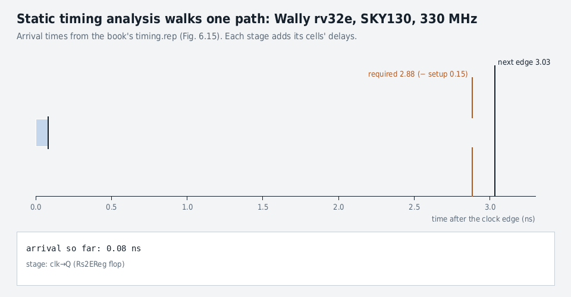

# Chapter 6 · Logic Synthesis

Oct 28, 2026 · @Abhishek

## At a glance

> **Logic synthesis maps RTL onto a library of real cells, minimizing area and power subject to a clock-period constraint.** Every number it reports traces back to three figures of merit: performance, power and area (PPA).

Synthesis reads four inputs. The **RTL** is your design. The **constraints** give the clock period, I/O delays, drive and load, and activity. The **cell library** describes each gate's delay, power and area at every load, voltage and temperature. The **technology file** holds metal layers and design rules. It then runs three steps. **Analyze** parses the files. **Elaborate** builds technology-independent registers, adders and muxes. **Compile** maps them onto real cells and keeps optimizing until timing is met at the lowest area.

&#91;embedded content: Design Compiler flow from the book, with the verification checks at each hand-off\]

The chapter's questions, and where each is answered:

| Question | Answer in | Key number |
| --- | --- | --- |
| How fast can a path run? | 6.1.1 setup, hold, STA | Tc ≥ tpcq + tpd + tsetup + tskew |
| Where does power go? | 6.1.2 power | P = αCV²f; the clock is most of it |
| How do processes compare? | 6.2 FO4, PVT, datapath fits | TSMC28 FO4 = 11.6 ps |
| How do I read the reports? | 6.4 logs | rv32e SKY130: slack −0.18 ns at 3.03 ns |
| What limits Wally? | 6.5 results | rv32e 2.8 GHz, rv64gc 800 MHz in TSMC28 |
| Can I do it myself? | Lab | my core: 91.6k µm², 5.2 ns, 122 pJ/cycle |

**Why a CPU verification engineer needs this chapter.** Synthesis is the first tool after yours that reads the RTL, and it reads it differently. It deletes logic it can prove constant. It assumes `x` is whatever value is cheapest. It times paths that your tests never exercise and ignores paths that a constraint declares false. Interviewers at CPU companies ask about setup and hold, gate-level simulation, equivalence checking and low-power checks because those are where RTL sign-off and physical sign-off meet.

## 6.1.1 Timing from first principles

A synchronous design is flops separated by clouds of logic. Every timing rule in the chapter comes from one question: **when the clock rises, does each flop's D input hold the right value, and hold it still?**

### Four numbers describe every block

| Symbol | Name | What it means | Which check uses it |
| --- | --- | --- | --- |
| tpd | propagation delay | latest time the logic output settles after its input changes | setup (max delay) |
| tcd | contamination delay | earliest time the logic output can start to change | hold (min delay) |
| tpcq | clock-to-Q propagation | latest time a flop's Q settles after the clock edge | setup |
| tccq | clock-to-Q contamination | earliest time Q can start to change | hold |

A flop also has two windows of its own. D must be stable **tsetup before** the edge and **thold after** it. The book's analogy: a camera needs the subject still while the shutter is open.

Max and min delays differ because of input patterns, rising vs falling edges, voltage, temperature, manufacturing variation and aging. Setup is checked with the slowest numbers and hold with the fastest.

### Setup: the clock must be slow enough

The path launches at register R1, goes through logic, and is captured by R2 on the **next** edge. Everything must fit in one period:

```latex
T_c \ge t_{pcq} + t_{pd} + t_{setup} + t_{skew}
```

### Hold: the new data must not arrive too early

On the **same** edge, R1's new value races toward R2. R2 is still sampling the old value. If the new value arrives inside R2's hold window, R2 captures garbage:

```latex
t_{ccq} + t_{cd} > t_{hold} + t_{skew}
```

No Tc appears in the hold inequality. **A hold violation cannot be fixed by slowing the clock.** The chip fails at every frequency, so hold bugs are catastrophic. The hardest case is two flops back to back with no logic between them (tcd = 0). Tools fix it by inserting delay buffers. FPGAs avoid it by using flops with a deliberately large tccq.

### Clock skew hurts both checks

Clock edges do not arrive everywhere at once. Wire lengths differ, buffers vary in manufacturing, and supply noise shifts edges. tskew is the spread between the earliest and latest edge. For setup, the worst case is a late launch and an early capture. For hold, it is an early launch and a late capture. Design Compiler calls skew **clock uncertainty** and subtracts it on both sides.

&#91;embedded content: Setup and hold on one path R1 → logic → R2 (after book Figs. 6.2–6.5; not to scale)\]

Read it left to right. Setup is a race against the next edge, and the green slack is what is left over. Hold is a race against the same edge: the shaded window at the first edge must close before D2 starts to move.

### Static timing analysis (STA)

STA checks every path without test vectors. It is the timing counterpart of formal verification:

1. **Startpoint:** a flop's clock pin at t = 0.
2. **Arrival time:** add the delays along the path: tcq + the delay of each gate.
3. **Required time:** Tc − tsetup (minus uncertainty) at the endpoint flop's D pin.
4. **Slack = required − arrival.** Positive means the path passes at that frequency.
5. **WNS** (worst negative slack) is the most negative slack, or 0 if none. **TNS** (total negative slack) is the sum of the negative slacks over all endpoints. WNS tells you the frequency gap. TNS tells you how many paths need work.
6. The **critical path** is the path with the WNS. It sets the clock period.

**Worked example (book Code Example 6.1).** `assign y = &b;` sits between two flops. Synthesis builds the 4-input AND from NAND2 + NOR2.

| Quantity | Calculation | Value |
| --- | --- | --- |
| Arrival at D | tcq 0.32 + NAND 0.06 + NOR 0.09 | 0.47 ns |
| Required | Tc 2.0 − tsetup 0.13 | 1.87 ns |
| Slack | 1.87 − 0.47 | **+1.40 ns** (met) |

With a 1.40 ns margin, this path alone could run with Tc = 0.60 ns, or 1.67 GHz.

### How synthesis attacks a critical path

- **Upsize**: use a higher-drive cell on a high-fanout net, such as a mux select driving 64 bits.
- **Precompute**: compute the result for late signal = 0 and = 1, then select with a mux when it arrives.
- **Pick a faster architecture**: a prefix adder on the critical path, a ripple adder elsewhere. Critical paths cost area. Noncritical paths are built as small as possible.
- **Low-Vt cells**: faster, but leakage grows exponentially, so use them only on critical paths.
- **Escalate**: the RTL designer simplifies the path or moves logic between stages. The physical designer flattens, preplaces, or tunes the clock tree.

A well-balanced design has many near-critical paths and no single outlier. STA assumes the worst case, so real silicon usually runs faster. That margin is why overclocking works.

**Why a DV engineer cares.** STA never reads your testbench, so a timing pass says nothing about function. Function passing says nothing about timing. Three things live between the two worlds:

- **False paths** (logically impossible paths) and **multicycle paths** are constraints someone wrote, and a wrong one hides a real violation. Ask how each exception was verified.
- **Gate-level simulation with SDF** (Standard Delay Format: the delays written out by synthesis) catches reset and X-propagation problems that RTL simulation hides.
- **CDC (clock domain crossing)** paths are excluded from STA, so their correctness is a verification problem.

## 6.1.2–6.1.3 Power and area

Power is energy per unit time. Dynamic power comes from **charging and discharging capacitance**, and leakage comes from **transistors that never fully turn off**.

### Dynamic power from one capacitor

Charging a capacitor C from 0 to VDD draws C·VDD² from the supply. Half is stored in the capacitor and half is burned in the pull-up transistor. Discharging burns the stored half in the pull-down. So one full rise and fall costs C·VDD². A clock does that every cycle:

```latex
P = \frac{E}{T_c} = E f \qquad P_{dyn} = \alpha\, C\, V_{DD}^2\, f \qquad P_{leak} = I_{leak}\, V_{DD}
```

| Signal | Activity factor α | Why |
| --- | --- | --- |
| Clock | 1 | rises and falls every cycle |
| Data that changes every cycle | ½ | one transition per cycle |
| Random data | ¼ | changes in half the cycles |
| Typical data (default estimate) | 0.1 | PC upper bits, sign bits and idle units rarely toggle |

Scale check: 1 fF swung at 1.8 V costs 1 fF × 1.8² = 3.2 fJ. Multiply by millions of nodes and gigahertz clocks and you get watts.

### Leakage

Subthreshold current flows source to drain in OFF transistors. Tiny transistors also leak by tunnelling through the thin gate oxide. At full speed, dynamic power is usually 10× or more above leakage. With the clock stopped (f = 0), **leakage is all the power**. That is why a phone's standby battery life is a leakage number.

### Energy per cycle beats power

Power changes with the frequency target, but energy per cycle does not. The book's rv32e run in SKY130 reports 6.122 mW at 333 MHz:

```latex
E = \frac{P}{f} = \frac{6.122\,\text{mW}}{333\,\text{MHz}} \approx 18\ \text{pJ/cycle}
```

Energy tracks area. The Wally divide/square-root unit in TSMC28 averages 0.28 fJ/µm²/cycle, so **a smaller design is roughly a lower-power design.**

### Knobs that cut power

| Knob | Attacks | How |
| --- | --- | --- |
| Clock gating | dynamic | stop the clock to idle flops (α → 0 on the clock pins) |
| Power gating | leakage | switch off VDD to idle blocks; state must be saved or rebuilt |
| Multi-Vt cells | leakage vs speed | high-Vt (slow, low leakage) off the critical path |
| Drive strength | dynamic vs speed | small cells where timing allows |
| DVFS (dynamic voltage and frequency scaling) | both | lower V and f together when peak speed is not needed |
| AVS (adaptive voltage scaling) | guard band | measure the chip's real speed and trim V to match |

Why DVFS pays so well: P = αCV²f, and the achievable f falls roughly in proportion to V. Cutting V by 20% therefore gives about 0.8² × 0.8 ≈ 0.51× the power at 0.8× the speed. Energy per operation falls to about 0.64× (this is a first-order estimate; real f versus V curves are steeper near threshold).

**DV angle.** Each knob adds hardware that verification owns. A clock gate that is enabled one cycle late drops a write. A power domain without isolation drives X into the always-on logic. UPF (Unified Power Format) simulation, clock-gating checks and retention tests exist for these. Low-power verification comes up often in CPU DV interviews.

### Area

Area is the sum of cell areas, measured in µm². Wires are assumed to run over the cells. Area sets cost and how many cores and caches fit on a profitable die. Synthesis trades area for speed in two main ways:

- **Architecture.** A ripple-carry adder is small but slow. A prefix adder is fast but big. Design Compiler's DesignWare library picks per instance from the timing constraint.
- **Drive strength.** A high-drive cell has wider transistors, so it drives a load faster. It also costs more area and power, and its larger input capacitance slows the gate before it.

The book's summary: performance generally trades off against power and area.

## 6.2 Fabrication technologies

The process node sets the starting PPA before any RTL is written. **Normalize delay to FO4 and most of the node disappears.** The same design lands at roughly the same FO4 count in every process.

### From planar scaling to FinFETs

From 10 µm (1972) to 28 nm (2009), **planar** nodes shrank the drawn gate length by about 1/√2 ≈ 0.7 per generation. Each node fit twice the transistors in the same area. Under **Dennard scaling**, delay scales with feature size and power per gate with its square, so every node was cheaper, faster and lower energy. Supply voltage fell to protect thin oxides, and threshold voltage fell to keep speed. Leakage grows exponentially as threshold drops, so planar scaling stalled below 28 nm. **FinFETs** wrap the gate around three sides of a fin to regain control. Node names are now marketing labels, not dimensions. For example, TSMC N3 vs N5 is 33% denser and 10–15% faster at the same power, or 25–30% lower power at the same speed.

28 nm is the last node universities reach at moderate cost: about $12,000 for 100 unpackaged 1-mm² chips through IMEC, after a 3-month NDA (non-disclosure agreement). The book also uses open **SKY130** (github.com/google/skywater-pdk with the OSU 12-track cell library) and a prerelease **SKY90**.

### 6.2.1 The inverter tells you the process (Table 6.1)

| Characteristic | SKY130 | SKY90 | TSMC28 |
| --- | --- | --- | --- |
| Nominal VDD (V) | 1.8 | 1.2 | 0.9 |
| Track pitch (µm) | 0.37 | 0.35 | 0.090 |
| Cell height (tracks) | 12 | 8 | 9 |
| INVX1 FO4 delay (ps) | 99.5 | 43.3 | 11.6 |
| INVX1 area (µm²) | 4.4 | 1.96 | 0.252 |
| INVX1 leakage (nW) | 0.13 | 2.0 | 1.1 |
| INVX1 input capacitance (fF) | 2.8 | 3.49 | 0.54 |

**FO4** is the delay of an inverter driving four copies of itself. It is the universal ruler for logic speed. A design at 30 FO4 per cycle runs at 1/(30 × 11.6 ps) = 2.9 GHz in TSMC28 and 1/(30 × 99.5 ps) = 335 MHz in SKY130. Microarchitects quote FO4 so that designs compare across nodes.

**PVT corners** (process, voltage, temperature). Typical-typical (TT), slow-slow (SS) and fast-fast (FF) transistors, ±10% VDD, and −40 to 125 °C. In Table 6.2, across the listed corners, **delay spans about 2–3× while leakage spans several orders of magnitude.** One example: TSMC28 FO4 is 16.7 ps at SS/−10%/−40 °C but 9.0 ps at FF/+10%/−40 °C. INVX1 leakage climbs from 1.1 nW (TT, 25 °C) to 111.8 nW (FF, +10%, 125 °C). Signoff checks **setup at the slow corner** and **hold at the fast corner**, because each is the worst case for its check.

### 6.2.2 Datapath units have predictable PPA

The authors synthesized each building block from 8 to 128 bits in SKY90 and TSMC28, sweeping the target frequency. Each block's best delay fits a curve in FO4. **Most units grow with log2N, but carry-save adders and flops are flat at 3–4 FO4.** The "fast add32" (the best-delay 32-bit adder) is the unit of area:

&#91;embedded content: Book Table 6.4 delay fits evaluated at 8–128 bits\]

| Fast add32 | SKY130 | SKY90 | TSMC28 |
| --- | --- | --- | --- |
| Delay (ps) | 891 | 449 | 100 |
| Delay (FO4) | 9.0 | 10.4 | 8.6 |
| Area (µm²) | 2,581 | 1,441 | 209 |
| Leakage (nW) | 18 | 714 | 1,060 |
| Dynamic energy (fJ/op) | 685 | 658 | 82 |

Area at best delay, relative to a fast add32 with S = N/32: comparator **0.58S**, shifter **1.9S**, mux4 0.35S, flop 0.33S, and the multiplier is quadratic at **13S²**. So a comparator is about half an adder, a shifter about two, and a 32×32 multiplier about 13. At lowest area a ripple adder is only **0.32S**: the speed costs 3× the area.

**Using it in an interview.** Estimate a 64-bit ALU stage in TSMC28: mux4 bypass (3.1 + 0.50×6 = 6.1 FO4) + add (1.9 + 1.4×6 = 10.3) + flop (3.3) ≈ 19.7 FO4 ≈ 229 ps. That leaves about 1/3 of a 30-FO4 cycle for result muxing and wires. This kind of back-of-envelope estimate is what microarchitects do before RTL. Mux delay grows with N because it is measured from the select, which must drive every bit.

### 6.2.3 Memories: flops vs SRAM

In TSMC28 a flop is **1.89 µm²** and an SRAM bit cell **0.13 µm²**, 14.5× smaller. SRAM still needs precharge, sense amplifiers and pitch-matched decoders from a memory compiler, so the win is largest for big arrays. From Table 6.5 (TSMC28):

| Array | Style | Area (µm²) | tsetup (ps) | tcq (ps) | Leakage (µW) | Energy (pJ/access) |
| --- | --- | --- | --- | --- | --- | --- |
| 64 × 128 cache data | Flop | 33k | 13 | 212 | 162 | 26 |
| 64 × 128 cache data | SRAM | 7k | 107 | 365 | 15 | 9 |
| 1024 × 68 BTB (branch target buffer) | Flop | 261k | 13 | 380 | 1,390 | 217 |
| 1024 × 68 BTB | SRAM | 48k | 72 | 550 | 84 | 10 |

SRAM is 4.7–5.4× smaller, leaks 10–17× less, and costs 3–22× less energy per access, but it is slower and needs **synchronous read**: the address sets up before the edge and data comes out tcq after. Wally writes memories as `always_ff` and swaps in SRAM wrappers when `USE_SRAM` is set. This only works because the RTL already assumes a registered read (Code Example 4.22).

Other options from the margins: a ROM compiler had so much overhead that a 128 × 32 boot ROM synthesized from gates came out smaller and faster. Latch-based register files (Ibex) save area but do not suit FPGAs or Verilator.

**DV angle.** Swapping flop memories for SRAM macros changes behavior: read latency, X on uninitialized data, write-through rules and byte enables. A testbench that passed on flops must be rerun on the SRAM configuration, with memory models matching the vendor macro.

## 6.3–6.4 Running synthesis and reading the reports

One `make` command produces a netlist and about a dozen reports. **Read them in this order: errors and warnings, QoR, critical path, hold, then power and area.**

### 6.3 Running it

```bash
cd $WALLY/synthDC
make synth DESIGN=wallypipelinedcore TECH=sky130 CONFIG=syn_rv32e FREQ=330
# TSMC28 if licensed: TECH=tsmc28 FREQ=3000; tsmc28psyn = physical synthesis
```

- The Makefile runs `scripts/synth.tcl` with `.synopsys_dc.setup`. A run takes minutes for rv32e and over an hour for rv64gc with 16 KiB caches.
- Results land in `runs/<design>_<config>_<tech>_<freq>_<date>__<git hash>`, so every result traces to the exact source. The first run caches the analyzed Liberty (.lib) file in `alib-52`.
- Wally's top level takes a `cvw_t P` parameter struct. When the top module contains `cvw_t`, `wrapperGen.py` generates `wallypipelinedcorewrapper`, which loads `config.vh` and passes P down. Reports are still for `wallypipelinedcore`.
- The three key Design Compiler commands are **`analyze`** (parse and syntax-check), **`elaborate`** (build generic logic: registers, adders, muxes) and **`compile_ultra`** (map to real cells and optimize timing, then area).
- **Topographical (physical) synthesis** reads Milkyway and TLU+ technology files, places cells while mapping and estimates real wire lengths. Results land within about 5% of place-and-route. All of the book's TSMC28 numbers use it.

### synth.out: the optimizer's diary

The log shows the passes. Phase 1–3 mapping produces a big, slow first try. Constant registers are removed: `controlregW/q_reg[1] is a constant and will be removed`. DesignWare is attached to the ALU. Delay optimization, wire-load-model (WLM) backend and leakage passes follow. Each pass prints area, WNS and total setup cost, so you can watch area trade against slack. `LINT-99` reports 2,472 potential problems. In a configurable design, most are inputs tied off by the configuration.

**DV reading of the log.** "Register is a constant and will be removed" is synthesis proving a flop never changes. If that flop should change, you have found a bug that simulation never exercised. Treat unexpected constant or unloaded flop removals as verification leads.

### Mapped outputs

| File | What it is | Who uses it |
| --- | --- | --- |
| `DESIGN.sv` | gate-level Verilog netlist; hierarchy and names kept by default | gate-level simulation, equivalence checking, you |
| `DESIGN.sdc` | Synopsys Design Constraints: clock period, I/O delays, drivers, loads, max fanout | place and route, signoff STA |
| `DESIGN.sdf` | Standard Delay Format: per-cell and per-net delays | timing-annotated gate simulation |
| `DESIGN.ddc` | encrypted Synopsys database | Design Vision schematics, later DC sessions |

The hazard unit is a good first netlist to read (Code Examples 6.2–6.3). In rv32e, the MDU, FPU and CSR stall inputs are tied to 0, so about fifteen cells remain. Design Vision (`design_vision-xg`) draws them as a schematic.

### QoR report: the one-page verdict (rv32e, SKY130, 330 MHz)

| Metric | Value | Reading |
| --- | --- | --- |
| Levels of logic | 37 | gates on the critical path |
| Critical path slack | −0.15 ns at 3.03 ns | best period ≈ 3.18 ns |
| TNS | −57.77 ns over 710 violating paths | many paths fail by a little |
| Hold violations | 0 |  |
| Cell area | 95,313 µm² | a square about 0.31 mm on a side |
| Cells | 8,226 total: 1,173 sequential, 2,069 buffers/inverters |  |

**Total negative slack (TNS)** of −57.77 ns over 710 paths averages only −81 ps per path. That is a design near its wall, not one with a single broken path.

### 6.4.4 Reading a timing report line by line

| Column | Meaning |
| --- | --- |
| Point | a cell pin (library, cell type, drive strength: `sky130_osu_sc_12T_ms__inv_4` = OSU 12-track, medium speed, inverter, drive 4) or a net |
| Fanout / Cap | how many pins the net drives and their total capacitance (pF) |
| Trans | output transition time, 20%→80% of VDD |
| Incr | this cell's delay |
| Path | running sum of Incr = arrival time so far |
| r / f | rising or falling at this point |

**rv32e's critical path** (Fig. 6.15): a taken branch causes a flush.

| Time (ns) | Event |
| --- | --- |
| 0 | clock rises at `Rs2EReg` |
| 0.32 | clk→Q; `Rs2E[0]` falls |
| 0.72 | five gates later, the forwarding control `ForwardBE[1]` is ready |
| 1.24 | forwarding mux output reaches the comparator |
| 1.84 | 32-bit comparator done after 10 levels; `FlagsE` |
| 2.18 | branch logic: `PCSrcE` rises (taken) |
| 2.62 | hazard unit: `StallE` falls (the branch flushes rather than stalls) |
| 3.06 | enable/clear logic reaches `InstrEReg` D |
| 2.88 | required: 3.03 period − 0.15 setup |
| **−0.18** | **slack; real limit 1/(3.03 + 0.18) = 311 MHz** |



Three lessons hide in this report:

- **False path.** The report shows D rising, but a flush clears the register, so D actually falls. STA has no idea which values signals take, so it times a logically impossible case. You can declare false paths, but each one is a claim that needs proof. A wrong one ships a timing bug.
- **Many near-critical paths.** Rerun and you get a different endpoint a few picoseconds away. Fixing one path rarely moves WNS much.
- **set\_critical\_range 50 ps** makes DC also improve paths within 50 ps of the worst, so you can tell truly critical paths from ones that were merely relaxed. Turning it off for the final run saves a little area.

### Hold report and uncertainty

The shortest path (`mindelay.rep`) is `ReadDataMWReg` feeding back to itself through its enable mux. It arrives at 0.221 ns. The library hold time is −0.050 ns (this flop tolerates data that changes just before the edge), so the requirement is −0.050 ns and hold slack is **+0.271 ns**.

Adding `set my_uncertainty 0.1` (100 ps of clock skew) hurts both checks:

| Check | Before | With 0.1 ns uncertainty |
| --- | --- | --- |
| Setup slack | −0.18 ns | −0.30 ns (endpoint moves to `ImmExtEReg`) |
| Hold slack | +0.271 ns | +0.166 ns |

Place and route inserts delay buffers if hold breaks after the real clock tree is built.

### 6.4.5 Power report

| Module | Switching (mW) | Internal (mW) | Leakage (nW) | Total (mW) | Share |
| --- | --- | --- | --- | --- | --- |
| ieu | 0.458 | 3.299 | 602 | 3.758 | 61.4% |
| ifu | 0.264 | 1.213 | 69 | 1.477 | 24.1% |
| lsu | 0.052 | 0.609 | 32 | 0.661 | 10.8% |
| ebu | 0.038 | 0.177 | 10 | 0.215 | 3.5% |
| **core** | **0.820** | **5.302** | **716** | **6.122** | 100% |

- **Switching** power charges the wires and pins a cell drives. **Internal** power is spent inside cells, mostly flops toggling on every clock. Here internal power is 87% of the total: the clock is the power.
- Leakage is 0.012% of dynamic at full speed.
- The default activity is 1.0 on clocks and 0.1 elsewhere. For better numbers, record a VCD from gate simulation of a real workload (`wsim --vcd`). The result depends on the workload: CoreMark has no floating point, so it predicts an idle FPU.
- Energy is 6.122 mW / 333 MHz = **18 pJ/cycle**.

### 6.4.6 Area report

Cell area is 95,064 µm²: 52,330 combinational + 42,734 noncombinational (flops). The integer execution unit (ieu) is 71% (its datapath ieu/dp alone is 67.4%), and inside it **the register file `regf` is 34,373 µm², or 36.2% of the core**. Next are the ifu at 17.1% and the lsu at 7.8%. In a small core, flop-based state dominates area, and timing cannot shrink it.

### 6.4.7 Other reports

- `check_design.rpt`: hundreds of unconnected ports, expected in a configurable design. rv32e has no privileged unit, so `TimerIntM` dangles.
- `constraint_all_violators.rep`: every endpoint with negative slack.
- `constraint.rep`: summary of unmet constraints, mainly max delay.

## 6.5 Wally synthesis results

**rv32e reaches 2.8 GHz in about 6,500 cells (0.007 mm²) in TSMC28, limited by Execute-stage branch logic. rv64gc reaches 800 MHz with about 200,000 cells and 42 RAMs (0.5 mm²), limited by the TLB and PMP fault path.** Everything below explains how those two numbers come about.

### 6.5.1 Synthesis configurations

The simulation configurations have huge memories: rv32i has an 8 MiB DTIM (data tightly integrated memory). Design Compiler cannot build that from flops, so synthesis uses derived configurations (Table 6.6):

- **syn\_**\* (SKY130/SKY90): smaller DTIM, IROM, caches and predictor, all in flops.
- **syn\_sram\_**\* (TSMC28): smaller DTIM/IROM only. Caches and predictor become SRAM macros.
- **Feature-strip chains** such as syn\_rv64gc → pmp0 → noPriv → noFPU → noMulDiv → noAtomic switch features off one at a time to find who owns the critical path.

Core memories per configuration (Table 6.7): rv32e has only a 16 × 32 register file (512 flops). rv32i/imc add a 128-word DTIM (4,096 flops). The gc configurations add caches, BHT (branch history table), BTB, TLBs (1,952–3,392 flops) and PMP (1,024 flops). With `USESRAM=1` the caches are 4 ways of 4 KiB each.

### 6.5.2 Area and delay vs target clock period

Sweep the target with `./wallySynth.py --freqsweep 330 --tech sky130` and plot with `extractSummary.py`. The shape is the same in every process:

- **Loose targets are met** easily and area is at its minimum.
- **Tighter targets** cost a little area as synthesis picks faster, more parallel logic. Area grows only slightly because flops (38% of rv32e area is the register file) do not get bigger.
- **Past the wall**, achieved delay plateaus and results get noisy. The best rv32e cycle is **28–32 FO4 in every process**.
- **TSMC28 vs SKY130:** about 5× smaller feature size gives about 15× less area and 8× shorter period. Ideal Dennard scaling would predict 25× and 5×. The market spent area to buy speed.

`--maxopt` turns on `flatten` (optimize across module boundaries but lose names) and `optimize_registers` (retiming: move logic across pipeline flops). TSMC28 got markedly faster and SKY90 barely changed. On rv32i and rv64i, flattening found that the core drove no outputs and **optimized the whole processor away**. A design with no observable outputs synthesizes to nothing, so testbench-free synthesis needs real outputs.

### 6.5.3 Area vs configuration (TSMC28, real SRAMs)

| Module (µm²) | rv32e | rv32i | rv32imc | rv32gc | rv64i | rv64gc |
| --- | --- | --- | --- | --- | --- | --- |
| ifu | 1,071 | 906 | 1,967 | 208,720 | 1,605 | 221,465 |
| ieu | 4,951 | 6,522 | 6,673 | 7,618 | 13,645 | 16,795 |
| lsu | 470 | 15,328 | 15,325 | 164,555 | 16,071 | 183,752 |
| privileged |  |  | 12,040 | 16,001 |  | 18,729 |
| mdu |  |  | 8,358 | 4,107 |  | 9,883 |
| fpu |  |  |  | 31,776 |  | 38,575 |
| hazard + ebu | 327 | 11 | 317 | 384 | 16 | 545 |
| **Total** | **6,831** | **22,836** | **44,810** | **433,212** | **31,355** | **489,759** |

- rv32e's ieu is about 30% smaller than rv32i's because it has 16 registers, not 32.
- rv64's ieu is about 2× rv32's because the datapath is twice as wide. The LSU and FPU are not, because most of their structures do not depend on XLEN.
- **rv64gc is 11× rv32imc and 72× rv32e.** In the gc parts, the 42 RAMs (4 data subarrays + 1 tag array per way, × 4 ways × 2 caches, + BHT + BTB) are 65–70% of area.
- Flops are 15–36% of the logic cell count but add 60–100% more area, because each flop is bigger than the average gate. Inverters and buffers are 15–30% of the count but add only 10–15% more area.

&#91;embedded content: Book Table 6.9, TSMC28, USESRAM = 1, no MAXOPT\]

Without caches, flops are 42–48% of the area. With them, the RAMs take 64–72%. So adding gc features changes which kind of cell dominates.

### Critical path per configuration (Table 6.11)

| Config | Critical path |
| --- | --- |
| rv32e | Execute: forward register → compare → taken branch → flush pipeline |
| rv32i, rv64i | Execute: forward register → compare → taken branch → PC register |
| rv32imc | Execute: forward register → integer multiply |
| rv32gc | Memory: HPTW (page-table walker) → VAdr → ReadDataWord → AMO → LineWriteData |
| rv64gc | Fetch: PMPAdr → PMP check → InstrAccessFault |

The authors flag the rv64gc path as suspicious. They expected the PMP path to start at the TLB's physical address, not at the `pmpaddr` register, and leave it as an open question. **An honest unexplained result is itself a finding.** A path that should not exist can mean a constraint gap or an RTL structure nobody intended.

### 6.5.4 Turning features off (rv64gc)

`--featuresweep` builds orig → PMP0 → noPriv → noFPU → noMulDiv → noAtomic. In SKY90 and TSMC28 the cycle time generally improves and area shrinks as features go. Area gains are larger in Skywater because its memories are small flop arrays. In TSMC28 the RAMs dominate, so removing logic barely moves total area. The book notes noise: noFPU and noMulDiv come out slower than noPriv, which questions run-to-run quality. "You get what you pay for" with synthesis effort.

**Interview reading.** These tables let you answer "what limits frequency in an in-order RISC-V core?" with data. A small core is limited by forwarding plus branch resolution in Execute. A Linux-capable core is limited by address translation and protection checks that must raise a fault in the same cycle. Verification cares because those same paths (forwarding, flush, PMP fault, page walk) are where the corner-case bugs live.

## Lab: synthesizing my own core with open tools

Design Compiler and TSMC28 need licenses, so I ran the chapter's flow on the Lab 3 pipeline from `cpu-from-scratch` with open tools. **The core maps to about 91,600 µm² of SKY130 cells, close to Wally rv32e's 95,313 µm², and its critical path is the same forward → branch → PC path the book reports for rv32i.** The core closes at 5.2 ns (193 MHz, 65 FO4), set by a half-cycle register-file write path. The full-cycle forward → branch path alone would allow 4.0–4.6 ns (50–57 FO4), versus 28–32 FO4 for Wally under Design Compiler. Most of that full-cycle gap is the open-source mapper, not the RTL.

### The flow

| Step | Tool | What it does |
| --- | --- | --- |
| Elaborate + generic synthesis | Yosys 0.70 (`pip install yowasp-yosys`) | RTL to generic gates; `+` becomes a prefix carry network (`$lcu`) |
| Flop mapping | `dfflibmap` | flops to `sky130_fd_sc_hd__dfxtp_1` / `edfxtp_1` (enable flop) |
| Delay-driven mapping | ABC: `strash; dch -f; map -D <ps>; buffer -p; upsize; dnsize` | logic to SKY130 HD cells for a target delay |
| Timing | `synth/sta.py` (I wrote it, about 300 lines) | NLDM (nonlinear delay model) lookup, rise/fall with unateness, setup checks, WNS/TNS, path report |
| Power | `synth/power.py` | αCV² per net + flop clock-pin internal energy + leakage from the .lib |

The library is SKY130 HD (high density) typical, 1.8 V, 25 °C. That is a different cell library from the book's OSU 12-track, but the same process. Wires are ideal, like the book's zero-wire-load runs. `sta.py` reads each arc's 2-D tables (input slew × output load), interpolates them bilinearly, and propagates arrival and slew in topological order. In other words, it is the 6.1.1 algorithm in code.

### Finding 1: the first bug was a tool portability bug

Yosys rejected the RTL: `core_pipe.sv:132: syntax error, unexpected TOK_CONSTVAL`. The forwarding function used `return 2'b10;`, which Verilator accepts but this Yosys parser did not. I rewrote it as an assignment to the function name (`fwd = 2'b10;`) and reran the regression: **53/53 tests still match the ISS.** Synthesizability across every tool in the flow is a lint rule (Chapter 5.3), not an afterthought.

### Finding 2: area, and where it goes

| Metric | My core (SKY130 HD, 4 ns target) | Wally rv32e (book, SKY130 OSU) |
| --- | --- | --- |
| Cells | 12,052 | 8,226 |
| Flops | 1,783 | 1,173 |
| Area (µm²) | 91,642 | 95,313 |
| Register file | 32 × 32 | 16 × 32 |
| Register-file share of area | 60% (57,210 µm², hierarchical run) | 36% |

The register file is 32 registers, twice rv32e's 16, so it holds 1,024 enable flops (`edfxtp_1`, 30.0 µm² each) plus two 32:1 read muxes. **The 60% vs 36% gap is the 16 extra registers, as Table 6.8 predicts (rv32e's ieu is 30% smaller than rv32i's).** The hazard unit synthesized to a single OR gate (`FlushE = LoadStallD | PCSrcE`). The other three outputs are wires, the open-source version of Code Example 6.3.

### Finding 3: the full-cycle critical path is the book's rv32e/rv32i path

Every full-cycle worst path starts at the `RdW` flop (Writeback destination register). It goes through the forwarding compare (`Rs1E == RdW` or `Rs2E == RdW`) and the forwarding mux into Execute, then through the branch comparator and the branch/JALR target logic. Depending on the run, it ends in one of two places, and each matches a row of Table 6.11:

- **Execute registers** (`R1E`/`R2E`, the forwarding-mux inputs): a taken branch drives `FlushE`, which clears them. This is rv32e's path: forward → compare → taken branch → flush.
- **The PC register** (`pcreg`) or its trace copy `PCNextM`. This is the rv32i/rv64i path: forward → compare → taken branch → PC register.

**The trace copy is a lesson of its own.** `PCNextE/M/W` exist only to feed my RVVI-style trace port. They are on a core output, so synthesis keeps them, and they sit on the critical path, costing 64 flops (PCNextM and PCNextW) plus their muxes. Wally keeps its tracer (`wallyTracer.sv`) in the testbench, where it probes internal signals. **Verification-only state belongs in the testbench or under an `ifdef`, never in shipped RTL.**

### Finding 4: a half-cycle path sets the real limit

My register file writes on the **falling** edge, like Wally's. A value written in Writeback during the first half of the cycle can then be read in Decode during the second half, with no W→D bypass mux. The cost: the write decode gets only **half a cycle**. My first STA treated every flop as rising-edge and missed this. I then traced clock polarity through the clock buffers (ABC had inserted 1,024 clock inverters, one per register-file flop) and re-timed every netlist:

| Path class | Worst path | Limit on Tc (Kogge-Stone build) |
| --- | --- | --- |
| rise → rise | RdW → forward → branch → PC / flush | 4.02 ns |
| rise → fall (write) | RdW → write decode (`we3 & a3 != 0`, plus reset) → enable pins of a 32-bit row | 2 × 2.60 = **5.21 ns** |
| fall → rise (read) | register-file flop → 32:1 read mux → R1E/R2E | 2 × 1.3 ≈ 2.6 ns |

The write path is only 10 gates, but it must fit in Tc/2, and its decoded enables fan out to 32 flops each. **The 2.6 ns write path costs more than the 4.0 ns forwarding path.** The fixes are a rising-edge write plus a bypass mux (adds delay to the read path) or a faster, better-buffered write decoder. Either is a microarchitecture trade-off, not a synthesis setting.

&#91;embedded content: My runs: 9 targets × 2 adder styles, Yosys 0.70 + ABC, timed with synth/sta.py\]

This is the open-source version of the book's Fig. 6.21. Loose targets are met. Below about 5.5 ns both builds hit the same floor, set by the write path rather than by the adders.

**DV angle.** Half-cycle paths come from negedge flops, latches and DDR (double data rate) logic. STA handles them only when the clock definitions are right, and a tool that assumes every flop is rising-edge reports a pass. When you review a timing signoff, ask how many negedge or latch endpoints exist and whether they were timed at half cycle.

### Finding 5: the adder you write is not the adder you get

A registered N-bit adder (`synth/addr.sv`) gives one clean flop → adder → flop path. I measured the combinational delay after clk→Q (HD inverter FO4 = 80.5 ps, computed from the .lib):

| N | Yosys default: ns / FO4 / levels | Kogge-Stone: ns / FO4 / levels | DC fit 1.9 + 1.4 log2N (FO4) |
| --- | --- | --- | --- |
| 8 | 0.90 / 11.1 / 9 | 0.90 / 11.1 / 9 | 6.1 |
| 16 | 1.71 / 21.3 / 17 | 1.25 / 15.5 / 13 | 7.5 |
| 32 | 2.89 / 35.9 / 33 | 1.99 / 24.7 / 25 | 8.9 |
| 64 | 5.28 / 65.6 / 65 | 3.83 / 47.5 / 40 | 10.3 |

Yosys's default carry network is Brent-Kung (a prefix adder), but after ABC's restructuring the default path has **N + 1 levels, so the mapper turned it back into a ripple chain.** Kogge-Stone (`techmap -map +/choices/kogge-stone.v`) survives better but still grows close to linearly. Design Compiler's DesignWare keeps true log-depth adders, which is a 3–5× FO4 advantage at 32–64 bits. **This is the main reason commercial synthesis matters for CPUs.**

### Finding 6: power is the clock

For the Kogge-Stone netlist mapped at a 4 ns target, `power.py` gives **122 pJ/cycle**. Flop clock-pin internal energy is 76.6 pJ (63%), the clock nets and buffers another 22.9 pJ, data-net switching at α = 0.1 17.1 pJ, and logic internal energy 5.2 pJ. **82% of the energy is clocking.** At 200 MHz that is 24 mW. Leakage is 41 nW, 0.0002% of dynamic. The book's rv32e shows the same picture: 87% internal power, 0.012% leakage.

The 1,024 register-file flops alone burn 1,024 × 45.3 fJ = 46 pJ/cycle (38% of the total), even though at most one row is written per cycle. **Clock-gating each register row would cut close to that 38%,** minus the cost of 32 clock-gate cells, and would swap 30 µm² enable flops for 20 µm² plain ones. This is why real cores gate register-file clocks, and why clock-gating enables are a classic verification target.

### Finding 7: the synthesizer's timing and signoff STA disagree

ABC was asked for 6 ns, but `sta.py` finds that netlist needs **6.25 ns**. At an 8 ns target the default-adder build needs 8.54 ns. ABC times its own model: flop outputs are a fixed `buf_2` driver with a 5 fF load, and clk→Q, setup and clock edges are not modelled. My STA uses the real flop arcs, pin loads and clock phases. Real flows have the same miscorrelation between synthesis, place and route, and signoff. That is why teams add clock uncertainty and `set_critical_range` margins, and why only the signoff number counts.

Loose targets give smaller, slower netlists. At a 10 ns target, the default build needs 9.03 ns and 90,459 µm². Over the whole sweep, area moves only about 1%, because flops dominate it. That is the same shape as the book's Fig. 6.21.

Reproduce with `synth/run_all.sh`. It downloads the HD liberty, runs both sweeps, the power estimate and the hierarchical area.

## Recap, interview drill and companion

### Ten lines to remember

1. Synthesis maps RTL onto cells to **minimize area and power subject to a clock constraint**. Its inputs are RTL, constraints, the .lib and the tech file. Its steps are analyze, elaborate and compile.
2. **Setup:** Tc ≥ tpcq + tpd + tsetup + tskew. **Hold:** tccq + tcd > thold + tskew. Hold has no Tc in it, so slowing the clock cannot fix a hold failure.
3. STA adds max delays along every path: slack = required − arrival. WNS sets the frequency, and TNS tells you how many paths are near the wall.
4. P = αCV²f + Ileak·VDD. Clocks are α = 1 and data defaults to 0.1. **Energy per cycle** (P/f) is the metric that does not change with the target frequency.
5. FO4 normalizes speed across processes: 11.6 ps in TSMC28 and 99.5 ps in SKY130. Wally's best cycle is **28–32 FO4** in all of them.
6. Most datapath delays grow with **log₂N**. CSAs and flops are flat at 3–4 FO4. A comparator is about 0.5 adder of area, a shifter about 2, and a 32-bit multiplier about 13.
7. An SRAM bit is 14.5× smaller than a flop in TSMC28, but SRAM needs peripherals and a synchronous read. In rv64gc the RAMs are two-thirds of the area.
8. rv32e is limited by forward → compare → branch → flush. rv64gc is limited by PMP/TLB fault detection.
9. False paths, multicycle paths, CDC and negedge or latch paths are **constraints a human wrote**, so each one needs review.
10. Synthesis tells you about your RTL. Treat removed constant flops, unconnected ports and outputs that drive nothing as verification leads.

### Interview drill (say these out loud)

**Q1. Walk me through setup and hold. Why can't you fix hold by slowing the clock?** Setup is a race against the next edge: launch tpcq plus logic tpd must land tsetup before the capture edge, after skew. Hold is a race against the same edge: the earliest new data, tccq + tcd, must arrive after the capture flop's hold window closes. Tc appears only in setup, so a hold violation fails at any frequency. The fix is delay buffers on the short path, typically after clock-tree synthesis when real skew is known.

**Q2. What is static timing analysis, and what can it not tell you?** STA sums cell and wire delays along every path from table-driven models at a given PVT corner. It needs no vectors and is exhaustive within its constraints. It cannot tell you whether a path is logically reachable, so false and multicycle paths are human claims. It also says nothing about function, CDC correctness, or whether the constraints match the real clocks. A wrong exception is a silent escape. As DV I would ask how each exception was proven, for example with an assertion or formal check.

**Q3. A report shows WNS −0.15 ns, TNS −58 ns over 710 endpoints. What do you do?** That averages about −81 ps per endpoint: a broad wall, not one bad path. Look at the top few paths for a shared structure. In Wally rv32e it is forward → compare → branch → flush. Then decide between RTL change (move the flush, precompute the branch condition), synthesis effort (flatten, retime, low-Vt on critical cells) or relaxing the frequency target. Each RTL change gets a full regression, because timing-driven rewrites are a classic source of functional bugs.

**Q4. Where does the power go in a CPU core, and how would you reduce it?** Mostly the clock. Wally rv32e internal power is 87% of the total, and in my own synthesis 82% of the energy was clocking. So: clock-gate idle flops (register-file rows, pipeline registers in stalled stages), power-gate idle units for leakage, and use DVFS, where power falls roughly with k³ and energy with k². Each of these adds logic that must be verified: gating enables, isolation, retention and UPF.

**Q5. How would you verify a clock-gating change?** First, an equivalence check of the gated vs ungated design (sequential equivalence, since enables change state timing). Then assertions that a gated flop never needs to capture: `!en |=> $stable(q)` paired with `en` covering every write source. Coverage of gate open and close around stalls, flushes and exceptions. Finally gate-level simulation for glitch-free enable timing (latch-based ICG).

**Q6. What is gate-level simulation for if we have STA and LEC?** LEC (logical equivalence checking) proves the netlist matches the RTL, and STA proves timing. GLS (gate-level simulation) with SDF still catches what neither covers: reset sequences and X-propagation the RTL simulator was optimistic about (Chapter 4's x-optimism), uninitialized memories, glitches on asynchronous paths, and wrong constraints that STA trusted. Run a small, smart set (boot, reset, low-power entry and exit), not the full regression.

**Q7. Why do CPUs use SRAM for caches but flops for the register file?** SRAM bit cells are about 14.5× smaller and leak far less, but they need sense amps, decoders and precharge. They also give synchronous reads and usually one or two ports. A register file needs 2–3 reads and 1 write every cycle at low latency, so it is built from flops or latches, or a custom multi-port array. That is also why my small core's area is 60% register file.

**Q8. Synthesis says a register is constant and removes it. Should you care?** Yes. Synthesis proved the flop can never change from reset. If that is intended (a tied-off feature in this configuration), document it. If not, it is dead logic your tests could not have exercised: a missing connection, a wrong parameter or a stuck enable. It is a free formal result. The same goes for logic optimized away because it drives no output. With `--maxopt`, Wally rv32i and rv64i synthesized to nothing because no output was observable.

**Q9. Your design closes at the typical corner. Are you done?** No. Signoff checks setup at slow-slow, low voltage and the worst temperature, and hold at fast-fast, high voltage. FO4 varies 2–3× across corners and leakage varies by orders of magnitude. Add on-chip variation margins and clock uncertainty. Typical is for estimates only.

**Q10. Tell me about something you did with synthesis.** (Use the lab.) I synthesized my own five-stage RV32I core onto SKY130 with Yosys and a static timing analyzer I wrote. Finding 1 was a portability bug: one parser rejected `return` in a function. The full-cycle critical path matched Wally's rv32e and rv32i rows: forwarding, then branch, then flush or PC. The real limit was a half-cycle path my first STA missed, because the register file writes on the falling edge. Once I traced clock polarity through the buffers, the core closed at 5.2 ns instead of 4.0 ns. The lesson for verification is that clock definitions are part of what has to be verified.

### Companion

**[Timing Closure Bench](https://claude.ai/artifact/5qmCCjH8HrHPJ3ASkuNA1z)**: a setup/hold slack lab with live timing diagram, what-if speed-ups on Wally's real critical path (with uncertainty), an αCV²f power and DVFS model calibrated to the book's power report, an FO4 stage estimator from Table 6.4, and an 8-question self-check.

Lab code: `cpu-from-scratch/synth/` (`run_all.sh`, `sta.py`, `power.py`, `minperiod.py`).

## Book coverage check (Ch 6 audit)

This tab has been checked against all 23 sections of Chapter 6 (6.1–6.6) and its 12 tables. The tab above already covers every table and report the book discusses. The book details below were the remaining gaps.

- **How the power numbers are produced.**
  - Design Compiler's default activity is `power_default_toggle_rate` = 0.1 on ordinary nets and 1 on clock nets, with `power_default_static_probability` = 0.5 for leakage.
  - Dynamic energy per operation = dynamic power × clock period.
  - **DV angle:** these defaults are guesses. A realistic power estimate needs switching activity from simulation (a SAIF or VCD dump from a representative workload), which is a deliverable the DV team often owns.
  - The book itself calls it "suspicious" that SKY130 and SKY90 show similar adder energies, which raises doubts about how well those libraries are characterized. Treat library data as an input you can question.
- **The hazard unit is the book's netlist example** (Code Examples 6.2 and 6.3; the full RTL is reproduced in the Ch 7 coverage check).
  - In rv32e, every MDU, FPU, CSR and trap input is tied to 0, so the synthesized netlist shrinks to a few SKY130 cells (inv, nor2, oai21, buffers). StallF becomes a plain buffer of StallD.
  - The `#1` delays in the RTL are only there to show causality in simulation; synthesis ignores them.
  - To view the netlist as a schematic, open the `.ddc` file in Design Vision (File / Read, then Schematic / New Schematic View).
- **Memories without a generator** (6.2.3).
  - There is no SkyWater SRAM generator.
  - TSMC's generator involves licensing hassles and produces tall, poorly used macros, so the area win is smaller than expected.
  - OpenRAM's decoders were not good enough at the time.
  - When no multiport RAM is available, a **latch-based register file** saves area over flip-flops. Ibex offers one, but latches do not suit FPGAs or Verilator, both of which are optimized for flip-flops.
- **Area breakdown, quantified** (Tables 6.9 and 6.10).
  - rv64gc is 11× the size of rv32imc and 72× the size of rv32e.
  - In the gc configurations, caches plus branch-predictor RAMs are 65–70% of the area: 42 RAMs = 2 caches × 4 ways × (4 data subarrays + 1 tag), plus the BHT and BTB.
  - Flip-flops are 15–36% of the logic cell count but add 60–100% area, because a flop is large. Inverters and buffers are 15–30% of the cell count but only 10–15% of the area.
- **Reproducing the feature sweep** (Fig. 6.24, Table 6.12): run `./wallySynth.py --featuresweep --tech {sky130|sky90|tsmc28psyn} --targetfreq {1000|3000|10000} [--usesram]`, then `./extractSummary.py`. Turning features off shortens the cycle and shrinks area. The area savings are bigger on SKY130 and SKY90 because their memories are tiny flop arrays; in TSMC28 the RAMs dominate. The PMP0 row (no PMP) removes the fetch-stage PMP-check critical path.


---

Interactive companion page for this chapter: [`companion-pages/ch06-lab.html`](../companion-pages/ch06-lab.html) (download and open in a browser).
