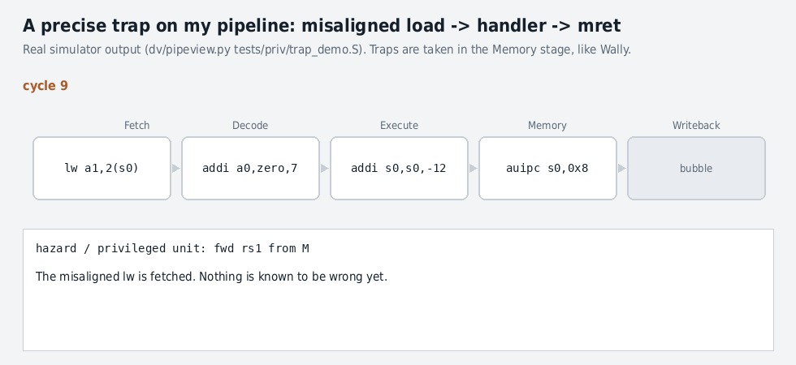

# Chapter 8 · Privileged Operations

Oct 28, 2026 · @Abhishek

## At a glance

A CPU needs a way to stop what it is doing, hand control to trusted code, and resume cleanly. That is a **trap**. Chapter 8 builds it from three pieces: **privilege modes** (who may do what), **CSRs** (the registers that hold the machine's control state), and **trap hardware** (the few register moves that happen in one cycle when something goes wrong or an interrupt arrives).

&#91;embedded content: Trap entry and return in M-mode (after book §8.2; S-mode path mirrors it with s-prefixed CSRs)\]

The whole chapter fits in that loop. Hardware does very little: it saves the PC and the reason, turns interrupts off, raises the mode, and jumps. Software does the rest. `mret` reverses exactly what entry did.

| Idea | One-line version | Why an interviewer cares |
| --- | --- | --- |
| Modes | M (firmware) > S (OS) > U (apps); a mode can touch only its own CSRs and lower ones | Most privilege bugs are a missing permission check |
| Precise trap | Every older instruction finished, the trapping one and every younger one had no effect | It is the property your lock-step compare proves |
| Exception vs interrupt | Exception: caused by *this* instruction (mepc = its PC). Interrupt: arrives between instructions (mepc = next one to run) | mepc off by 4 is the classic bug |
| CSR address | Bits \[11:10\] = 11 → read-only; bits \[9:8\] → lowest mode allowed | Write to read-only CSR = illegal instruction |
| mcause | MSB = 1 for interrupt; low bits = code; fixed priority when several fire | Priority and the MSB are frequent test holes |
| Global enable | M-mode interrupts are taken if MIE=1 **or** the hart is in a lower mode | Lower-mode code can never mask M interrupts |
| Delegation | medeleg/mideleg send a trap to S-mode instead of M | The decision diamond in the diagram |
| Wally | Traps are taken in the Memory stage, flush D/E/M/W; mret and CSR writes flush and refetch | Where timing bugs live |

## 8.1 Principles: protection, traps and CSRs

A privileged unit has two jobs. It **protects** the machine from buggy or malicious programs, and it **handles traps**: unusual events that must interrupt normal execution. Privileged instructions and CSRs (control and status registers) are the interface to both.

### Security vs protection

**Security** is the general problem of keeping unauthorized agents out and limiting the damage when they get in. Attacks target confidentiality (steal data), integrity (tamper with data) or availability (deny service). **Protection** is the specific hardware and software mechanism that stops one program from touching another's resources.

The first protection step is **privilege modes**. Applications run in user mode (U) and can only touch what the OS grants them. The OS kernel runs in supervisor mode (S) and checks every request. The attack surface shrinks from every program on the machine to the kernel. History shows the cost of skipping this: the 80286 had protection hardware in 1982, but mainstream Windows did not use it properly until Windows 2000, and Windows 95 was famously crash-prone because one bad program could take down the system.

### Traps: exceptions and interrupts

|  | Exception | Interrupt |
| --- | --- | --- |
| Caused by | the instruction itself | an external event (timer, peripheral, another hart) |
| Examples | illegal instruction, misaligned access, page fault, ecall, ebreak | timer tick, UART data ready, inter-processor message |
| Synchronous? | yes, it always happens on that instruction | no, it arrives between instructions |
| xepc points to | the faulting instruction | the first instruction not yet executed |

### Precise vs imprecise traps

A trap is **precise** when every older instruction has completed and no younger instruction has changed architectural state. The book's example of an imprecise machine: a 20-cycle `div t1,t2,t3` followed by a 1-cycle `add s0,s0,s1` that is allowed to retire first. If an interrupt arrives after the add but before the div:

- Return to the div: the add runs **twice** and s0 is wrong.
- Return after the add: the div **never** runs and t1 is wrong.

Neither return address is correct, so the program cannot resume. **RISC-V only has precise traps.** In-order cores get this by changing state only at the end of the pipeline (Writeback). Out-of-order cores use a reorder buffer to commit in program order.

**DV angle.** "Precise" is a property you can check mechanically. At every trap, the reference model and the DUT must agree on mepc, on every register, and on memory. Lock-step comparison does exactly that. A missing flush or a store that slips out of a trapping instruction is a precise-trap bug.

### CSRs

CSRs configure the processor and report on it. They control traps (enables, saved PC, cause), switch optional features on and off, and hold performance counters.

## 8.2 RISC-V practice: modes, instructions, CSRs, traps

### 8.2.1 Three privilege modes

| Code | Mode | Who runs there | Typical system |
| --- | --- | --- | --- |
| 11 | Machine (M) | firmware, SBI (supervisor binary interface) | every core boots here; bare-metal MCUs use only M |
| 01 | Supervisor (S) | OS kernel (Linux), virtual memory | application processors |
| 00 | User (U) | applications | secure MCUs (M + U), Linux systems (M + S + U) |

The base ISA has only M-mode and no CSRs. **Zicsr** adds CSRs, and the S and U extensions add the other modes. The current mode is held in hardware but is not directly readable. It changes only by trapping up or by `mret`/`sret` back down.

### 8.2.2 Privileged instructions

| Instruction | Effect |
| --- | --- |
| `csrrw rd, csr, rs1` | rd ← csr; csr ← rs1 |
| `csrrs rd, csr, rs1` | rd ← csr; csr ← csr \| rs1 (**no write if rs1 = x0**) |
| `csrrc rd, csr, rs1` | rd ← csr; csr ← csr & \~rs1 (no write if rs1 = x0) |
| `csrrwi/csrrsi/csrrci` | same, with a 5-bit zero-extended immediate instead of rs1 |
| `ecall` | exception: call the next more privileged level (U→S is the ABI, S→M is the SBI) |
| `ebreak` | breakpoint exception: debuggers patch it over an instruction |
| `mret` / `sret` | return: PC ← mepc/sepc, mode ← MPP/SPP, MIE ← MPIE (SIE ← SPIE) |
| `wfi` | wait for interrupt: sleep until something is pending (may legally be a nop) |
| `sfence.vma` | flush TLB entries (Chapter 11) |

Pseudo-instructions you will see everywhere: `csrr rd, csr` = `csrrs rd, csr, x0` (read only), `csrw csr, rs` = `csrrw x0, csr, rs`, and `csrs`/`csrc` for setting or clearing bits.

**The "no write when rs1 = x0" rule matters.** It makes `csrr` legal on read-only CSRs, and it avoids side effects on registers where a write does something. Writing a read-only CSR, or touching an unimplemented one, raises **illegal instruction**.

After `mret`: MPP is set to the least privileged supported mode, MPIE to 1, and MPRV is cleared if returning below M. `mret` from S or U mode is illegal. `wfi` resumes when any interrupt is **pending**, even with interrupts globally disabled: software can disable interrupts, `wfi`, and then poll without the cost of a trap.

### 8.2.3 CSRs: address encodes access rights

There are up to 4,096 CSRs, addressed by a 12-bit field. **The address itself encodes who may touch the CSR:**

| Address bits | Meaning |
| --- | --- |
| \[11:10\] | 00, 01, 10 = read/write; **11 = read-only** |
| \[9:8\] | lowest privilege that may access it: 00 U, 01 S, 11 M |

So 0x300 (mstatus) is an M-mode read/write CSR and 0xF14 (mhartid) is M-mode read-only. 0xC00 (cycle) is readable from U-mode but read-only. A decoder can check access with two comparisons, without a table.

**mstatus**, the most complex CSR:

| Field | Bits (RV32) | Purpose |
| --- | --- | --- |
| MIE / SIE | 3 / 1 | global interrupt enable for M / S |
| MPIE / SPIE | 7 / 5 | the previous enable, saved by a trap and restored by xret |
| MPP / SPP | 12:11 / 8 | the previous privilege mode, so xret knows where to go |
| FS, VS, XS, SD | 14:13, 10:9, 16:15, 31 | FP/vector/extension state: Off, Initial, Clean, Dirty. Lets the OS skip saving unused register files |
| MPRV, MXR, SUM | 17, 19, 18 | memory-access privilege tweaks (Chapter 11) |
| TVM, TW, TSR | 20, 21, 22 | trap satp/sfence.vma, wfi and sret: hooks for hypervisors |
| MBE, SBE, UBE | mstatush 5, 4; mstatus 6 | data endianness per mode |

Other CSR families:

- **misa** lists extensions as letters (I = bit 8, M, A, F, D, C, ...) with XLEN in the top two bits. Wally treats it as read-only.
- **mvendorid, marchid, mimpid, mhartid** identify the hart. Wally is vendor 0x602 (OpenHW), arch ID 36, mimpid 0x100.
- **Counters**: mcycle, minstret and mhpmcounter3–31 (64-bit; RV32 adds an `h` half). U-mode read-only views are cycle, time and instret. mcounteren/scounteren gate lower-mode access, because counters enable **timing side-channel attacks**. `time` comes from the platform timer (CLINT), not a CSR register. A 64-bit counter at 1 GHz wraps in 585 years.
- **menvcfg / senvcfg** gate features in lower modes (Sstc timer compare, Svpbmt, Svadu, cache-block operations), so an older OS cannot be attacked through a feature it does not know about.

Field legality uses spec jargon you should be able to define: **WPRI** (writes preserve, reads ignore: reserved fields), **WLRL** (software must write legal values only), **WARL** (write any value, read back a legal one: hardware coerces). Wally's mtvec is WARL: an illegal mode is coerced.

### 8.2.4 Reset

The core starts in M-mode at the reset vector (Wally: 0x80000000). mcause holds the reset cause or 0, mstatus.MIE = 0, MPRV = 0, and all PMP entries are off. **Everything else is undefined**, so firmware must initialize it. A testbench that relies on X-free CSRs after reset is relying on implementation luck.

### 8.2.5 Traps step by step (into M-mode)

1. MPP ← current mode; MPIE ← MIE; **MIE ← 0** (no nested interrupt yet); mode ← M.
2. **mepc ← PC** of the faulting instruction (exception) or of the next unexecuted instruction (interrupt).
3. **mcause** ← {interrupt bit in the MSB, code}.
4. **mtval** ← extra information (bad address, faulting instruction bits, or 0).
5. PC ← **mtvec** (plus 4 × cause for vectored interrupts).
6. The handler runs, then `mret` reverses steps 1 and 2.

For an `ecall`, the handler must advance mepc by 4 itself, or the program will loop on the ecall forever.

### Cause codes and priority (Table 8.4)

| Priority | Trap | mcause | mtval |
| --- | --- | --- | --- |
| 1 | M external / software / timer interrupt | 0x8000000B / 3 / 7 | 0 |
| 2 | S external / software / timer interrupt | 0x80000009 / 1 / 5 | 0 |
| 3 | Instruction page fault | 12 | PC |
| 4 | Instruction access fault | 1 | PC |
| 5 | Illegal instruction | 2 | the instruction bits |
| 6 | Instruction address misaligned | 0 | target address |
| 7 | Breakpoint | 3 | PC |
| 8 | ecall from U / S / M | 8 / 9 / 11 | 0 |
| 9 | Store/AMO, then load address misaligned | 6 / 4 | address |
| 10 | Store/AMO, then load page fault | 15 / 13 | address |
| 11 | Store/AMO, then load access fault | 7 / 5 | address |

With Zicclsm (hardware misaligned access in cacheable memory), misaligned faults drop to the lowest priority. **Priority is checkable:** construct an instruction that is both a page fault and misaligned, and the cause must be the higher one. These are classic directed-test targets.

**Horizontal vs vertical traps.** A trap handled in the same mode is horizontal; a trap to a higher mode is vertical. **Traps never go to a lower mode**, so an exception in M is always handled in M, even if it is delegated.

### Delegation

Linux handles most traps in S-mode. Bouncing every trap through M-mode firmware would be slow, so **medeleg** (exceptions, one bit per cause) and **mideleg** (interrupts) let hardware send traps straight to the S handler, using the S-mode CSRs (sepc, scause, stval, stvec, and sret). Linux typically delegates page faults, U-mode ecalls and breakpoints, and sets mideleg = 0x222 for supervisor software, timer and external interrupts. S-mode sees `sip = mip & mideleg`.

### Interrupts

Six interrupt sources: software, timer and external, each at M and S level. Each has a pending bit in **mip** and an enable bit in **mie** (bits 3/7/11 for M, 1/5/9 for S). Sources:

- **External** (MEIP/SEIP): peripherals through the **PLIC** (platform-level interrupt controller), which arbitrates and drives the core's external interrupt pins.
- **Software** (MSIP): another hart writes a memory-mapped bit in the **CLINT** (core-local interruptor). That is how inter-processor interrupts work.
- **Timer** (MTIP): CLINT asserts when mtime ≥ mtimecmp. The handler clears it by writing a later mtimecmp. With **Sstc**, stimecmp raises supervisor timer interrupts directly, without the M-mode bounce.

**When is an interrupt taken?** It must be pending in mip, enabled in mie, and **globally enabled**:

| Interrupt | Taken when current mode is |
| --- | --- |
| Not delegated (to M) | U or S always; M only if mstatus.MIE = 1 |
| Delegated (to S) | U always; S only if mstatus.SIE = 1; never while in M |

Among several, the priority is M before S, then external > software > timer. **Vectored mode** (mtvec\[1:0\] = 01) sends interrupts to base + 4 × cause, while exceptions still go to base. With base 64-byte aligned, the add is just a concatenation.

### 8.2.6 A trap handler (book Code Example 8.1)

The book's example sets mtvec, clears both delegation registers, enables the machine timer (`mie` = 0x80) and sets mstatus.MIE. It drops to U-mode with an ecall, takes timer interrupts in a loop, and exits with another ecall. The handler:

1. Swaps `tp` with **mscratch** to get a trap stack pointer (`csrrw tp, mscratch, tp`), then saves the registers it uses.
2. Reads mcause and mtval. **MSB set means interrupt**, so `bgez` branches to the exception path.
3. Interrupt: re-arms mtimecmp. Exception: `mepc += 4`, then checks for an ecall (cause & 0xFC == 8 catches 8, 9 and 11) and acts on a0.
4. To change mode, it rewrites mstatus.MPP: `csrc mstatus, 0x1800`, then `csrs mstatus, a0 << 11`. `mret` then "returns" into the new mode.
5. Restores registers, swaps tp back, and runs `mret`.

The book notes the ecall-to-change-mode trick is great for tests and dangerous in a real system.

## 8.4 Wally's privileged unit

**Wally does all privileged work in the Memory stage and changes all architectural state on the clock edge into Writeback.** Load and store faults are not known until M anyway. Taking every trap at the same late point keeps traps precise with almost no special cases.

### Blocks (`src/privileged/`)

| Module | Job |
| --- | --- |
| `privdec.sv` | decodes SYSTEM instructions (op 1110011) in M: ecall, ebreak, mret, sret, wfi, sfence.vma; raises illegal-instruction, including wfi timeout |
| `csr.sv` + `csrsr` (status), `csri` (mip/mie), `csrc` (counters), `csrm`, `csrs`, `csru` | each submodule holds its registers, address decode, write enables and read mux. If no submodule claims the address, the access is illegal |
| `trap.sv` | combines exceptions and interrupts and outputs `TrapM`, `CauseM` (priority encoder), `DelegateM` |
| `privmode.sv` | the 2-bit current privilege mode (`PrivilegeModeW`) |
| `privpiperegs.sv` | carries faults detected in D and E down to M so they are handled there |

Privileged support is enabled by `ZICSR_SUPPORTED`. With it set to 0, everything is tied off and synthesizes away. Further switches include `S_SUPPORTED`, `ZICNTR_SUPPORTED`, `VECTORED_INTERRUPTS_SUPPORTED`, `BIGENDIAN_SUPPORTED`, `WFI_TIMEOUT_BIT` (default 16, so wfi times out after 2^16 cycles when TW is set), `VIRTMEM_SUPPORTED` and `PMP_ENTRIES`.

### Inside `trap.sv` (read the real code)

```systemverilog
assign MIntGlobalEnM = (PrivilegeModeW != M_MODE) | STATUS_MIE;
assign SIntGlobalEnM = (PrivilegeModeW == U_MODE) | ((PrivilegeModeW == S_MODE) & STATUS_SIE);
assign PendingIntsM  = MIP_REGW & MIE_REGW;
assign EnabledIntsM  = (MIntGlobalEnM ? PendingIntsM & ~MIDELEG_REGW : '0)
                     | (SIntGlobalEnM ? PendingIntsM &  MIDELEG_REGW : '0);
assign ValidIntsM    = (Committed | WaitedM) ? '0 : EnabledIntsM;
assign InterruptM    = (|ValidIntsM) & InstrValidM;
assign TrapM         = (ExceptionM & ~CommittedF) | InterruptM;
```

Three details interviewers like:

- **`InstrValidM`:** an interrupt is taken only when M holds a real instruction, so mepc is a real PC. A bubble has no PC to return to.
- **`Committed`:** if the LSU or IFU has started a bus transaction that cannot be abandoned (for example a cache-line write in progress), interrupts wait. Exceptions on the instruction itself still trap.
- **The cause priority encoder** lists undelegated S interrupts before delegated ones, then exceptions in spec order. ecall's cause is `{3'b010, PrivilegeModeW}`, which gives 8, 9 or 11 for free.

Wally's performance counters (Table 8.10) are a debugging gift: cycles, instret, branches, mispredictions, load stalls, cache misses, CSR writes, interrupts taken and exceptions taken. `testbench.sv` prints them with `PrintHPMCounters`.

### 8.4.5 Pipeline hazards added by the privileged unit

| Event (in M) | What the hazard unit does | Why |
| --- | --- | --- |
| **TrapM** | flush D, E, M **and W**; PC ← trap vector | the faulting instruction must not write anything |
| **RetM** (mret/sret) | flush D, E, M; PC ← xepc | mode and PC change at the M→W edge; younger instructions were fetched under the old state |
| **CSRWriteM** (`CSRWriteFenceM`) | flush D, E, M; PC ← PCE (the next instruction) | younger instructions may depend on the new CSR (satp, frm, mstatus.FS, MPRV...) |
| fence.i, sfence.vma | same flush and refetch | instruction memory or translations may have changed |
| **CSR read** | `CSRRdStallD`: stall D if the next instruction uses the result | CSRs are read in M, two cycles from issue to use, like a load |
| **wfi** | `WFIStallM` holds wfi in M until an interrupt is pending or it times out | the timeout raises illegal-instruction (hypervisor support) |

The PC mux grows two levels (book Fig. 8.17). PC1NextF is the branch/jump target or PC+4. PC2NextF selects PCE when a CSR write or fence refetches. The final level selects the **trap vector** (mtvec or stvec, plus cause × 4 if vectored) or **xepc** for xret. The LSB is always forced to 0.

### Watch it on my pipeline

I added the same mechanism to my Lab 3 core (details in the Lab section). This is the real simulator output for a misaligned `lw`, the handler, and `mret`:



The cycle-by-cycle key points:

| Cycle | F | D | E | M | W | Event |
| --- | --- | --- | --- | --- | --- | --- |
| 12 | addi t6 | addi a3 | addi a2 | **lw a1,2(s0)** | addi a0 | **TRAP in M**, cause 4: flush M, E, D; W gets a bubble |
| 13 | csrr t1,mepc | bubble | bubble | bubble | bubble | PC = mtvec |
| 15 | csrw mepc | addi t1 | **csrr t1** | bubble | bubble | **stall** (CSR read-use) |
| 19 | (past end) | (past end) | mret | **csrw mepc** | addi t1 | **CSR write**: refetch, flush |
| 23 | (past end) | (past end) | (past end) | **mret** | bubble | **mret**: PC ← mepc |
| 24 | addi a2 | bubble | bubble | bubble | mret | resume after the faulting load |

The "(past end)" entries are fetches beyond the handler's last instruction. They are harmless because they are always flushed before they reach M.

### 8.4.6 Endianness

Wally is little-endian inside. With `BIGENDIAN_SUPPORTED`, and MBE/SBE/UBE set for the current mode, an **endian swapper** reverses the bytes of loads and stores, and subword reads invert their address. Instructions are always little-endian so disassembly is unambiguous. The book's example stores `0xFEDCBA98_76543210` at address 1000:

| Load | Little-endian | Big-endian |
| --- | --- | --- |
| `ld x2, 1000` | FEDCBA98\_76543210 | FEDCBA98\_76543210 |
| `lwu x3, 1000` | 00000000\_76543210 | 00000000\_FEDCBA98 |
| `lwu x4, 1004` | 00000000\_FEDCBA98 | 00000000\_76543210 |
| `lbu x5, 1001` | 0x32 | 0xDC |

A full-width load reads back the same value in either mode. Subword loads expose the byte order. The swapper adds a mux delay to the M-stage memory path.

## 8.3 Test plan: how privileged features are verified

**The book is candid: the privileged unit had a high number of difficult bugs.** It names three reasons: a complex specification with many easily overlooked corner cases, exceptions and CSR accesses disturbing the pipeline, and interaction with peripherals that were themselves lightly tested. The reference model at the time (Spike) lacked the peripherals to generate some interrupts. Tests therefore could not always be checked against a reference, so the same misreading of the spec could end up in both the test and the RTL.

### Where the tests live

riscv-arch-test (2025) covers only a small privileged set: misaligned loads, stores, branches and jumps, plus ecall and ebreak. Wally adds its own in `tests/wally-riscv-arch-test/riscv-test-suite/rv{32,64}i_m/privilege`, built on `WALLY-TEST-LIB-32/64.h`. That library provides a generic trap handler that logs a signature per trap (mcause, optionally mtval and mstatus bits) and macros such as `GOTO_U_MODE` and `GOTO_S_MODE`.

| Area | Tests |
| --- | --- |
| ecall, ebreak, mret | WALLY-trap-01 |
| sret, S-mode CSRs (stvec, sscratch, sepc, scause, stval) | WALLY-trap-s-01, WALLY-trap-u-01 |
| wfi | WALLY-wfi-01, WALLY-status-tw-01 |
| mtvec / stvec | WALLY-mtvec-01, WALLY-stvec-01 |
| mie / sie | WALLY-mie-01, WALLY-sie-01 |
| medeleg / mideleg | WALLY-trap-s-01, WALLY-trap-u-01 |
| Machine info registers | WALLY-minfo-01 |
| misa | WALLY-misa-01 |
| mstatus fields | MPP, MPIE: trap-01; SPP, SPIE: trap-s-01; TW: status-tw-01; TSR: trap-sret-01; SXL/UXL: status-xlen-01; MBE/SBE/UBE: endianness-01; FS/SD: status-fp-enabled-01; MPRV/MXR/SUM/TVM: MMU tests |
| PMP | WALLY-pmp-01 (Chapter 11) |
| **Not tested** (per the book) | performance counters, sip and mip directly, sfence.vma explicitly |

### How tests provoke each trap (Table 8.8)

| Exception | Trigger |
| --- | --- |
| Illegal instruction | `.word 0` (0x00000000 is always illegal) |
| Breakpoint | `ebreak` |
| Instruction access fault | `jr zero` (jump to unimplemented address 0) |
| Load / store access fault | `lw t1, 0(zero)` / `sw t4, 0(zero)` |
| Load / store misaligned | a misaligned access to a **peripheral**, e.g. `lw t4, 0(0x2000001)`. Cacheable RAM handles misalignment in hardware with Zicclsm, so it would not trap |
| ecall from U / S / M | `GOTO_U_MODE` / `GOTO_S_MODE` / `GOTO_M_MODE`, then `ecall` |
| Instruction misaligned | not testable on Wally: with C enabled, every 2-byte aligned target is legal |
| Page faults | MMU tests, Chapter 11 |

| Interrupt | Trigger (Table 8.9) |
| --- | --- |
| S software | `csrs sip, 2` (SSIP is software-writable) |
| M software | write 1 to the CLINT MSIP register at 0x02000000 |
| S timer | `csrs mip, 0x20` (STIP), or stimecmp with Sstc |
| M timer | mtimecmp (0x02004000) = mtime (0x0200BFF8) + offset, then wait. In RV32, handle the carry into the high word |
| M / S external | configure the PLIC (thresholds at 0x0C200000/0x0C201000, priority, enable), enable a GPIO input interrupt, then drive the pin in loopback |

**Interview point.** Interrupts are the hardest to verify with a reference model, because the model does not know when a pin rises. Lock-step solves this the RVVI way: the DUT reports "interrupt taken before instruction N", and the model checks that it was legal (pending, enabled, highest priority) and then follows. Interrupt tests are not run against Sail in the book, so they are exactly the ones most likely to share a spec misreading with the RTL.

## Lab 5: a machine-mode privileged unit for my core

I added Wally's privileged mechanism, cut down to M-mode, to the Lab 3 pipeline. I extended the ISS to match and verified both in lock-step. **The core now runs ecall, ebreak, mret, all six Zicsr forms, five exception types and three interrupt sources. All 56 regression tests match the reference model instruction by instruction, including every CSR write and every trap.**

### What I built

| Piece | File | Wally counterpart |
| --- | --- | --- |
| SYSTEM decode (ecall, ebreak, mret, wfi, csr\*; reserved encodings illegal) | `rtl/pipe/priv.sv: privdec` | `privdec.sv` |
| CSRs: mstatus (MIE, MPIE, MPP = 11), misa, mie, mip, mtvec (direct or vectored), mscratch, mepc, mcause, mtval, mcycle/minstret (+h), cycle/time/instret views, ID registers | `priv.sv: priv` | `csr*.sv` |
| Exceptions: instruction misaligned (no C), illegal (incl. bad CSR address or write to read-only CSR), breakpoint, ecall, load/store misaligned | `priv.sv` | `trap.sv` + sources |
| Interrupts: MTI, MSI, MEI, gated by MIE and mie, only on a valid instruction in M | `priv.sv` | `trap.sv` |
| Trap flushes D, E, M, W; mret and CSR writes flush D, E, M and refetch; CSR read-use stall; trapping store blocked | `hazard.sv`, `core_pipe.sv` | `hazard.sv`, `controller.sv` |
| CLINT-like block: mtimecmp, msip and an external line, all memory-mapped | `tb/tb.sv` | `uncore/clint_apb.sv`, PLIC |
| ISS: CSRs, traps, mret; **follows the DUT for interrupt timing and for mcycle/time/mip values** | `dv/iss.py` | ImperasDV over RVVI |

The trace now has two new record types: `csr[addr]=value` on every CSR write, and a `trap pc=... cause=... tval=...` line in retirement order.

### Experiment 1: the directed tests pass in lock-step

| Test | What it covers | Result |
| --- | --- | --- |
| `tests/priv/trap_basic.S` | all six csr forms on mscratch, misa/mhartid reads, CSR read-use stall, then 8 traps: ecall, ebreak, `.word 0`, write to read-only `mvendorid`, unimplemented CSR 0x7C0, misaligned `lw` and `sh`, `jalr` to a non-word target. The handler logs (mcause, mtval, mepc) and checks them; after mret, mstatus must be 0x1880 | PASS, 224 trace lines match (216 instructions + 8 traps) |
| `tests/priv/interrupts.S` | vectored mtvec; 5 timer interrupts re-armed through mtimecmp; a software interrupt left pending **while MIE = 0** (must not be taken) and taken immediately after `csrsi mstatus, 8`; an external interrupt | PASS, lock-step match (599 instructions, 1,033 cycles) |

One detail worth retelling. The faulting `jalr ra, 2(t2)` must not write ra, and the test checks `ra == 0` afterwards. With a trap taken in M and W flushed, the jump never retires. That is a precise trap in miniature.

### Experiment 2: injecting privileged bugs

`dv/privhunt.py` builds the core with each bug and judges both tests two ways: the program's own self-check, and lock-step against the ISS.

| Injected bug | trap\_basic self-check | trap\_basic lock-step | interrupts self-check | interrupts lock-step |
| --- | --- | --- | --- | --- |
| (none) | pass | match | pass | match |
| `BUG_MEPC_PLUS4`: mepc saves PC+4 | **FAIL** | **mismatch** | pass | **mismatch** |
| `BUG_INT_BUBBLE`: interrupts taken on bubbles | pass | match | **FAIL** | **mismatch**: `trap pc=00000000` (a bubble has no PC) |
| `BUG_MRET_NOMIE`: mret leaves MIE = 0 | pass | match | **FAIL** (hangs) | length mismatch only |
| `BUG_CSR_NOFLUSH`: no refetch after CSR writes | pass | match | pass | match |

What the table teaches:

- **mepc + 4 passes the interrupt test's self-check.** After each timer interrupt the program resumed one instruction too far, skipping a `wfi`, a `li` or the loop branch. Later code and later interrupts happened to repair the damage, so the program still reported PASS. Lock-step flagged the first skipped instruction. In trap\_basic it diverged at the first `csrr` of mepc (ISS 0x80000074, DUT 0x80000078). **Self-checking tests only check what the author thought to check.**
- **mret-not-restoring-MIE is caught late and weakly.** My ISS follows the DUT for interrupt timing, so when the DUT simply stops taking interrupts, the ISS stops too. Only the hang and the final length differ. A stronger checker also needs the pin values, so it can say "interrupt pending and enabled, but the DUT did not take it". That is why RVVI carries interrupt pin state to the reference model, not just trap events.
- **The missing CSR-write flush is not a bug in my core.** Every CSR my core implements is consumed in M (mtvec and mepc at trap or mret time, MIE by the trap unit), so a younger instruction never uses a stale value. It only costs cycles: trap\_basic takes 372 cycles with the refetch and 338 without, about 3 cycles for each of its 12 CSR writes. Wally needs the flush because some CSRs are used earlier in the pipe: satp for fetch translation, mstatus.FS for decode, frm in the FPU, MPRV for loads and stores. **Whether a flush is required depends on where each CSR is consumed. Review it CSR by CSR.**

The Chapter 5 bug hunt still behaves the same on the extended core (6 pipeline bugs, same catch pattern). The single-cycle core is untouched and still passes.

### Experiment 3: a trap through the pipeline, cycle by cycle

`python3 dv/pipeview.py tests/priv/trap_demo.S 34` produced the animation and table in section 8.4. The viewer now prints TRAP, MRET, CSR-write refetch and CSR-read stalls.

## Recap

- **Privilege is a hardware promise.** M-mode can do anything; S and U are fenced in by CSR permission checks and later by PMP and the MMU. Every fence is a place to test the illegal side, not only the legal side.
- **A trap is a precise, atomic state swap.** Hardware writes mepc, mcause, mtval and the mstatus stack (MPIE ← MIE, MIE ← 0, MPP ← mode), raises the mode and jumps to mtvec. `mret` reverses it. Nothing else is automatic.
- **Exceptions and interrupts differ only in timing and mepc meaning.** Exceptions belong to an instruction; interrupts arrive between instructions and must be sampled at a clean retire boundary.
- **The CSR address is the permission table.** \[11:10\] = 11 is read-only, \[9:8\] is the minimum mode. WARL fields must read back legal values whatever is written.
- **In Wally, traps are resolved in Memory.** The trapping instruction and everything younger are flushed; mret and CSR writes flush and refetch because they can change how younger instructions behave.
- **Verification needs the reference model to follow the DUT** for things it cannot predict: interrupt arrival, mcycle/time, mip. Lock-step catches what self-checking tests miss (Lab 5: mepc + 4 passed self-check, failed lock-step).

## Interview drill

**1. Walk me through what hardware does on an exception.** Precisely: squash the faulting instruction and everything younger, keep everything older. Then mepc ← faulting PC, mcause ← code (MSB 0), mtval ← address or instruction bits or 0, MPIE ← MIE, MIE ← 0, MPP ← current mode, mode ← M (or S if delegated), PC ← mtvec base. Interrupts are the same with mcause MSB 1, mepc = next unexecuted instruction, and a vectored offset of 4 × cause.

**2. Why is mepc not PC + 4 for ecall?** Hardware treats every exception the same so that faults can be retried (a page fault re-executes the load). Only software knows ecall should be skipped, so the handler adds 4. A designer who "helpfully" adds 4 in hardware breaks page-fault retry.

**3. A U-mode program has MIE = 0. Can a machine timer interrupt still fire?** Yes. MIE gates M-level interrupts only while the hart is in M. From U or S they are always globally enabled; lower privilege cannot mask higher-privilege interrupts. The equivalent rule holds for S interrupts and SIE. M-mode can never be interrupted by an S-level interrupt.

**4. How would you verify interrupt priority?** Raise several pending-and-enabled sources in the same cycle (MEI, MSI, MTI, SEI, SSI, STI), in every mode, with every mideleg combination. Check mcause and the vector target against the priority rule. Cover point: cross of {pending set} × {mode} × {mideleg} × {MIE, SIE}. Directed tests rarely hit the simultaneous case; force it with a CLINT/PLIC driver that asserts lines together.

**5. Two exceptions on one instruction. Which wins?** The spec's fixed synchronous-exception priority: instruction-side faults (breakpoint, instruction page or access fault, misaligned fetch) first, then illegal / ecall / ebreak, then load/store misaligned and faults. Test it by building instructions that trip two causes at once and checking mcause.

**6. What is WARL and how do you test it?** Write Any, Read Legal: software may write any value, and the field must read back a legal one (e.g. mtvec.MODE = 3 must read back a supported mode). Test: write all-ones, zeros, walking ones, and every reserved encoding; compare the read-back against the reference model's legalisation, not against the written value.

**7. Why flush after a CSR write?** A CSR can change how already-fetched younger instructions must execute: mstatus.MPRV, satp, PMP, FP enable. Flushing and refetching is the simplest way to make the new state apply to the next instruction. My Lab 5 core showed the bug-injection limit: removing the flush was invisible because all CSR effects are consumed in Memory. That is a reason to say "this test cannot see it", not "it is safe".

**8. Your lock-step compare fails right after an interrupt. Debug it.** First ask whether the reference model took the interrupt at the same instruction. ISSes cannot predict asynchronous timing, so the testbench must tell the ISS "interrupt taken at this retire, cause X" (RVVI style) and then check it was legal: pending, enabled, globally enabled, highest priority. Also exempt mcycle, time and mip from compare or copy them from the DUT.

**9. What is the difference between mstatus and mstatush, and why does RV32 need it?** RV32 has 32-bit CSRs, so fields beyond bit 31 of the RV64 mstatus (MBE, SBE) live in mstatush. The same split applies to mcycleh/minstreth. Classic test: read a 64-bit counter while the low half wraps; software must read hi, lo, hi and retry if hi changed.

**10. What did you learn from injecting privilege bugs?** Self-checking tests check what the author expected. mepc + 4 passed the interrupt test's self-check because the handler did not check where it resumed; lock-step caught it. Forgetting MIE ← MPIE on mret just hung the test, which a timeout catches but does not explain. Weak detection points to the checker that is missing.

## Companion

Open the **[Trap and CSR Lab](https://claude.ai/artifact/WG1xoji79wjidH45PnhcUN)**. Raise ecall, illegal, misaligned and timer events and watch mepc, mcause and mstatus move. Decode CSR permissions from the address, and work out which interrupt is taken across modes and delegation. The page ends with an 8-question self-check.

## Book coverage check (Ch 8 audit)

This tab has been checked against all 22 sections of Chapter 8 (8.1–8.5), Tables 8.1–8.12 and every code listing. The tab above already explains how a trap works. What follows is everything else the book specifies that the tab did not have yet. Chapter 8 produces more senior-level CPU DV questions than any other chapter, so the extra detail is worth having.

### mstatus fields the tab skipped

- **FS, VS and XS: the four-state dirty protocol** (Table 8.2). The encodings are 00 Off, 01 Initial, 10 Clean and 11 Dirty.
  - When FS = Off, *any* instruction that touches FP state raises **illegal instruction**. Reset normally leaves FS = 00.
  - Bare-metal FP code must first set FS: `lui t0, 2; csrs mstatus, t0` sets bit 13, which gives FS = 01. Forgetting this step is the classic "why does my first fadd trap" bug.
  - Hardware sets FS = 11 whenever an instruction writes an f register or fcsr. After the OS saves the FP state it writes FS = 10 (Clean). It then saves again only if the state becomes dirty again.
  - SD is the read-only OR of the three "is it 11?" checks: SD = (FS==11) | (VS==11) | (XS==11).
  - **Coverpoints:** every FS state × {FP load, FP op, fcsr write, fmv}. Also check that an FP instruction in the Off state traps *and* leaves FS unchanged.
- **UXL / SXL** (Table 8.3, RV64 only). These fields set the effective XLEN in U and S mode: 01 = 32, 10 = 64, 11 = 128. Wally hardwires both to misa.MXL, so an RV64 Wally cannot run RV32 code. RV64 cores always support 64-bit U-mode (the Ssu64xl extension).
- **TW** (timeout wait). In U or S mode with TW = 1, a wfi that does not complete within a bounded time raises illegal instruction. This lets a hypervisor switch to another guest instead of idling.
  - Wally's privdec counts with WFICounter. When bit WFI\_TIMEOUT\_BIT (default 16) is set, it raises WFITimeoutM.
  - Without S-mode, the timeout applies only in U-mode.
- **TVM and TSR**. With TVM = 1, accessing satp or executing sfence.vma in S-mode is illegal. With TSR = 1, sret in S-mode is illegal. Both are hypervisor hooks.

### Counters, envcfg and identification

- **The counter CSR set.**
  - mcycle and minstret, plus mhpmcounter3–31 (an h half on RV32).
  - mhpmevent3–31 select the event each counter counts.
  - **mcountinhibit** stops individual counters to save energy.
  - mcounteren and scounteren gate reads from S and U mode respectively. Counters are a timing side channel.
  - `time` is a read-only view of the memory-mapped CLINT timer. There is no mtime CSR.
  - Pseudoinstructions: rdcycle, rdtime, rdinstret, and on RV32 the h versions.
- **Extension names.** Zicntr provides cycle, time and instret. Zihpm provides the platform counters. Sscounterenw means scounteren is writable, so U-mode access is possible.
- **Wally's counters** (Table 8.10; COUNTERS sets how many exist, up to 32, and the rest are hardwired to 0). They count:
  - cycles and instret;
  - loads, stores, branches and jumps;
  - branch-predictor misses: wrong instruction fetched, wrong direction, wrong target, RAS wrong address, instruction-class predictor wrong;
  - I$ and D$ accesses and miss cycles;
  - CSR writes, fences, interrupts taken and exceptions taken;
  - divide stall cycles.
  - Chapter 21's benchmarks parse these values from the log.
- **menvcfg/senvcfg bits** (Fig. 8.5). menvcfg is always 64 bits, with menvcfgh on RV32.
  - **STCE** enables stimecmp in S-mode. With STCE = 0, S-mode access to stimecmp is illegal and STIP behaves as if Sstc were absent.
  - **PBMTE** enables Svpbmt.
  - **ADUE** enables hardware A/D updates. With ADUE = 0, a page that needs A or D set raises a page fault instead.
  - **CBZE / CBCFE / CBIE** enable cbo.zero, cbo.clean/flush and cbo.inval.
  - **FIOM** makes I/O fences below M-mode also order main memory.
  - The S-only bits (STCE, PBMTE, ADUE) exist only in menvcfg. U-mode needs the feature enabled in *both* menvcfg and senvcfg.
  - The book's motivation: firmware that does not save stimecmp would let S-mode processes pass information to each other through it (a covert channel), and a U-mode cbo.inval on a dirty line could corrupt memory.
- **mseccfg** (for Zkr and Smepmp) is hardwired to 0 in Wally.
- **Identification.** JEDEC assigns mvendorid values for a fee; RISC-V International assigns marchid on request. Wally reports mvendorid 0x602, marchid 36, mimpid 0x100, mhartid 0 and **mconfigptr 0**.
  - misa is read-only in Wally, so extensions cannot be switched off at run time.
  - Linux discovers Z-extensions by trying them during boot and catching the illegal-instruction traps.

### Interrupt details

- **Which mip bits are writable.**
  - From M-mode, SEIP, SSIP and STIP are writable. That is how M-mode firmware forwards interrupts to S-mode.
  - In sip, **only SSIP is writable** (to clear it). The other sip bits are driven by external agents.
  - Only 6 bits of mip and mie are not hardwired to 0, and synthesis removes the rest.
- **Wally only lets S-level interrupts be delegated.** Without S-mode, S interrupts are not normally produced; if one occurs, the M-mode handler takes it.
- **IntPendingM ends a wfi even when the interrupt is not enabled**: wfi waits for *pending*, not for *taken*. When the interrupt arrives, WFIInterruptedM keeps the wfi from being flushed, so it commits; the trap then flushes everything younger.
- **Vectoring details.**
  - Direct mode is 00 and vectored mode is 01. **Sstvecd** means direct mode is supported, which RVA20S64 and later profiles expect; Wally always supports it.
  - Each vector slot holds a single instruction, normally a jump to the real handler.
  - Exceptions are never vectored because they are less latency-sensitive than a timer interrupt.
  - Trap handlers must be 4-byte aligned. The PC LSB is always forced to 0.
- **AIA** (Smaia/Ssaia, ratified June 2023) replaces the PLIC with a more general controller. It supports message-signalled interrupts (PCIe MSI) and lowers interrupt overhead under hypervisors. Mention it if an interviewer asks how RISC-V scales to server-class cores.
- **Exception details.**
  - medeleg has one bit per exception cause; the unused cause bits (10, 14) are 0.
  - Access-fault examples from the book: reading nonexistent memory, writing ROM, a word access to a byte-only peripheral, and an access to a protected region.
  - A misaligned-access handler can emulate the access with two aligned accesses plus shift and merge.
  - With C enabled, instruction-address-misaligned can never happen, because jalr clears bit 0 and all offsets are even.

### Wally implementation details

- The **csr** module, not trap.sv, computes the next mtval and the trap PC, because both depend on xtvec and xepc (the book's reason is locality). The csr module also sends PMP and satp to the LSU, sends frm to the FPU, and receives SetFFlagsM back.
- **privpiperegs** delays faults detected in D and E so that all of them are handled in M.
- **Fences**: fence.i (with Zifencei) and sfence.vma (with VIRTMEM\_SUPPORTED) assert the same `CSRWriteFenceM` flush-and-refetch. The simplest implementations are:
  - fence.i: flush the D$ and invalidate the I$;
  - sfence.vma: invalidate the whole TLB.
  - fence.i is a no-op on a cacheless system.
- **PC logic** (Fig. 8.17), as a chain of muxes:
  1. PC1NextF = PC+4 or the branch target.
  2. PC2NextF = PC1NextF or PCE (refetch after a CSR write or fence).
  3. Then TrapVectorM (mtvec or stvec, plus `{CauseM,00}` when vectored, which is why the base is 64-byte aligned) or EPCM (xret).
  4. Finally RESET\_VECTOR.

### The exact test recipes (Table 8.9, Fig. 8.11)

- **M timer, safe on RV32**: read mtime low and high (0x0200BFF8 and 0x0200BFFC). Add the offset to the low word, and if it wrapped (`bgtu new, old, nowrap`), increment the high word. Store mtimecmp **high first, then low** (0x02004004, then 0x02004000). Spin on a bounded loop so a missing interrupt fails instead of hanging.
- **M external through the PLIC and GPIO loopback**:
  1. M threshold = 0 (0x0C200000), S threshold = 7 (0x0C201000).
  2. Priority of source 3 (GPIO) = 1 (0x0C00000C). Enable source 3 for M (0x0C002000 = 0b1000).
  3. GPIO: output\_en (0x08) = input\_en (0x04) = 1. Clear rise\_ip, fall\_ip, high\_ip and low\_ip (0x1C, 0x24, 0x2C, 0x34). Set high\_en = 1 (0x28).
  4. Write output\_val (0x0C) = 1, which drives the pin and raises the interrupt.
- **S external**: same as M external with the thresholds swapped (S = 0, M = 7), and enable source 3 in the S context at **0x0C002080**.
- **S software**: `csrs sip, 2`. **S timer**: `csrs mip, 0x20`, or with Sstc set STCE and program stimecmp.
- Interrupt tests are not run on Sail, because Sail lacks these peripherals.
- Tests for modes other than M live in `rv{32,64}i_m/privilege/<test>{u,s}-01`, until riscv-arch-test adopts `rv64i_u` and `rv64i_s` directories.
- MMU, PMA and PMP tests use a table and `run_test_loop`.
- The book is candid that these tests only check *Wally's* implementation choices, not every legal implementation, and that they cover only basic privileged functionality.

### The trap-handler example, as a template (Code Example 8.1, `examples/asm/trap`; run `make && make sim`)

- mscratch holds a dedicated **trap stack** (`topoftrapstack`). `csrrw tp, mscratch, tp` swaps it in on entry and swaps it back before mret.
- The handler logs mcause and mtval to the signature on every trap. That is how the book's privileged tests produce signatures without a reference model.
- ecall arguments: a0 = 0, 1 or 3 switches mode by rewriting MPP (`csrc mstatus, 0x1800; slli a0, a0, 11; csrs mstatus, a0`). a0 = 4 ends the test through `write_tohost`.


---

Interactive companion page for this chapter: [`companion-pages/ch08-lab.html`](../companion-pages/ch08-lab.html) (download and open in a browser).
