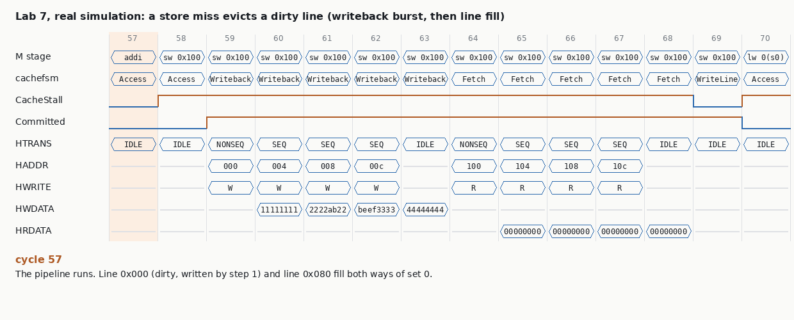

# Chapter 10 · Caches

@Abhishek

## At a glance

DRAM is big and cheap but 50–150 ns away. On-chip SRAM is fast but small and expensive. A **cache** keeps copies of recently used memory in SRAM next to the core, so most accesses see SRAM speed and DRAM cost. Chapter 10 covers how a cache finds data (tag, set, offset), what happens on a miss (victim, writeback, line fetch), how stores are handled (write-back with dirty bits), which line to throw out (LRU and tree pLRU), and how Wally builds all of this as one parameterized module shared by the I-cache and D-cache.

&#91;embedded content: The memory hierarchy (after book Fig. 10.1)\]

| Idea | One-line version | Why an interviewer cares |
| --- | --- | --- |
| Locality | Temporal: reuse soon. Spatial: neighbors soon. | It is why caches work, and the pattern that breaks them |
| AMAT | A1 + MR1 × (A2 + MR2 × (…)) | Back-of-envelope performance questions |
| 3 Cs | compulsory, capacity, conflict misses | Each has a different fix |
| Tag / set / offset | set bits index, tag compares, offset picks the word | Address-split arithmetic is asked constantly |
| Associativity | N ways per set, compared in parallel | Fewer conflict misses, more compare logic |
| Write-back + dirty | stores stay in the cache until eviction | Lost writebacks are the classic cache bug |
| pLRU | N−1 bits per set, a tree pointing at the victim | Tree update and victim walk, on a whiteboard |
| Flush / invalidate | write back dirty lines / clear valid bits | fence.i, DMA, power-down |
| Wally | Address and Data stages; cachefsm for misses; CacheStall and CacheCommitted | Corner cases: store→load, traps, interrupts during fills |

## 10.1 Principles

### Performance: miss rate, miss penalty, AMAT

- **Hit**: the data is in the cache. **Miss**: go to the next level. The **miss rate** is the fraction of accesses that miss; the **miss penalty** is the cycles a miss costs.
- On a simple in-order pipeline that stalls on misses: **memory stall cycles = instructions × (accesses / instruction) × miss rate × miss penalty** (Eq. 10.1).
- **Example 10.1.** Base CPI is 1.2, 30% of instructions are loads/stores, so there are 1.3 accesses per instruction (counting the fetch). With a 2% miss rate and a 40-cycle penalty: 1.3 × 0.02 × 40 = 1.04 extra CPI, so CPI = 2.24 (87% slower). With **no cache**, every access pays 40 cycles: CPI = 1.2 + 1.3 × 40 = 53.2, about 24× slower than with the cache.
- **AMAT** = A1 + MR1 × (A2 + MR2 × (A3 + …)). The miss penalty of level *i* is the AMAT of level *i+1*. Example 10.2: 1 + 0.05 × 15 = 1.75 cycles.
- **Example 10.3** (two levels, the one to practice). I-fetch AMAT = 0.98 × 1 + 0.02 × (3 + 0.2 × 30) = 1.16; data AMAT = 0.96 × 1 + 0.04 × (3 + 0.2 × 30) = 1.32. A load/store costs 1.16 + 1.32 − 1 = 1.48, because one cycle overlaps. With 40% loads/stores: CPI = 0.6 × 1.16 + 0.4 × 1.48 ≈ 1.29.

**The 3 Cs of misses**:

| Miss type | Cause | Fix |
| --- | --- | --- |
| Compulsory (cold) | first touch of a line | longer lines, prefetching |
| Capacity | working set bigger than the cache | bigger cache, L2/L3 |
| Conflict | too many hot lines map to one set | more associativity |

Out-of-order and multithreaded cores *hide* part of the penalty with **non-blocking caches**. Wally, like our core, simply stalls.

### Locality, lines, and the direct-mapped cache

- **Temporal locality**: recently used data will be used again (loop counters, the loop's own instructions). **Spatial locality**: nearby data will be used soon (array walks, sequential fetch).
- So a miss brings in a whole **line** (block), 64 bytes in most modern CPUs (RISC-V Zic64b). Longer lines exploit spatial locality but take longer to fill, and for a fixed size they mean fewer lines and more conflicts.
- **Direct-mapped** (Fig. 10.2): each address has exactly one possible place. The **set** (index) bits pick the row, the **offset** bits pick the byte, and the remaining upper bits form the **tag**, stored next to the line with a **valid** bit. Hit = valid & (stored tag == address tag).
- **Example 10.4.** 4 KiB direct-mapped cache, 32-byte lines, 128 sets, 64-bit addresses. The offset is bits 4:0 (word offset 4:3, byte offset 2:0), the set is bits 11:5, the tag is bits 63:12. Address 0x2138 = …0010 | 0001001 | 11 | 000 → set 9, tag 2, word 3. Address 0x4120 maps to set 9 too, with tag 4: a **conflict**.
- Capacity counts **data bits only**; tags and status bits are overhead.

### Writes: write-through vs write-back

- A store first looks up the tag like a load. On a hit it writes only the bytes in **ByteMask**, at the word offset. The book's example writes 0xAABBCCDD to 0x14: data replicated across the line, LineByteMask = 0x00F0.
- **Write-through**: every store also goes to the next level. Simple and always consistent, but it costs write bandwidth and power; fine only for small systems.
- **Write-back**: the store stays in the cache and sets the **dirty** bit. A dirty line is written back only when it is **evicted**. Every real L1 D-cache does this, and Wally's does too.
- **Write miss**: **write-allocate** (Wally's choice) fetches the line and then **merges** the store into it. No-write-allocate sends the store onward and leaves the cache alone.
- **Coherence.** With several cores, each may hold dirty copies, so snooping or directory protocols keep everyone seeing the latest store (Ch 19 and beyond). Even a single core plus a **DMA engine** has this problem.

&#91;embedded content: 2-way set-associative read (after book Fig. 10.6)\]

### Associativity

- **N-way set associative**: each set holds N lines (ways). All N tags are compared in parallel, and the hitting way's data is selected.
- **Code Example 10.2** (copying `a[i]` to `b[i]`, two 8 KiB arrays). In an 8 KiB direct-mapped cache, `a[i]` and `b[i]` always map to the same set, so every access misses: **thrashing**. With 2 ways they coexist, and the hit rate jumps to 75%, purely from spatial locality (1 miss per 4-word line).
- **Direct-mapped** = 1-way. **Fully associative** = 1 set, all ways; no conflict misses, but expensive comparators, so it is used for small structures like TLBs.

### Design trade-offs

- Book Figs. 10.7 and 10.8: **capacity misses dominate** at typical 16–32 KiB L1 sizes. Conflict misses matter for direct-mapped caches but are rare from 4 ways up.
- Typical L1: 8–32 KiB for 1–2-cycle latency, **4 KiB per way** to match the page size (Ch 11 explains why: the index comes only from untranslated bits), so 2–8 ways and 64-byte lines.
- Each level should be at least 4–8× larger than the one below. Caches can be **inclusive** (needed for coherence in multicore systems), **exclusive** (better use of space) or **NINE** (non-inclusive, non-exclusive).

### Replacement: LRU and tree pseudo-LRU

- On a miss in a full set you must pick a **victim**. True **LRU** is 1 bit per set for 2 ways, but the cost grows as N·log2(N) bits plus a list update for N ways.
- **Tree pLRU** uses N−1 bits per set, arranged as a binary tree; each node points toward the older half. **Victim**: walk from the root following the bits. **Update on every access**: every node on the path to the accessed way is set to point *away* from it.

&#91;embedded content: 8-way tree pLRU: victim walk and update (book Figs. 10.9, 10.20-10.23)\]

- **Example 10.5.** From the "after" tree, accessing way 3 sets N6 → 1, N5 → 0 and N2 → 0, so the victim becomes way 4.
- Both LRU and pLRU **thrash** when the working set exceeds the ways: five lines in one set of a 4-way cache, accessed round-robin, miss every time. That makes a great directed test.
- Tree pLRU first shipped in the Intel 486 (1989).

### Flush and invalidate

- **Flush**: write back every dirty line, then clear the dirty bits; the lines stay valid. **Invalidate**: clear every valid bit.
- When you need them: invalidate at **reset**; flush before **power-down**; and **self-modifying code or program loading**. The new instructions were written through the D-cache, so flush the D-cache and invalidate the I-cache (`fence.i`). They also give **DMA coherence** (CMO instructions, Ch 19).
- "Flush" also means a pipeline flush. Ask which one the interviewer means.

## 10.2 RISC-V practices

- **AMOs** need atomic read-modify-write in the cache (Ch 17).
- **I-cache/D-cache coherence** comes from software via `fence.i` (Zifencei). Wally implements it as "flush D-cache + invalidate I-cache".
- **PMA**: only memory is cacheable. Memory-mapped I/O (GPIO pins, UART registers) must **bypass** the cache, because its values change on their own and reads can have side effects (Ch 9's RXFIFO).
- **Compressed instructions** can straddle two lines (spills, Ch 14).
- **Zic64b** tells the OS lines are 64 bytes; Wally defaults to 64-byte lines.

## 10.3 Test plan, and what to add

The book's whole test plan is two lines: the caches are exercised by the ordinary instruction tests and by booting Linux, and cache *performance* is checked in Section 21.3.1. Booting Linux is a strong system test, but it is a terrible way to **find** a cache bug: the failure surfaces millions of cycles after the cause. A senior DV plan for an L1 D-cache looks like this.

| Layer | What | How |
| --- | --- | --- |
| Architectural | Every load returns what an uncached memory would | Lock-step vs ISS; **plus an end-of-test memory image compare after a full flush**, because a lost writeback that is never re-read is still a bug |
| Transaction | Every access hits or misses exactly as a reference cache model predicts; every eviction writes back the right line to the right address | A cycle-agnostic **cache model** (tags, valid, dirty, LRU) fed by the same access stream, compared per access |
| Directed corner cases | conflict thrash (N+1 lines in one set), dirty eviction, store miss with merge, sub-word stores into fetched lines, back-to-back store→load to the same line, flush with a mix of clean/dirty lines, uncacheable (PMA) accesses interleaved, trap during a miss, interrupt during a fill | Short assembly tests, each owning one scenario |
| Random | Loads/stores to a few hot sets across many tags, all sizes | Constrained-random generator biased to **conflict addresses** (stride = sets × line size) |
| Performance | Miss count, writeback count, stall cycles | Compare with the model; a correct-but-slow cache (stuck LRU) only shows up here |

**Coverage bins worth having**: hit/miss × read/write × victim clean/dirty × way × first-free vs pLRU victim; every pLRU node in both directions; flush with 0, some or all lines dirty; miss while an interrupt is pending; store→load to the same line in consecutive cycles; access to every set.

## 10.4 Wally's cache

### One module, two caches

`cache.sv` is shared by the I-cache and the D-cache (`READ_ONLY_CACHE` = 1 removes writes, dirty bits and writebacks). Inside are `cacheway` × NUMWAYS (data, tag and status for one way), `cachefsm` (multi-cycle sequencing) and `cacheLRU` (pLRU). The default rv64gc L1 is:

| Parameter | Value |
| --- | --- |
| Line | 64 B (512 b) |
| Ways | 4 |
| Sets | 64 |
| Way size | 4 KiB |
| Capacity | 16 KiB |
| PA\_BITS | 56 |
| Tag | 44 bits: PAdr\[55:12\] |
| Set | PAdr\[11:6\] |
| Word offset | PAdr\[5:3\] |

Because the set bits sit inside the 4 KiB page offset, the cache can be indexed before address translation finishes (Ch 11).

### Two stages: Address and Data

The tag and data arrays are **synchronous SRAM**: the address must be set up before the clock edge.

- **Address stage**: `CacheSetTag = CacheSetData = NextSet`. These are the set bits of the *next* address (IEUAdrE for the LSU, PCNextF for the IFU).
- **Data stage**: the arrays output their tag, data and valid bits. **Hit** = valid & (tag == PAdr upper bits), and the word is selected by the word offset.
- **Stores** read only the tag and status arrays in the Address stage and write the data array in the Data stage (CacheSetData = PAdr set). So back-to-back stores flow without stalls (Fig. 10.15).
- **Structural hazard: a store followed by a load.** The store's Data-stage data write collides with the load's Address-stage data read, so the load stalls one cycle (StoreStallD; the same hazard as the DTIM in Ch 7).
- Each data way is split into **four 64 × 128-bit SRAM banks**, because generated SRAMs top out around 128 bits wide. The banks have byte enables, plus a chip enable that is turned off on a stall so outputs hold. Valid and dirty bits are **flip-flops**, since they need reset and independent writes.
- The read mux is a **distributed AND-OR**: each way ANDs its line with its one-hot SelectedWay, and the top level ORs them. This uses the one-hot hit vector directly and saves power. SelectedWay = HitWay (normal), VictimWay (writeback) or FlushWay (flush).

### cachefsm

&#91;embedded content: Wally cachefsm (book Fig. 10.19)\]

Key outputs (Table 10.2):

- **SetValid / SetDirty / ClearDirty** write the status bits; **SelVictim** points the ways at the victim.
- **SelAdrTag / SelAdrData** switch the set address from NextAdr to PAdr (or FlushAdr) during multi-cycle work.
- **SelFetchBuffer** returns the missed word straight from the fetch buffer ("early return"), which saves a cycle.
- **CacheBusRW** is the fetch/writeback request to `ahbcacheinterface`, which bursts the line over AHB.
- **CacheStall** goes to the hazard unit (whole pipeline); **CacheCommitted** goes to the trap unit (interrupts wait).
- **CacheAccess / CacheMiss** pulse for performance counters.

### pLRU in hardware

The LRU array is flip-flops: it is small, needs reset, and is read and written every cycle.

- **Victim.** If any way is invalid, take the first invalid way (priority encoder); otherwise walk the tree. Because the way numbers are constants, the mux tree collapses to selecting bits: for 8 ways, victim = {LRU\[6\], LRU\[5 or 4\], LRU\[3..0\]}.
- **Update.** `LRUUpdate` marks the nodes on the path to the accessed way, `WayExpand` replicates the way bits per level, and `NextLRU = path ? ~WayExpand : LRU`.
- **Example 10.8.** With LRU = 1100010 and an access to way 6: LRUUpdate = 1010001, WayExpand = 1110000, NextLRU = 0100011.

### Bus, flush and stalls

- **Bus address** (Table 10.3): fetch = {PAdr line}, writeback = {victim Tag, PAdr set}, flush = {Tag, FlushAdr}, all line-aligned. Writebacks send the line one beat at a time, with BeatCount selecting the word.
- **Flush.** `FlushAdr` (binary set counter) × `FlushWay` (one-hot ring) visits every line. A dirty line goes to FlushWriteback; ClearDirty is asserted *before* the writeback, which is safe on a single core but not with coherence. Best case is sets × ways cycles (256); worst case 64 × 4 × (1 + 15) = **4,096 cycles**.
- **Stalls.** CacheStall raises StallW for the whole pipeline. If both caches miss, the EBU serves the D-cache first, and the D-cache waits in AddressSetup holding its data until the I-cache is done.
- **Traps and interrupts.** TrapM drives **FlushStage**, which resets the cachefsm and aborts pending cache writes. Interrupts wait while **CacheCommitted** (fetch, writeback or flush in flight), the same way BusCommitted works in Ch 9.

## Lab 7: a D-cache for cpu-from-scratch, and three ways to check it

**Goal.** Put a write-back, write-allocate, set-associative data cache with tree pLRU in front of the Lab 6 bus RAM. Then answer the DV question this chapter sets up: *a cache is invisible to software when it works, so how do you see that it works?*

### What was built

| File | What it is | Wally counterpart |
| --- | --- | --- |
| `rtl/pipe/dcache.sv` | Parameterized WAYS × SETS × LINEWORDS (default 2 × 8 × 16 B = 256 B, tiny on purpose). Tag/valid/dirty arrays, AND-OR hit mux, first-invalid-then-pLRU victim, FSM with Access / Writeback / Fetch / WriteLine (early return) / Flush / FlushWriteback, and **AHB INCR4 bursts** (NONSEQ + 3 SEQ, pipelined) | `cache.sv`, `cacheway.sv`, `cachefsm.sv`, `cacheLRU.sv`, `ahbcacheinterface.sv` |
| `rtl/pipe/core_pipe.sv` | PMA: 0x9000\_xxxx cacheable, 0x9100\_xxxx the same RAM uncached. `fence.i` flushes. LSUStall = bus ∣ cache; Committed = bus ∣ cache; one AHB port shared by the cache bursts and the uncached busfsm | `lsu.sv`, `hazard.sv`, `trap.sv` |
| `dv/cachemodel.py` | **Transaction-level cache model**: reads only the access stream (address, R/W, flush) and predicts every hit/miss, way, writeback address, fill and flush order; compares with the DUT's log | a cache scoreboard / reference model |
| `tb/tb.sv` | `+CACHELOG` event log, `+RAMDUMP` end-of-test RAM image, `+CACHEVIEW` waveform trace, CACHESTATS counters | performance counters |
| `tests/cache/cache_basic.S`, `dv/gencache.py` | 7 directed scenarios; random generator aimed at **conflict addresses** (3 hot sets × 6 tags, two of them differing only in the top tag bit), all access sizes, occasional `fence.i` + uncached peek | — |
| `dv/cachehunt.py`, `dv/cacheperf.py` | bug hunt over 4 independent checks; miss-rate study | — |

The simplification versus Wally: the arrays are read combinationally (hit in the same cycle), so there are no Address/Data stages and no store→load structural hazard. Everything on the miss side follows the book.

### Results

- **Regression:** 66/66 at the default configuration, plus 36/36 at each of 1-way × 16 sets, 4-way × 4 sets with 2 RAM wait states, and 8-way × 2 sets with 32-byte lines. Every cache test passes lock-step, the RAM-image compare and the cache model. The Ch 5, 8 and 9 bug hunts give the same answers as before.
- **cache\_basic.S:** 132 instructions in 305 cycles: 30 accesses, 13 misses, 5 eviction writebacks and 3 flush writebacks, matched event by event by the model.
- **Miss cost:** a clean miss stalls 7 cycles (detect + 5-cycle fill burst + WriteLine); a dirty miss stalls 12 (adds a 5-cycle writeback burst). The animation is that dirty miss, from the simulation:

**A bug I wrote myself, and which check found it.** My first burst engine reset its beat counters on the same edge that captured the last read beat, and the reset had priority. So word 3 of every fetched line was lost. **Lock-step caught it** in scenario 4: a store miss into a line pre-filled through the uncached alias read back 0 instead of 0xA3A3A3A3. **The cache model said MATCH**, because it checks *which* line moves and when, not the bytes inside it. That is a clean example of why one checker is never enough.

### Miss rate vs associativity (`dv/cacheperf.py`, same 256 B capacity)

| Configuration | copy b\[i\]=a\[i\] miss% | copy cycles | sum 512 B twice miss% | sum cycles | 3 lines, one set, round-robin miss% | round-robin cycles |
| --- | --- | --- | --- | --- | --- | --- |
| 1-way × 16 sets | 100.0 | 1,593 | 25.0 | 2,449 | 100.0 | 1,007 |
| 2-way × 8 sets | 25.0 | 817 | 25.0 | 2,449 | 100.0 | 1,007 |
| 4-way × 4 sets | 25.0 | 817 | 25.0 | 2,449 | 2.5 | 305 |
| 2-way, **stuck LRU** (bug) | 62.5 | 1,185 | 21.9 | 2,401 | 67.5 | 773 |

How to read it:

- **copy** is the book's Code Example 10.2. Direct-mapped thrashes (100%); 2 ways gives the predicted 75% hit rate, purely from spatial locality.
- **sum** is a pure capacity problem: associativity does nothing, only a bigger cache helps.
- **round-robin** over 3 lines in a 2-way set is LRU's pathological case: every access misses. 4 ways fixes it.
- Look at the last row. The **stuck-LRU bug is faster on two of the three kernels**, because always evicting way 0 happens to keep one line resident in a cyclic pattern. A performance regression suite that only checks "not slower than before" could call this bug an optimization. Only a check against a reference model calls it a bug.

### Bug hunt: four checks, six bugs

Each bug was run against `cache_basic` (self-check / lock-step / RAM image / cache model) and 10 random seeds × 300 operations (number of seeds failing each check).

| Injected bug | basic: self | lock | mem | model | random: lock | mem | model |
| --- | --- | --- | --- | --- | --- | --- | --- |
| (none) | ok | ok | ok | ok | 0/10 | 0/10 | 0/10 |
| `BUG_NO_WRITEBACK`: dirty victim dropped | FAIL | FAIL | FAIL | FAIL | 10/10 | 10/10 | 10/10 |
| `BUG_DIRTY_ON_HIT`: store hit leaves line clean | FAIL | FAIL | FAIL | FAIL | 10/10 | 10/10 | 10/10 |
| `BUG_NO_MERGE`: store miss loses the store | FAIL | FAIL | FAIL | **ok** | 10/10 | 10/10 | **0/10** |
| `BUG_LRU_STUCK`: pLRU never updated | **ok** | **ok** | **ok** | FAIL | **0/10** | **0/10** | 10/10 |
| `BUG_TAG_SHORT`: tag MSB not compared | FAIL | FAIL | FAIL | FAIL | 10/10 | 10/10 | 10/10 |
| `BUG_FLUSH_SKIP_LAST`: flush misses the last set | FAIL | FAIL | FAIL | FAIL | **3/10** | **2/10** | **3/10** |

What each one teaches:

- **The model catches control bugs at the moment they happen.** BUG\_DIRTY\_ON\_HIT shows up as "model WB 90000300, dut FILL 90000400": the writeback that should have happened at the eviction is missing. Lock-step only fails later, when that line is read again.
- **The model cannot see data.** BUG\_NO\_MERGE, and my own last-beat bug, sail through it. Lock-step and the RAM image are the data checkers.
- **Lock-step cannot see performance.** BUG\_LRU\_STUCK passes every data check; only the model's "victim way 1, DUT chose way 0" finds it.
- **Random is only as good as its constraints.** The generator picks 3 of the 8 sets as hot, so the flush bug in the last set shows up in only 3 of 10 seeds. The directed scenario 7, a dirty line placed in set 7 on purpose, catches it every time. Cover "every set flushed while dirty", don't hope for it.
- **The end-of-test RAM image matters.** A lost writeback to a line that is never re-read is invisible to lock-step; comparing memory after a final `fence.i` catches it.

**One more experiment: incoherence that is not a hardware bug.** Store through the cache to 0x9000\_0040, then read the same RAM through the uncached alias 0x9100\_0040 with no `fence.i`. The DUT returns 0 (the stale RAM); the ISS returns 0x1234. Lock-step reports a MISMATCH, but the hardware is right and the *program* is wrong: it accessed one location with two cacheability attributes and skipped the flush. Expect exactly this when DMA engines share memory with a cache, and be ready to triage it as a software/PMA issue, not an RTL bug.

## Recap

- **Caches trade a little SRAM for a lot of DRAM latency** by exploiting temporal and spatial locality. Measure them with miss rate × miss penalty, or AMAT level by level.
- **Address = tag | set | offset.** Set bits index, every way compares its tag in parallel, offset picks the word. Misses are **compulsory**, **capacity** or **conflict**, and each has its own fix.
- **Write-back + write-allocate + dirty bits** is the L1 norm. A miss may cost a writeback plus a line fill, and the dirty-line bookkeeping is where data gets lost.
- **Tree pLRU**: N−1 bits per set; walk the bits to the victim, flip the path away on every access. Invalid ways are filled first.
- **Wally**: one cache module for I and D, Address/Data stages on synchronous SRAM, cachefsm for multi-cycle work, early return from the fetch buffer, CacheStall freezes the pipeline, CacheCommitted delays interrupts, and fence.i flushes.
- **Verification needs three views**: values (lock-step), memory (end-of-test image after a flush) and behaviour (a transaction-level cache model). In Lab 7 no single view caught all seven bugs (six injected, one of my own).

## Interview drill

**1. Split this address.** For a 32 KiB, 8-way cache with 64 B lines and 40-bit physical addresses: sets = 32 KiB / (64 × 8) = 64, so offset = 6 bits, set = 6 bits, tag = 40 − 12 = 28 bits. Each way is 4 KiB, exactly a page, so the cache can be indexed in parallel with the TLB (virtually indexed, physically tagged). Then say the overhead: 64 × 8 × 28 bits = 1.75 KiB of tags plus the status bits.

**2. Walk me through a load miss in a write-back cache.**

- Detect the miss: no way is both valid and matching the tag.
- Choose a victim: the first invalid way, else the pLRU choice.
- If the victim is dirty, write it back: a burst to {its tag, this set}.
- Fetch the new line: a burst into the fill buffer.
- Write the line in with the new tag, valid = 1, dirty = 0 (or merge the store and set dirty = 1 for a store miss), and update the LRU bits.
- Return the requested word, early from the fill buffer.

Throughout, the pipeline is stalled and interrupts are held off. In Lab 7 that is 7 cycles clean, 12 cycles dirty.

**3. Write-through vs write-back, and write-allocate vs no-allocate?** Write-through sends every store onward: simple and coherent, but bandwidth- and power-hungry. Write-back keeps stores until eviction and needs dirty bits and writebacks. On a store miss, write-allocate fetches the line and merges; no-allocate writes around the cache. L1 D-caches are usually write-back plus allocate, and some L1s pair write-through with a write buffer.

**4. Explain tree pLRU and do one update.** An N-way set keeps N−1 bits as a binary tree. To find the victim, follow the bits from the root. After any access, set every node on that way's path to point away from it. Example: LRU = 1100010, access way 6, the path is N6, N4, N0, so NextLRU = 0100011. Only log2 N bits are written per access, versus N·log2 N bits of state for true LRU.

**5. How would you verify an L1 D-cache?**

- **Lock-step** against an ISS for values.
- **End-of-test memory compare** after a flush, for writebacks nobody re-reads.
- **A transaction-level cache model** checking hit/miss, victim, writeback and fill addresses, and flush order at every access.
- **Directed scenarios**: thrash N+1 lines in a set, dirty eviction, clean-then-store-hit-then-evict, store-miss merge, sub-word writes, top-tag-bit aliasing, flush with a dirty line in the last set, uncacheable interleaving, trap/interrupt during a fill.
- **Random** biased toward conflict addresses.
- **Coverage** on set × way × hit/miss × R/W × victim dirty × every pLRU node direction.

**6. Your cache passes all lock-step tests. What could still be wrong?**

- Anything that never becomes architecturally visible: a lost writeback to data nobody re-reads (needs a memory compare), and replacement-policy or performance bugs (needs a model or performance counters; Lab 7's stuck LRU even made two kernels faster).
- Scenarios the stimulus never reaches: Lab 7's random test hit the last-set flush bug in only 3 of 10 seeds.
- Interactions with interrupts and traps during bursts.

**7. Two arrays thrash in a direct-mapped cache. Options?** Add associativity (2 ways gave 75% hits in Lab 7, which is spatial locality alone); change the layout (pad one array by a line so they map to different sets); block or tile the loop; or add a victim cache. The thrash comes from both arrays sharing one set, not from the size of the cache.

**8. What is fence.i for, and how does Wally implement it?** It makes stores to instruction memory visible to fetch (program loading, JITs, self-modifying code). Wally flushes the D-cache (walking sets × ways and writing back dirty lines) and invalidates the I-cache. The cost is sets × ways cycles if everything is clean, and up to 4,096 cycles for the rv64gc L1 when every line is dirty, so use it sparingly. DMA coherence uses the CMO instructions (Ch 19).

**9. Same address, cached and uncached, values differ. How do you triage?** First check whether software did the required maintenance (a flush or CMO) between the two attribute views, or whether a DMA master wrote memory behind the cache. Accessing one location with mismatched attributes is a programming error the hardware is allowed to expose. In Lab 7 the DUT returned stale RAM and the ISS returned the stored value until a fence.i was added. Only then suspect the RTL: flush coverage, dirty-bit handling.

**10. Why hold off interrupts during a fill or writeback?** The burst is already on the bus; abandoning it midway would leave a partial line in memory or the cache, or break the AHB/AXI burst protocol. So the FSM finishes the operation and the interrupt is taken on a clean boundary (CacheCommitted, like BusCommitted). TrapM does reset the FSM before it commits (FlushStage), so exceptions on the access itself are still precise.

## Companion

Open the **[Cache Lab](https://claude.ai/artifact/BXnmqCgxspkXB2W5ScfkRf)**:

- split addresses (book Example 10.4, Wally's L1, Lab 7's cache);
- run copy, sum, round-robin and dirty-eviction patterns through 1-, 2- and 4-way caches, with every miss labelled compulsory, capacity or conflict and the stuck-LRU bug one click away;
- click a pLRU tree through book Examples 10.5 and 10.8;
- price a hierarchy with AMAT (book Example 10.3 is the default);
- finish with an 8-question self-check.

## Book coverage check (Ch 10 audit)

This tab was checked against all 20 sections of Chapter 10, Tables 10.1–10.3 and Examples 10.1–10.8. It already covered the theory, the Wally organisation and pLRU. The material below is what was still missing: the two worked waveform examples (10.6 and 10.7) and some port and hierarchy facts.

### Port structure: why loads and stores pipeline differently

- **The tag and data arrays are single-ported SRAMs**: each can do one read *or* one write per cycle. **The valid, dirty and LRU status arrays are dual-ported flip-flop arrays**: they can be read in the Address stage and written in the Data stage of the same cycle.
- A store reads only tag and status in its Address stage and writes data in its Data stage. Back-to-back stores therefore never collide. A store followed by a load does collide, because the load's Address stage needs the data array while the store's Data stage is writing it. That is the `StoreStallD` hazard, the same one as the DTIM in Ch 7.
- The cache RTL has **no F/D/E/M/W suffixes**, because the same module serves the IFU and the LSU. It uses Address and Data stages instead. `PAdr` is `NextAdr` delayed one cycle, and translated by the MMU when virtual memory is on.

### Example 10.6: read hit (rv64gc, 16 KiB, 4-way, 64 B lines)

Load 4 bytes from 0x00\_0000\_8000\_0384, where the line holds …AAAA\_5555\_1111\_2222.

- **Cycle 0 (Address)**: CacheSetTag = CacheSetData = NextAdr\[11:6\] = 001110 = **set 14**.
- **Cycle 1 (Data)**: the way reads ReadDataLine, ReadTag and Valid. Valid & (ReadTag == PAdr\[55:12\]) gives HitWay = 1, so SelectedWay = 1 and ReadDataLineWay = the whole line.
- `subcachelineread` selects a 32-bit word with PAdr\[5:2\] = 0001, giving **ReadDataWord = 0xAAAA\_5555**.

### Example 10.7: two back-to-back store hits

Store 0x12345678 to …\_0388, then 0xAABBCCDD to …\_03C8.

- **Cycle 0**: Address stage of store 1. CacheSetTag = set 14 (tag and status only, no data read).
- **Cycle 1**:
  - Data stage of store 1: hit, so SetDirtyWay = 1. CacheSetData = PAdr\[11:6\] = 14. The word offset is 0010, so LineByteMask = 0x…\_00F0 (bytes 7:4). LineWriteData is the store data **replicated** across the line, `12345678_12345678_…`. The write happens on the clock edge.
  - In the same cycle, store 2's Address stage reads set 15.
- **Cycle 2**: Data stage of store 2. LineByteMask = 0x…\_0F00 (word 2), and LineWriteData = AABBCCDD replicated.
- **Point to notice:** for store hits, CacheSetData lags CacheSetTag by one cycle.

> **The book's addresses don't all match its masks.** The masks only line up for **store 1 at …0384** (set 14, word 1, mask 0x00F0, which is the figure's address) and **store 2 at …03C8** (set 15, word 2, mask 0x0F00, which is the text's address).
>
> - The text's store-1 address, …0388, would be word 2.
> - The figure's store-2 address, …03C4, would be word 1.
>
> When you redraw it, use 0384 and 03C8. Spotting this is a small way to show you check the numbers rather than trusting the figure.

### Hierarchy design numbers (10.1.6)

- Capacity misses dominate typical 16–32 KiB L1s. Conflict misses become rare at 4-way associativity or more. Compulsory misses are negligible in nontrivial programs.
- Very long lines raise the miss rate for a fixed capacity, because there are fewer lines. Fig. 10.7 (SPEC92) shows this, and Fig. 10.8 shows SPEC2000 miss rate against size and associativity.
- Each cache level should be **4–8× larger** than the level below it. With 16 KiB L1I and L1D, the L2 should be at least 8 × 32 = 256 KiB. L3 is typically 4–64 MiB and is shared by all cores.
- **Inclusive** caches hold everything in the levels below, which coherence needs for snoop filtering. **Exclusive** caches hold none of it, which uses space best. **NINE** (non-inclusive, non-exclusive) caches may hold some of it.
- **Associativity and virtual memory** (Section 11.1.1.7): if each way is no larger than a page, indexing does not need translation. Wally's 4 KiB ways on 4 KiB pages are the example.

---

Interactive companion page for this chapter: [`companion-pages/ch10-lab.html`](../companion-pages/ch10-lab.html) (download and open in a browser).
