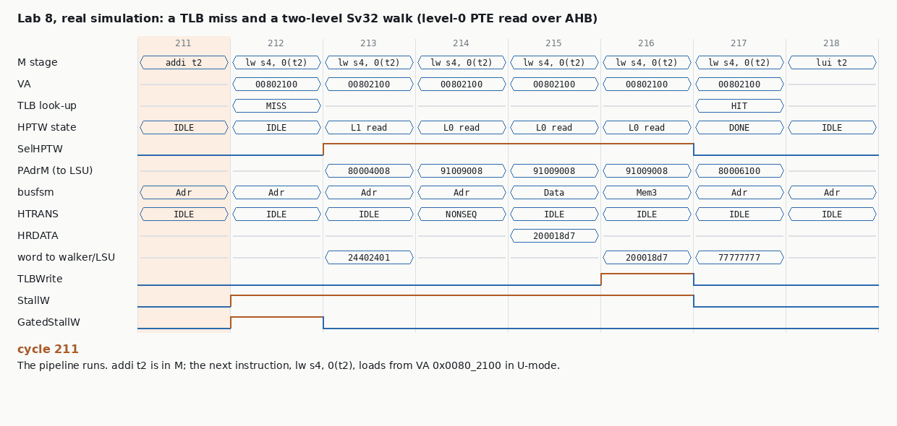

# Chapter 11 · Virtual Memory

@Abhishek

## At a glance

**One sentence:** every load, store and fetch carries a *virtual* address; the MMU turns it into a *physical* address and, on the way, decides whether this access is allowed at all.

Why bother? Three jobs that nothing else in the CPU does:

- **Isolation.** Each process gets its own private address space. Process A literally cannot name process B's memory, because no entry in A's page table points there.
- **Illusion of a big, contiguous memory.** A program sees one flat space from 0 up; the pages behind it can be scattered anywhere in DRAM, or not in DRAM at all (on disk, loaded on a page fault).
- **Protection at page grain.** Each page says read, write, execute, user-or-kernel. Code pages are not writable, the stack is not executable, the kernel is invisible to user mode.

The price is that *every* memory access first needs a translation, and the translation lives in memory (the page table). The **TLB** is the cache that makes this nearly free; the **hardware page-table walker (HPTW)** refills it on a miss. Next to translation sits **physical** protection: **PMA** (what kind of thing lives at this physical address: cacheable? idempotent? which access sizes?) and **PMP** (which physical ranges may this privilege mode touch?). Wally's MMU is exactly these three: TLB + PMA checker + PMP checker.

&#91;embedded content: Sv32 translation · book Example 11.4, worked through\]

Read the picture top to bottom. The 12-bit page offset goes straight through: pages are 4 KiB, so translation only ever changes the page number. The VPN is cut into two 10-bit indices, one per level, because a 4 KiB table holds exactly 1024 four-byte PTEs. The walk is serial: the address of the level-0 PTE is not known until the level-1 PTE has come back, which is why a TLB miss costs one memory round trip per level.

| Term | Meaning |
| --- | --- |
| VA / PA | virtual / physical address. Sv32: 32-bit VA, 34-bit PA |
| VPN / PPN | virtual / physical page number (address without the page offset) |
| PTE | page-table entry: a PPN plus flag bits |
| satp | the CSR holding MODE (Bare / Sv32 / Sv39 / Sv48) and the root table's PPN |
| TLB | small, usually fully associative cache of VPN to PPN + flags |
| HPTW | hardware page-table walker: reads PTEs through the LSU on a TLB miss |
| PMA / PMP | physical memory attributes / physical memory protection |

## Theory, in the book's order

### 11.1 Principles

#### Pages and address translation

Memory is cut into fixed-size **pages** (4 KiB in RISC-V, so the low p = 12 bits are the page offset). Translation maps a **virtual page number** to a **physical page number** and leaves the offset alone. The book's first example: VA 0x00005028 has VPN 0x00005 and offset 0x028; the page table says virtual page 5 lives in physical page 1, so the 34-bit PA is 0x000001028 (Example 11.1).

A page can be in one of three states: in DRAM (the PTE holds its PPN), on disk only (*uncached*), or never allocated. Touching a page that is not in DRAM raises a **page fault**: the OS reads the page from disk, writes the PTE, and returns to the *same* instruction, which now succeeds. That is why page faults must be **precise and restartable**: the faulting load or store must not have changed anything. In a pipeline this means the fault is taken in M before the access commits, exactly like the misaligned-access traps in Ch 8.

#### Page tables, and why they have levels

One flat table with an entry per virtual page is too big: 2^20 entries x 4 B = **4 MiB** for a 32-bit space, and 2^52 x 8 B = **32 PiB** for 64 bits (Example 11.2). A **multilevel** table only allocates the parts that are used: the upper VPN bits index a level-1 table whose entries point to level-0 tables; an unused region has an invalid level-1 entry and no level-0 table at all. In Example 11.3 a program with 2,048 pages of code and heap at the bottom and one stack page at the top needs just 1 root table + 3 level-0 tables = 4 pages = **16 KiB** of page table.

Two conventions to say correctly in an interview: the **root has the highest level number** (level 1 in Sv32, level 3 in Sv48) and leaves normally sit at level 0; and **each table is exactly one page**, which is why each VPN slice is 10 bits in Sv32 (1024 x 4-byte PTEs) and 9 bits in Sv39/48 (512 x 8-byte PTEs).

#### The TLB

A k-level table turns every access into k + 1 memory accesses. The **TLB** caches recent VPN to PPN translations (with their permission bits) so a hit costs nothing extra. TLBs are small (Wally: typically 16 entries each for instructions and data; real cores add a larger second-level TLB) and **fully associative**, because a miss is expensive and conflict misses would be painful. Programs touch few pages at a time, so hit rates are very high. The useful mental number is **TLB reach** = entries x page size: 16 x 4 KiB = 64 KiB. Lab 8 measures what happens when a loop's working set exceeds it, and how one megapage fixes it.

&#91;embedded content: TLB look-up · CAM, RAM, mixer (the 4-entry DTLB of Lab 8)\]

Hardware: a **CAM** holds the tags (valid, VPN, page size, ASID) in flops and compares all entries in parallel; a **RAM** holds the PPN and flags; the matching line drives an AND-OR read mux; a **mixer** builds the PA, taking more low bits from the VA for bigger pages. Replacement: Wally uses a simple **recently-used bit** per entry: pick the first entry whose bit is clear; when all bits would be set, clear them all except the one just used. It is a pLRU, cheap enough for a fully associative structure where true LRU is not.

#### Context switches: ASID and global pages

Each process has its own table, so on a context switch the old translations become wrong. Flushing the whole TLB every switch is slow. An **ASID** (address-space ID, in satp) is stored in each TLB entry and must match, so translations from several processes coexist. Pages mapped identically in every process (the kernel) set the **G** (global) bit and match regardless of ASID. Lab 8's TLB has no ASIDs (ASIDLEN = 0 is legal), so software must sfence.vma on every switch.

#### Caches and virtual memory: VIPT

The L1 cache wants to start its look-up before translation finishes. If the **set index comes only from page-offset bits**, which translation never changes, the cache can be indexed with the virtual address while the TLB translates in parallel, and the tag compare uses the physical address: **virtually indexed, physically tagged (VIPT)**. The cost: index + line offset must fit in 12 bits, so **each way is at most 4 KiB**, and a bigger L1 needs more ways (the book's example: Intel Haswell's 32 KiB L1 is 8-way). Lower-level caches see the PA anyway, so the limit does not apply to them.

### 11.2 RISC-V practices

#### satp and the modes

| satp.MODE | VA bits | PA bits | Levels | PTE size | Leaf page sizes |
| --- | --- | --- | --- | --- | --- |
| Bare | (none) | (none) | 0 | (none) | no translation |
| Sv32 (RV32) | 32 | 34 | 2 | 4 B | 4 KiB, 4 MiB megapage |
| Sv39 (RV64) | 39 | 56 | 3 | 8 B | 4 KiB, 2 MiB, 1 GiB gigapage |
| Sv48 (RV64) | 48 | 56 | 4 | 8 B | 4 KiB, 2 MiB, 1 GiB, 512 GiB terapage |

satp holds MODE, the ASID and the root table's PPN. Translation applies to **S- and U-mode** accesses only; M-mode is always untranslated unless **mstatus.MPRV** says otherwise (below). In Sv39/48 the VA must be sign-extended from its top bit; an address that is not raises a page fault.

#### The PTE

| Bits | Field | Meaning |
| --- | --- | --- |
| 0 | V | valid. V = 0: page fault, nothing else in the PTE matters |
| 1, 2, 3 | R, W, X | readable, writable, executable. All 0 = **pointer** to the next level |
| 4 | U | user page. U-mode may only touch U = 1 pages; S-mode may not touch them unless SUM = 1, and never executes them |
| 5 | G | global: matches any ASID |
| 6 | A | accessed since the OS last cleared it |
| 7 | D | dirty: written since the OS last cleared it |
| 9:8 | RSW | free for the OS |
| top | PPN | physical page number (22 bits in Sv32, 44 in Sv39/48) |

XWR encodings: 000 pointer; 001 read-only; 011 read-write; 100 execute-only; 101 read-execute; 111 read-write-execute; **010 and 110 (W without R) are reserved and fault**. A pointer found at level 0 faults, and a pointer with D, A or U set is malformed and faults (Wally checks this; Lab 8 does too).

#### Superpages

A leaf above level 0 maps a bigger page: a **megapage** (Sv32 level 1: 4 MiB; Sv39/48 level 1: 2 MiB), a **gigapage** (level 2: 1 GiB), a **terapage** (Sv48 level 3: 512 GiB). The low PPN bits are replaced by VA bits, so they **must be zero**; a misaligned superpage is a page fault. Book Example 11.5(c), Sv48: VA 0x8000\_FFF8 ends its walk at a level-1 leaf with PPN 00\_0000\_9000\_0; the PPN's bottom 9 bits are dropped and the VA's bottom 21 bits used instead, so PA = 0x9000\_FFF8. Superpages save walk steps and TLB entries; different-sized pages may even alias the same PA (Example 11.6).

**Svnapot** (RV64) adds 64 KiB pages: N = 1 and PPN\[3:0\] = 1000 in a level-0 PTE mean sixteen aligned pages share one TLB entry. Example 11.7: a NAPOT PTE for VPN 0x80020 with PPN 0x80308; VA 0x80025678 has VPN 0x80025, the TLB ignores the low 4 VPN bits when matching, then replaces the PPN's low 4 bits (8) with the VPN's (5): PA 0x80305678.

#### A and D bits: Svade or Svadu

The OS uses A to pick pages to evict and D to know which must be written back to disk. Hardware may either **fault** when A = 0 (any access) or D = 0 (a store) so the OS sets them (**Svade**), or **set them itself** with an atomic write of the PTE (**Svadu**, enabled by menvcfg.ADUE). Svade is simpler hardware but each first touch costs a trap; Wally supports both (SVADU\_SUPPORTED). Lab 8 is Svade.

#### MPRV, MXR, SUM

- **MPRV** (mstatus): M-mode loads and stores are translated and checked *as if* in the mode held in MPP. Used by M-mode trap handlers to read a lower mode's memory (e.g. to emulate a misaligned access through that mode's page table). Fetches are not affected. mret to a mode below M clears MPRV.
- **MXR**: loads may read pages marked execute-only (X = 1, R = 0), so a handler can read the instruction that trapped.
- **SUM**: S-mode may read and write U pages. The kernel keeps it off except while copying to and from user buffers, so a kernel bug cannot silently follow a user pointer.

#### sfence.vma

The TLB is not coherent with the page table in memory. After changing a PTE, software must execute **sfence.vma** (optionally with rs1 = a VA and rs2 = an ASID to limit the flush) before the change is guaranteed visible. This is the contract that makes a correct TLB **architecturally invisible**, and it is exactly what lets Lab 8's reference model have no TLB at all.

#### PMA: what lives at a physical address

Physical memory attributes are fixed by the platform: per region, which access widths work, whether it can be read, written, executed, whether it is **cacheable**, **idempotent** (a repeated or speculative read is harmless) and supports atomics. In Wally's map, RAM at 0x8000\_0000 is XWR, cacheable, idempotent, atomics; the UART at 0x1000\_0000 allows only 8-bit accesses, is not cacheable and not idempotent (reading pops the FIFO, like Lab 6's RXFIFO); the boot ROM is XR. A PMA violation is an **access fault**. Leaving address 0 unmapped makes a NULL dereference fault. **Svpbmt** lets a PTE override cacheability per page (for DMA buffers).

#### PMP: which physical ranges a mode may use

| pmpcfg field | Meaning |
| --- | --- |
| L (bit 7) | locked: writes to this entry are ignored until reset, and the entry **also applies to M-mode** |
| A (bits 4:3) | 0 OFF, 1 **TOR** (top of range: from the previous pmpaddr up to this one), 2 **NA4** (one 4-byte word), 3 **NAPOT** (power-of-two region; trailing ones in pmpaddr give the size) |
| X, W, R (bits 2:0) | permissions for this region |

pmpaddr holds PA bits 33:2 (Sv32) or 55:2. Rules: the **lowest-numbered matching entry decides**, even if a higher one would allow the access; with no match, M-mode is allowed and S/U are denied (if any PMP entry exists); M-mode ignores unlocked entries. Page-table walker reads are checked too, as S-mode accesses.

Book Example 11.8, NAPOT decoding: pmpaddr = 0x2004013F has k = 6 trailing ones, so the size is 2^(k+3) = 512 B; clear them, 0x20040100, shift left by 2: base 0x8010\_0400. The region is 0x8010\_0400 to 0x8010\_05FF.

#### The nine memory exceptions

|  | misaligned | access fault (PMA / PMP) | page fault (translation) |
| --- | --- | --- | --- |
| instruction | 0 | 1 | 12 |
| load | 4 | 5 | 13 |
| store / AMO | 6 | 7 | 15 |

mtval (or stval) gets the faulting **virtual** address. Priority for one access (privileged spec): misaligned before page fault before access fault. A PMP or PMA failure *during the walk* is an access fault of the original access type (a load's PTE read failing PMP is cause 5, not 13). Lab 8's directed test checks every one of the data rows.

## 11.3 Test plan, and the verification angle

The book's plan is short: WALLY-pma and WALLY-pmp check each kind of normal and faulting access for PMA and PMP; WALLY-mmu-sv32 (RV32) and WALLY-mmu-sv39 / sv48 (RV64) walk page tables "rich enough to exercise all the virtual memory features and exception conditions" (Sv48 uses the 4-level table of Fig. 11.10a, with deliberately malformed PTEs); WALLY-mmu-svxx covers MPRV, MXR, SUM and TVM; with Svadu, Svnapot and Svpbmt there is a combined variant. The book also says plainly: **no tests yet for sfence.vma**. Detailed plans live in cvw/docs/testplans.

That gap is worth turning into an interview answer, because it shows the general problem with MMU verification: **a TLB is supposed to be invisible**. If it works, no architectural result changes. So the bugs that matter split into three groups, and each needs a different check:

| Bug group | Example | What sees it |
| --- | --- | --- |
| Wrong translation or wrong permission | U bit ignored, megapage offset bits wrong, D=0 store not faulting, PMP priority wrong | lock-step against a reference model that walks the table on every access (no TLB) |
| Stale state | entry survives sfence.vma; ASID or G compare wrong; satp change not honoured | lock-step only if the test *changes a PTE, fences, and re-touches the page* while the stale entry still sits in the TLB; a TLB transaction model sees it immediately |
| Performance only | replacement always picks entry 0; superpages never cached; walker reads not cached | invisible to lock-step; needs a TLB model or counters |

Coverage points I would put in an MMU plan:

- every XWR encoding x U bit x effective mode (U, S, M with MPRV) x access type, for leaves at each level
- every malformed PTE: V=0, W without R, misaligned superpage, pointer at level 0, pointer with A/D/U, A=0, D=0 on store, non-canonical VA (Sv39/48)
- where each PTE comes from: cache hit, cache miss with dirty victim, uncached memory, a PMP-denied region (walk access fault)
- PMP: OFF / TOR / NA4 / NAPOT x permission x lock x mode, with overlapping regions to prove lowest-number priority; TOR with entry 0 (base 0)
- TLB state: hit, miss with free entry, miss with replacement, all-RU-bits reset, sfence.vma with the entry present, two pages sharing VPN\[1\] (mega vs kilo alias)
- priority: misaligned and page fault on the same access; page fault and access fault on the same access
- interaction: interrupt arriving during a walk (must wait: CommittedM), a walk whose PTE read misses the D-cache and evicts a dirty line

## 11.4 Wally's MMU

Wally has **two MMUs**: an IMMU in the IFU (translating PCF for fetches) and a DMMU in the LSU (translating IEUAdrM). Both are the same `mmu` module with `IMMU` = 1 or 0, and both contain three things: a **TLB** (when virtual memory is configured; ITLB\_ENTRIES / DTLB\_ENTRIES are typically 16), a **PMA checker** and a **PMP checker** (PMP\_ENTRIES must be 0, 16 or 64). There is **one** hardware page-table walker, shared, sitting in front of the LSU.

| Wally block | Job | Lab 8 equivalent |
| --- | --- | --- |
| tlbcam / tlbcamline | per-entry flops: Valid, VPN, ASID, PageType, G; match logic ignores low VPN bits for superpages | the TV / TVPN / TMega arrays and the Match loop |
| tlbram / tlbramline | PPN + flags, AND-OR read through `or_rows` | TPPN / TFlags with an AND-OR loop |
| tlblru | recently-used bits, first clear bit is the victim | the RU / Victim logic (same algorithm) |
| tlbmixer | builds the PA from PPN and VA bits by PageType | `TLBPAdr` |
| tlbcontrol | effective mode (MPRV), translation enable, all permission and A/D page-fault conditions | `EffMode`, `Translate`, `PermFault` |
| pmachecker / pmpchecker | region decode and permissions | the `pmp_check` function (PMA stays in the address decode) |
| hptw | the walker FSM below | the `walk_t` FSM (IDLE, L1, L0, DONE) |

&#91;embedded content: HPTW state machine · Wally, Sv32 path, Svadu states dashed\]

Details worth being able to say:

- **Two states per level.** Each level needs at least two cycles: drive the PTE address into the LSU, then read the PTE back. They cannot overlap because the next address depends on this PTE.
- **The pipeline stalls, the LSU does not.** During a walk HPTWStall asserts LSUStallM, so StallW freezes the pipeline; but the cache and bus must keep working *for the walker*, so they see **GatedStallW = StallW & \~SelHPTW**. (The book text prints it without the inversion; the figure and the code are what you should quote.) Lab 8 reproduces this, and the GIF below shows the busfsm moving through Adr, Data, Mem3 while StallW stays high.
- **Faults are reused, not duplicated.** If the walker finds an invalid PTE, Wally writes it into the TLB anyway and lets the replay hit it and raise the normal page fault. A PMP/PMA fault on a PTE read, or a malformed pointer, goes to the Fault state and writes nothing. Lab 8 does the simpler thing of remembering the walk's fault in a flop for the replay cycle.
- **Interrupts wait during a walk:** SelHPTW asserts CommittedM, so the Svadu read-modify-write of a PTE is atomic with respect to traps.
- **sfence.vma flushes everything** (all valid bits cleared) regardless of rs1/rs2: legal over-fencing. In S-mode with mstatus.TVM = 1 it is illegal (for hypervisors). Svinval's finer instructions are treated as sfence.vma.
- **Fault plumbing:** the IMMU raises instruction faults in F, carried to M by privpiperegs; the DMMU raises load and store/AMO faults; AMOs report store faults even though they also read.

## Lab 8: a data MMU for cpu-from-scratch

**Goal:** put Wally's DMMU between the address adder and the LSU: a TLB, a page-table walker that reuses the LSU, Sv32 page faults, PMP, and enough privilege (U-mode, MPRV, satp, sfence.vma) to make translation happen. Then verify it three ways and hunt seven injected bugs.

```
make mmu        # 72 tests: directed + 5 random MMU seeds (lock-step + TLB model); also at TLB = 1 and 8 entries
make mmuhunt    # 7 injected bugs vs self-check, lock-step, TLB model
make mmuperf    # what a miss costs, and TLB reach
```

### What was built

| Piece | File | Notes |
| --- | --- | --- |
| DTLB | rtl/pipe/mmu.sv | fully associative, TLB\_ENTRIES (default 4), 4 KiB and 4 MiB entries, recently-used-bit replacement, flushed by sfence.vma, no ASID |
| Walker | rtl/pipe/mmu.sv | IDLE, L1, L0, DONE. Reads PTEs **through the LSU**, so a PTE can come from the DTIM, the D-cache (hit or miss) or the AHB bus. DONE is the replay cycle |
| Page faults | rtl/pipe/mmu.sv | Svade: V=0, W without R, U vs mode, R, W, A=0, D=0 on store, misaligned megapage, pointer at level 0, pointer with D/A/U |
| PMP | rtl/pipe/mmu.sv | 4 entries, OFF / TOR / NA4 / NAPOT, lowest match wins, L applies to M; checks data accesses and the walker's PTE reads |
| Privilege | rtl/pipe/priv.sv | U-mode, MPP and MPRV, mret to MPP, ecall from U (8), satp, pmpcfg0 / pmpaddr0-3, sfence.vma, causes 5 / 7 / 13 / 15 |
| LSU glue | rtl/pipe/core\_pipe.sv | PAdrM feeds the DTIM, cache and bus; `GatedStallW = StallW & ~SelHPTW`; a walk counts as Committed |

Two honest simplifications: there is **no S-mode**, so satp translates U-mode accesses (and M-mode with MPRV, MPP = U), which real RISC-V does not allow without S; and **fetch is not translated** (no ITLB), so U-mode code runs from physical addresses. The ITLB would be the same module.

### Watch one miss, cycle by cycle



This is the `lw s4` in tests/mmu/mmu\_basic.S whose level-0 table lives in **uncached** RAM, so the walker's second read goes out over AHB. Five stall cycles: the miss, the root PTE (DTIM, same cycle), then Adr, Data, Mem3 on the bus, and the replay hits. Note GatedStallW dropping as soon as SelHPTW rises: that is what lets the busfsm leave Mem3 while StallW is still high.

### Three checks

- **Self-check** (tests/mmu/mmu\_basic.S): 4 KiB pages through tables in DTIM, D-cache and bus; cached and uncached megapages; each bad-PTE fault; Svade fix-up and retry (the handler sets A or D and fences); remap + sfence.vma; MPRV from M; PMP priority, TOR on the page table itself (walk access fault), and a locked entry hitting M-mode. The handler logs (mcause, mtval) and the test compares the whole log: 19 traps.
- **Lock-step** with the ISS, which now has U-mode, MPRV, satp, PMP and a page walk, but **no TLB**. With the rule "sfence.vma after changing a PTE", a walk on every access is exactly the architecture.
- **TLB model** (dv/tlbmodel.py) replays `+TLBLOG` (ACC va HIT/MISS, FILL va entry mega, SFENCE) and predicts each look-up and each victim.

The random generator (dv/genmmu.py) builds three level-0 tables (DTIM, cached, uncached) plus megapages, draws PTE flags from a mix of good and every kind of bad, alternates U-mode and MPRV segments, and between segments remaps PTEs and reprograms PMP entries 0-2 (always followed by sfence.vma). A typical seed: 2,500-2,800 instructions, \~310 translated look-ups, 130-190 traps.

### Bug hunt (10 random seeds x 300 accesses)

| Injected bug | mmu\_basic: self / lock / TLB model | random: lock | random: TLB model |
| --- | --- | --- | --- |
| (none) | ok / ok / ok | 0/10 | 0/10 |
| TLB\_NO\_FLUSH: sfence.vma does not invalidate | FAIL / FAIL / FAIL | 10/10 | 10/10 |
| TLB\_USER\_IGNORED: U bit not checked | FAIL / FAIL / ok | 10/10 | 0/10 |
| MEGA\_OFFSET: PA\[21:12\] from the PPN, not the VA | FAIL / FAIL / ok | 10/10 | 0/10 |
| NO\_DIRTY\_FAULT: store to D=0 page allowed | FAIL / FAIL / ok | 9/10 | 0/10 |
| PMP\_LAST\_WINS: highest-numbered match decides | FAIL / FAIL / ok | 10/10 | 0/10 |
| WALK\_NO\_PMP: PTE reads not PMP-checked | FAIL / FAIL / ok | **6/10** | 0/10 |
| TLB\_VICTIM0: always replace entry 0 | **ok / ok** / FAIL | **0/10** | 10/10 |

What the table teaches:

- **TLB\_VICTIM0 is a pure performance bug**: the TLB acts like a 1-entry TLB, every answer is still right, and only the transaction model notices (on the 2nd fill of the directed test). Same lesson as Lab 7's stuck LRU.
- **TLB\_NO\_FLUSH** fails lock-step only where a test changes a PTE and re-touches the page while the stale entry is still resident. The TLB model catches it on the very next look-up after any sfence.vma, PTE changed or not, which is why it fails every random seed even where values happened to agree.
- **WALK\_NO\_PMP** needs a PMP region that covers a *page table* while a walk passes through it; random PMP placement only managed that in 6 of 10 seeds. That is a coverage point, not luck: "PMP region overlapping a page-table page" belongs in the plan.
- The functional bugs fail the directed test because it was written from the fault table, one line per condition. Writing tests from the spec's table of conditions is the cheapest coverage there is.

### Bugs I actually hit while building it

- **Reference-model bug, found by lock-step:** the ISS decoded sfence.vma as illegal, because its generic SYSTEM decode (`rd = rs1 = 0` with funct12 lookup) ran first; sfence.vma has rs1 and rs2 fields. First divergence at instruction 124: ref traps with cause 2, DUT executes. Reminder that a mismatch is a question, not a verdict on the RTL.
- **Test bug:** U-mode code loaded t1/t2, then did an ecall to have M arm a fix-up, and M's code clobbered t1/t2. Self-check failed with code 4; lock-step agreed with the DUT, which pointed straight at the test.
- **Design point caught before it shipped:** permission and PMP checks must run on the **replay** cycle too, not just in IDLE. A U=0 page reached through a fresh walk is only checked after the fill; gating the checks on IDLE would let that one access through.
- **Memory-map collision:** two data pages at PA 0x8000\_8xxx overlapped the linker's .data (log and expected list). Moved to 0x8000\_9xxx.

### Performance (`make mmuperf`)

| Walk (sfence.vma before every load) | cycles per load | cost of the walk |
| --- | --- | --- |
| no translation | 6.94 | (none) |
| level-0 table in DTIM | 9.94 | +3.00 |
| level-0 table in the D-cache | 9.94 | +3.00 (after the first walk, the PTE hits) |
| level-0 table on the uncached bus | 11.94 | +5.00 |

| Pages touched round-robin (4-entry TLB) | 4 KiB pages | one megapage |
| --- | --- | --- |
| 1 | 6.12 | 6.06 |
| 2 | 4.16 | 4.03 |
| 4 | 3.17 | 3.02 |
| 5 | 4.89 | 2.81 |
| 8 | 5.49 | 2.51 |

Past 4 pages the working set exceeds the TLB's reach and cycles per load jump; through a megapage the same addresses need one entry. That is the whole argument for superpages (and for Svnapot's 64 KiB pages) in two columns.

All earlier results were re-run unchanged: privhunt, bushunt and cachehunt give the same tables as in Ch 8, 9 and 10, and the cache regressions pass at all four cache configurations.

## Recap and interview drill

**Interactive companion:** [MMU Lab](https://claude.ai/artifact/KwUeLtq6SmEJRUwiEiRsBb). It walks any Sv32 table PTE by PTE (book Example 11.4 is preloaded), lets you click PTE bits, runs streams through a TLB to show reach and the stuck-victim bug, and resolves PMP matches on the book's Table 11.6. **Code:** cpu-from-scratch.zip, Lab 8 (`make mmu`, `make mmuhunt`, `make mmuperf`).

### Ten things to be able to say without notes

1. Translation changes only the page number. The 12-bit offset passes through, so a VIPT L1 is limited to 4 KiB per way.
2. Sv32 = 2 levels of 1024 four-byte PTEs. Sv39 / Sv48 = 3 / 4 levels of 512 eight-byte PTEs. Each table is one page, and the root has the highest level number.
3. XWR = 000 is a pointer, W without R is reserved, and V = 0 means the rest is ignored. A leaf above level 0 is a superpage and must be aligned.
4. A page fault (12 / 13 / 15) comes from translation. An access fault (1 / 5 / 7) comes from PMA or PMP, including on the walker's own PTE reads. Misaligned outranks both, and mtval holds the VA.
5. Svade means A = 0 or D = 0 traps and the OS fixes it. Svadu means hardware writes the PTE atomically (Wally's Update\_PTE).
6. MPRV makes M-mode loads and stores act as MPP. SUM lets S touch U pages. MXR lets loads read X pages.
7. The TLB is not coherent. sfence.vma after any PTE change is what makes it invisible, so a reference model needs no TLB.
8. PMP: the lowest matching entry decides. With no match, M is allowed and S/U are denied. L binds M too and freezes the entry until reset. TOR, NA4, NAPOT; NAPOT size = 2^(trailing ones + 3).
9. Wally has two MMUs and one HPTW. Each level costs an Adr state and a Rd state. The walker uses the LSU while GatedStallW keeps the LSU moving, and CommittedM keeps interrupts out.
10. Verification splits three ways. Lock-step catches wrong answers. A stale-entry check needs a remap, sfence and re-touch, or a TLB model. Performance-only bugs need the TLB model or counters.

### Drill: ten questions with model answers

**1. Walk me through what happens on a load in Sv32 when the TLB misses.** The MMU flags a miss in M, stalls the pipeline and blocks the access. The HPTW takes over the LSU. It forms satp.PPN x 4096 + VPN\[1\] x 4 and reads the root PTE. If XWR = 000 it is a pointer: it forms PPN x 4096 + VPN\[0\] x 4 and reads again. A leaf is checked (V, reserved encodings, alignment for a megapage) and written into the TLB. The load then replays. This time it hits, the permission checks run on the TLB flags, PMP checks the PA, and the data access goes out. In Lab 8 that costs 3 cycles with the tables in the DTIM and 5 when the level-0 PTE comes over AHB.

**2. Why multilevel page tables, and what does one cost?** Size: a flat Sv32 table is 4 MiB per process, and a flat 64-bit one would be 32 PiB. Levels allocate only the parts in use: the book's 2,048-page program needs 16 KiB. The cost is one memory access per level on a TLB miss, done serially because each address depends on the last PTE. Superpages cut it short, and walk caches (and the D-cache holding PTEs) hide part of it.

**3. A PTE is changed in memory and the core keeps using the old translation. Is it a bug?** Only if sfence.vma ran in between. Without the fence it is allowed: the TLB is not coherent with page-table stores. With the fence, it is a real bug (a stale entry). To verify it, write a test that maps a page, touches it, remaps, fences and touches it again. A TLB model checking that every look-up after a fence misses catches it even when the old and new data happen to agree. In Lab 8, BUG\_TLB\_NO\_FLUSH failed all 10 random seeds on the model.

**4. Page fault or access fault? A user load whose level-0 PTE sits in memory the PMP forbids.** An access fault, cause 5, because the implicit PTE read failed physical protection. Translation never got an answer, so it is not a page fault. mtval holds the original VA. Wally keeps the original access type so a load reports a load access fault. Lab 8 tests this with a TOR region over a level-0 table.

**5. How would you verify PMP?** Start from the rule table: OFF / TOR / NA4 / NAPOT x R/W/X x L x mode (M, S, U) x access type, plus the boundaries of each region (first byte, last byte, one past). Cover priority with overlapping entries where a lower entry denies and a higher one allows; Lab 8's BUG\_PMP\_LAST\_WINS is exactly that. Cover TOR with entry 0 (base 0), and lock semantics: writes ignored, M bound, and the TOR base register locked too. Also cover PMP on walker reads and the default (no match) for each mode. Check results with lock-step against a model, and keep a coverage cross of matched-entry x outcome.

**6. What is GatedStallW and why does it exist?** It is StallW & \~SelHPTW. During a walk the pipeline must freeze, but the LSU must keep running to serve the walker's PTE reads. If the cache and bus saw the raw StallW, the bus FSM would wait in Mem3 for the stall to drop while the stall waits for the PTE: a deadlock. Lab 8's waveform shows it: StallW stays high for five cycles while the bus goes through Adr, Data and Mem3.

**7. Why can't interrupts be taken in the middle of a walk?** The walker owns the LSU and may be mid-transaction on the bus. With Svadu it may also be between reading a PTE and writing back its A/D bits, a read-modify-write that must be atomic. So SelHPTW asserts CommittedM, and the interrupt waits for the walk to finish and the instruction to complete or fault. This is the same reason as BusCommitted in Ch 9 and CacheCommitted in Ch 10.

**8. A TLB bug changes no results. How do you find it, and does it matter?** It matters because it costs performance: a TLB that thrashes or never caches megapages can lose a large fraction of throughput. Find it with a transaction-level model of the TLB that predicts hit or miss and the victim for every look-up, or with miss counters compared against a reference. In Lab 8, BUG\_TLB\_VICTIM0 passed self-check and every lock-step run, and the model failed it on the second fill.

**9. Why do superpages exist, and what can go wrong with them?** They increase TLB reach (one entry covers 4 MiB in Sv32 or 2 MiB / 1 GiB in Sv39) and shorten walks. Lab 8 measured 2.5 vs 5.5 cycles per load for 8 pages on a 4-entry TLB. What goes wrong: the misaligned-superpage check (PPN low bits must be 0), using the wrong bits in the mixer (Lab 8's BUG\_MEGA\_OFFSET only shows beyond the first 4 KiB of the megapage), the CAM's match ignoring the wrong VPN bits, and aliasing between a superpage and 4 KiB pages of the same PA.

**10. How does the reference model handle the TLB in lock-step?** It does not have one. It walks the page table on every access, which is the architectural definition when software fences after PTE changes. That makes the model simple and independent of the RTL's TLB design, so any timing-free difference is a real bug. The TLB's own behaviour (hits, victims, flush) is then checked separately by a transaction model. The model's privileged decode still needs care: in Lab 8 the first lock-step mismatch was the ISS treating sfence.vma as illegal.

### One-paragraph story for an interview

"I added an Sv32 MMU to a 5-stage RISC-V core of my own, modelled on Wally: a fully associative TLB with megapage entries, a page-table walker that borrows the LSU so PTEs can come from the cache or the bus, Svade faults and PMP. To verify it I used three independent checks. A directed test was written straight from the fault-condition table. Random page tables were run in lock-step against an ISS that walks memory on every access. A transaction-level TLB model predicted every hit and victim. Each functional bug I injected failed the directed test, but the walker-PMP bug was only hit by 6 of 10 random seeds, which told me a coverage point was missing. A replacement bug passed everything except the TLB model, which is why I would never sign off an MMU on lock-step alone."

## Book coverage check (Ch 11 audit)

This tab has now been checked against all 16 sections of Chapter 11, Tables 11.1–11.7 and Examples 11.1–11.9. The theory, Wally's MMU and Lab 8 were already covered. These are the remaining book details, plus two errors I found in the book's own example.

### Facts the tab lacked

- **Physical reach**:
  - Sv32 has a 22-bit PPN, so it can address 2^34 = **16 GiB**. That is why PA\_BITS = 34 on RV32.
  - RV64 has a 44-bit PPN, so it can address 2^56 = **64 PiB**.
  - Sv32 page-table indices are 10 bits (4-byte PTEs). Sv39 and Sv48 indices are 9 bits (8-byte PTEs). That is why an Sv32 megapage is 4 MiB but an RV64 megapage is 2 MiB.
- **Pointer PTEs** (XWR = 000) must have D, A and U = 0.
- **Aliasing example** (Table 11.3): three virtual addresses on three page sizes all map to one physical address.
  - 0x0100\_9531\_A00C on a terapage
  - 0x0080\_5531\_A00C on a gigapage
  - 0x0000\_8071\_A00C on a megapage
  - All three map to PA 0x00\_0000\_9531\_A00C.
  - **Coverpoint:** the TLB holds two entries of different sizes that map the same physical address.
- **Svpbmt** (RV64, enabled by menvcfg.PBMTE) uses PTE bits 62:61:
  - 00: use the PMA.
  - **01: NC**, non-cacheable main memory (idempotent).
  - **10: IO**, non-cacheable and non-idempotent.
  - A nonzero PBMT field when Svpbmt is missing or disabled is a **page fault**.
  - Why it exists: DMA coherence. The OS can mark buffers uncacheable, as x86 and ARMv8 allow, and Linux relies on this.
- **PMA facts** (Table 11.4):
  - Leave address 0 unmapped so that dereferencing a NULL pointer raises an access fault.
  - Peripherals with fixed-size registers allow only that access size: usually 32 bits, but **8 bits for the UART**.
  - PMA ranges never overlap, because the memory map does not overlap.
- **PMP setup rules**:
  - At reset every region is OFF. M-mode may then access everything, and S and U may access nothing.
  - **At least one region must be configured before entering S or U mode, or every fetch traps.** The minimal setup is pmpcfg0 = 0x0F (TOR + RWX) with pmpaddr0 = all ones.
  - OpenSBI uses PMP so that S and U can access everything except the firmware's own region. A compromised OS still cannot overwrite the firmware.
  - L = 1 also applies the permissions to M-mode. A secure boot loader can use it to lock away its own key ROM after use.
  - **pmpcfg packing**: RV32 packs 4 configuration bytes per pmpcfg (pmpcfg0 covers pmpaddr0–3). RV64 packs 8 and uses only the **even-numbered** pmpcfg registers (pmpcfg0, pmpcfg2, …).
- **TLB CAM details** (Table 11.7):
  - PageType is 2 bits (kilo, mega, giga, tera). It tells the match logic how many low VPN bits to ignore and tells the mixer how many VA bits to pass through.
  - In Sv39 the top VPN bits are ignored.
  - CAMHit = (OR of all Match) & \~TLBFlush, built with a distributed AND-OR. HitPageType is built the same way.
  - A misaligned-superpage detector checks that the low PPN bits are zero for the PageType.
  - A synthesized CAM is flops plus XNORs, not a custom CAM cell.
- **Address bits**, from the margin note in 11.1.2: the PDP-11 died of 16-bit addressing. Bell's quote: "only one mistake … not having enough address bits."

### Example 11.9, worked, with the book's slips corrected

The PMP regions in Table 11.6:

| Region | pmpaddr | Type | Range | Access |
| --- | --- | --- | --- | --- |
| 0 | 0x0FFFFFFF | NAPOT | 0x0000\_0000–0x7FFF\_FFFF (I/O) | RW |
| 2 | 0x2004003F | TOR (base from pmpaddr1 = 0x20040000) | 0x8010\_0000 up to, but not including, 0x8010\_00FC | R |
| 4 | — | — | 0x8010\_0200–… | X |
| 5 | 0x200400C0 | NA4, L = 1 | 0x8010\_0300–0x8010\_0303 | locked out for every mode, M included |
| 6 | 0x2004013F | NAPOT, k = 6 trailing ones → 2^9 = 512 B | 0x8010\_0400–0x8010\_05FF | no access |
| 15 | 0x2FFFFFFF | NAPOT, 28 ones → 2 GiB | 0x8000\_0000–0xFFFF\_FFFF | RWX |

Entries are checked in order, so regions 2, 4, 5 and 6 override region 15 inside their own ranges.

> **Book slips worth knowing:**
>
> - The book writes "pmpcfg1 << 2 = 20040000 << 2 = 80010000". It means **pmpaddr1**, and 0x20040000 << 2 = **0x80100000**.
> - A TOR region's top is **exclusive**: the region is \[pmpaddr(i−1) << 2, pmpaddr(i) << 2). 0x801000FC is the first address *outside* the region.
>
> Off-by-one errors at TOR edges are the most common PMP RTL bug. Cover the first byte, the last byte and the byte just past the end of every region.


---

Interactive companion page for this chapter: [`companion-pages/ch11-lab.html`](../companion-pages/ch11-lab.html) (download and open in a browser).
