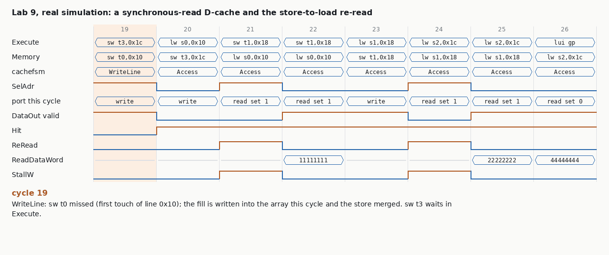

# Chapter 12 · Load/Store Unit

@Abhishek

## At a glance

**One sentence:** the load/store unit is where everything from Chapters 7 to 11 meets: it takes an address from the integer unit, translates and checks it (MMU), sends it to the right memory (D-cache, DTIM or bus), returns the data, and also lends itself to the page-table walker.

The book says plainly that this chapter has **no new principles**. It is about *integration*, which in interviews is the interesting part, because integration is where the bugs are: two correct blocks plus a wrong assumption about who owns the address, the read port, or the bus this cycle.

&#91;embedded content: LSU of an application core · simplified from book Fig. 12.2\]

Three ideas carry the whole chapter:

- **One address mux, many owners.** In a normal cycle the address comes from IEUAdrM. During a page walk it comes from the HPTW (SelHPTW). During a cache miss or flush, from the cache FSM's burst counter. Every owner change is a place where a stale address or stale data can slip through.
- **The D-cache read starts in Execute.** The SRAM is synchronous, so the set is presented one cycle early, from IEUAdrE. That address is *virtual*, which only works because the set bits sit inside the untranslated 4 KiB page offset (**VIPT**). The tag compare in Memory uses the physical address from the TLB.
- **Stall the pipeline, not the LSU.** Cache misses, bus transfers and walks stall all five stages, but the LSU's own machines keep running (GatedStallW), and interrupts are held off while anything is half-done (CommittedM).

| Wally configuration | Core memory | Bus | MMU |
| --- | --- | --- | --- |
| rv32e | none | yes: everything over AHB | none |
| rv32i / rv64i | DTIM | no | none |
| rv32imc (microcontroller) | DTIM | yes | PMA |
| rv32gc / rv64gc (application) | D$ | yes, with bursts | TLB + PMA + PMP + HPTW |

## Theory, in the book's order

### 12.1 The LSU datapath, end to end

Follow one load through Wally's application-core LSU (book Fig. 12.2):

1. **Execute:** the IEU computes IEUAdrE. The D-cache uses its low bits (the set) *right now* to start reading the SRAM, because the SRAM is synchronous: address in this cycle, data out next cycle.
2. **Memory:** the MMU translates IEUAdrM to PAdrM (TLB) and checks it (PMA: which device and is it cacheable; PMP: may this mode touch it). In parallel the cache compares its tags against PAdrM. A hit selects the word from the line (SCR), the endian swap (ES) and subword read (SWR) produce ReadDataM.
3. **Miss / uncached / walk:** the LSU stalls the whole pipeline and one of its machines takes the bus or the cache (below). When it finishes, the access completes in Memory as if nothing happened.

Stores take the same path, with subword write (SWW) and a byte mask; they only need the **tags** in Memory and write the data array at the end of Memory. The FPU (LLEN = max(XLEN, FLEN)) and atomics (Ch 17) add muxes in front; the structure does not change.

### 12.2 Integrating the D-cache

**Load and store hits.** A load hit returns data in Memory with single-cycle throughput. A store hit writes the line in the cycle after its tag check, which is the Writeback stage of the store and the Memory stage of the next instruction. That is the **store-delay hazard**: a load that immediately follows a store would read the SRAM in the same cycle the store writes it.

&#91;embedded content: Store-delay hazard · book Fig. 12.16 as a pipeline diagram\]

**Line fetch.** On a miss the cachefsm puts the line address on CacheBusAdr and raises CacheBusRW\[1\] (read) toward the **ahbcacheinterface**, which runs an AHB burst: HTRANS NONSEQ on the first beat then SEQ, HBURST from the line length (Table 12.1: 128-bit line on a 32-bit bus = INCR4; rv32gc 512/32 = 16 beats; rv64gc 512/64 = 8 beats), HSIZE = the bus width. Because AHB pipelines address and data, it needs **two counters**: BeatCount for the address phase and BeatCountDelayed for the data phase, which picks the FetchBuffer slot for HRDATA. CacheBusAck ends the handshake; a load miss is served straight from the FetchBuffer while the line is written (the same early return as Lab 7), a store miss merges its bytes into the line first.

**Writeback.** A dirty victim goes out as a write burst: SelBusBeat makes the SCR mux step through the line one bus word per beat (CacheBusRW = 01). The **buscachefsm** (Fig. 12.5) extends Ch 9's busfsm (Adr, Data, Mem3) with CacheFetch and CacheWriteback states, and goes **straight from CacheWriteback to CacheFetch** without an idle Adr cycle, overlapping the last writeback data beat with the first fetch address. Flushes chain writebacks the same way.

**Burst EBU.** The IFU and LSU share one AHB port. The arbiter (ebufsmarb) gives the LSU priority, counts beats from HBURST, and saves/restores the IFU's burst request when both ask. A real Wally war story: with virtual memory, a page walk can start a D-cache line fill *while an I-cache line fill is already in flight* (the walk happens with the pipeline stalled). The LSU preempted the IFU burst mid-line, leaving stale instructions in the I-cache, and Linux boot hung. The fix added IFUReq and **LSUDisable** so an in-flight burst always finishes first. The book calls it one of the hardest Wally bugs to find. It is a perfect interview example of an integration bug: both blocks were correct alone.

### 12.3 Integrating the MMU and the HPTW

**PMA checker.** Decodes the physical address into a device and its attributes. CacheableM steers the access: cacheable to the cache, otherwise a single NONSEQ transfer over the bus (FetchBuffer for loads, PreHWDATA for stores). A flush must reach the cache whatever the address, hence CacheableOrFlushM. Table 12.2 lists the resulting **seven kinds of LSU operation**:

| Operation | Who drives the bus address | Data path |
| --- | --- | --- |
| uncached load | PAdrM | HRDATA to FetchBuffer to ReadDataM |
| uncached store | PAdrM | store data to HWDATA |
| cached load hit | (no bus) | cache line to SCR to ReadDataM |
| cached store hit | (no bus) | store data into the line |
| line fetch | CacheBusAdr + BeatCount | HRDATA into FetchBuffer, then the line |
| line writeback | CacheBusAdr + BeatCount | line word (SCR) to HWDATA |
| flush | CacheBusAdr + BeatCount | each dirty line, as writebacks |

**PMP checker.** No LSU changes: PMA and PMP together raise access and misaligned faults.

**TLB and cache in parallel (VIPT).** The cache indexes with untranslated page-offset bits while the TLB translates; the tag compare uses PAdrM. That is why a way may be at most 4 KiB. The cache and TLB are the boundary between the virtual and physical worlds: everything beyond them, including the bus, sees only physical addresses.

**HPTW in the LSU.** One walker serves both ITLB and DTLB misses and reads PTEs **through the D-cache**, for three reasons the book lists: coherence (a PTE just written by a store may live only in the D-cache), A/D updates need a writable path (the I-cache is read-only), and walks are faster when PTEs hit. While walking it raises SelHPTW, and its address IHAdrM (built from PCF or IEUAdrM, satp and the previous PTE) replaces IEUAdrM in front of the MMU, so PMA and PMP still check every PTE read.

### 12.4 Stalls, flushes and traps

- **LSUStallM** = DCacheStallM (miss or flush) | HPTWStall (walk) | BusStall (bus transfer). It stalls all five stages. It drops on the last cycle of the operation, when ReadDataM is valid or the store has committed.
- **Decode-stage stalls** remain the controller's job: LoadStallD (load-use) and **StoreStallD** (load right after a store, the hazard above).
- **Traps first:** TLB, PMA and PMP faults are raised at the *start* of the access, before a miss could begin, and an uncached access that would fault is cancelled before it reaches the bus.
- **CommittedM** = BusCommittedM | DCacheCommittedM | SelHPTW holds off interrupts while anything is half-done. Unlike LSUStallM it stays high through the last cycle.
- **GatedStallW = StallW & \~SelHPTW** lets the LSU keep serving the walker. The cachefsm and buscachefsm look at Stall only at the *end* of an operation: the cache then waits in its AddressSetup state and the bus in Mem3, so a held instruction is not executed twice; after a line fill the bus returns to Adr so LSUStallM can drop.
- **Memory-stage flushes** happen in three cases: the first cycle of a miss, an uncached access that faults, or any other trap. Once a fill or writeback is in flight it is never faulted: its address was checked when the line was first brought in.

### 12.5 The examples, in numbers

- **Load miss then hits** (Code Example 12.1, Fig. 12.6): ld 0x28 misses, a 4-beat INCR4 fetch of 0x20-0x38 with two wait states on the first beat, then ld 0x20 and sd 0x30 hit.
- **Writeback then fetch** (Fig. 12.7): dirty line 0x5000 out (data 0x200, 0x208, 0x210, 0x218), line 0x7000 in (0x100...0x118), with no idle cycle between the bursts.
- **Uncached load then store** (Fig. 12.21): lb from peripheral 0x1000\_0002 with one wait state returns 0xC1; sb 0x55 to 0x1000\_0000, also one wait state.
- **TLB miss** (Fig. 12.23): Sv32, satp.PPN = 0x8000D, load from VA 0x0000\_1234. L1 PTE at 0x8000\_D000 = 0x20004CC1 (pointer to PPN 0x80013, a D-cache hit), L0 PTE at 0x8001\_3004 = 0x202000DF (a D-cache miss, so a line fill in the middle of the walk), leaf PPN 0x80800, replay hits: PA 0x8080\_0234, data 0x15151515.
- **A/D update** (12.5.6, Svadu): a store to VA 0x0080\_1450 finds PTE 0x20200817 at PA 0x8001\_5004 with A = D = 0; the HPTW writes back 0x202008D7 through the D-cache while it updates the TLB.

## 12.6 Test plan, and the verification angle

The book's LSU plan reuses what exists (load/store tests from Ch 7, privileged memory-fault tests from Ch 8, bus tests from Ch 9, MMU tests from Ch 11) and adds one honest line: *a more comprehensive test plan would stress the cache and its interaction with the HPTW.* That is the right instinct. Unit tests of each block already passed; what is left is the **seams**.

A useful way to plan LSU integration coverage is as crosses, not lists:

| Cross | Why it matters | Example hole |
| --- | --- | --- |
| operation (Table 12.2's seven) x the *previous* operation, back to back | a synchronous array, a shared bus, an FSM that has not returned to idle | store hit then load, fill then load to the same set |
| requester (program, HPTW for DTLB, HPTW for ITLB) x cache outcome (hit, clean miss, dirty miss, uncached) | the walker uses the same port and the same FSMs | level-0 PTE miss that evicts a dirty line in the middle of a walk |
| stall source (cache, bus, walk, Decode stall) x what arrives meanwhile (interrupt, flush, trap) | CommittedM and GatedStallW must cover every combination | interrupt pending while a writeback burst is half-done |
| IFU burst in flight x LSU request (walk, miss) | shared EBU, priority, preemption | Wally's Linux-boot hang (LSUDisable) |
| access size x offset x cacheable / uncached x hit / miss | byte masks, merge on miss, FetchBuffer word select | sb into a line that is being filled |
| fault (page, access, misaligned) x where the access is (cache, bus, walk) | faults must win before anything starts; in-flight fills must never fault | uncached store that also faults must not reach the bus |

The lesson from Lab 9, which a reviewer will like hearing: **how a generator builds addresses decides which seams it can ever reach.** Lab 7's generator computes each address with li + add, so two memory instructions are never adjacent in the pipeline. It is 100% blind to every store-to-load hazard, however many seeds you run. A directed list of adjacency cases plus a generator that emits runs of base + offset accesses closed that hole in one step. In coverage terms, the missing bin was **distance between consecutive memory operations = 1 instruction**.

## Wally's LSU, signal by signal

| Wally signal / block | Meaning | Lab equivalent (cpu-from-scratch) |
| --- | --- | --- |
| IEUAdrE to CacheSet | set presented to the SRAM in Execute | `AdrE` into dcache, `SetE` |
| SelAdr (cachefsm) | read the Memory-stage address instead (stall, miss, AddressSetup) | `SelAdr = HoldM \| Stall \| busy \| miss \| ReRead` |
| StoreStallD (controller) | load in Decode while a store is in Execute: one bubble | none: the cache sees DataOut invalid and re-reads (`ReRead`) |
| PAdrM / IHAdrM | physical address from the TLB, or the walker's address | `PAdrM`, mux in mmu.sv |
| CacheableM / CacheableOrFlushM | PMA decision; flushes always go to the cache | `SelCacheM` (0x9000 region), `FenceIM` |
| ahbcacheinterface, buscachefsm | bursts with BeatCount / BeatCountDelayed, FetchBuffer, CacheBusAck | burst engine inside dcache.sv (`AdrBeat`, `DataBeat`) |
| busfsm states Adr, Data, Mem3 | single uncached transfers | `busfsm` in core\_pipe.sv |
| LSUStallM = DCacheStallM \| HPTWStall \| BusStall | stall all stages | `CacheStallM \| MMUStallM \| BusStallM` |
| CommittedM | interrupts wait | `BusCommittedM \| CacheCommittedM \| SelHPTW` |
| GatedStallW = StallW & \~SelHPTW | the LSU keeps serving the walker | same name |
| ebufsmarb, LSUDisable | IFU / LSU arbitration with bursts | not needed: our IFU never uses the bus |

Design points worth defending in an interview:

- **Why read the SRAM in Execute at all?** Because a registered SRAM read takes a cycle; starting it in Execute hides that cycle, so a load hit still costs one cycle in Memory. The price is the store-delay hazard, and the requirement that the index come from untranslated bits (VIPT).
- **Where to pay for the store-delay hazard.** Wally stalls in Decode (StoreStallD), which is cheap to detect (opcode bits only) but stalls even when the store and load touch different sets. An alternative is to compare sets, or to detect the stale read in the cache (Lab 9). Both Wally and Lab 9 cost exactly one cycle per load-after-store on the copy kernel. The difference is where the logic lives.
- **Why the walker has Adr and Rd states per level.** The same one-cycle SRAM latency: the walker has to present a PTE address before it can read the PTE. Lab 9 reproduced that without designing it: once the cache read became synchronous, a walk through the D-cache grew from +3 to +4 cycles per level-0 access.
- **Why never fault an in-flight fill.** Its address was checked when the access started; faulting it halfway would leave the bus or the line half-written. Same rule as CommittedM.

## Lab 9: a synchronous-read D-cache, the way real SRAM behaves

**Goal:** Lab 7's cache read its arrays combinationally, which no real SRAM does. Lab 9 gives the data array a registered read, starts it in Execute from IEUAdrE (VIPT), and makes the core correct and fast again around that one cycle of latency. That is the core of Ch 12. Then it finds out which tests can even see the new hazards.

```
make lsu        # 78 tests at the default; 38 with Lab 7's combinational read; 38 at 4 ways x 4 sets + RAM_WAIT=2
make lsuhunt    # 4 read-path bugs vs the directed test and two random generators
make lsuperf    # cycles per memory op
```

### How the read path works

| Signal | Meaning |
| --- | --- |
| `SetE` | set bits of IEUAdrE: the next instruction's set, read at the end of Execute |
| `SelAdr` | read Memory's own set instead: while held (HoldM from the MMU, Stall), while the FSM is busy, on a miss, a flush, or a re-read |
| `DataOut`, `DataOutSet` | the registered read: all ways of one set, and which set it is |
| `DataOutOK` | 0 if the port was written in the cycle of the read (store hit or line fill): single-port, read-before-write |
| `ReRead` | a load hit whose DataOut is not valid for its set: stall one cycle and read again |

An elaboration-time check refuses a configuration whose set + offset bits exceed 12, because then the virtual index would not equal the physical one.

Design choice: Wally prevents a stale read with *rules* (StoreStallD in Decode, SelAdr and AddressSetup in cachefsm, separate Adr and Rd walker states). Lab 9 *checks* each read instead (valid bit + set compare) and re-reads when needed. The checking version is shorter to write and catches cases I did not think of. The rule version makes no assumptions inside the cache and frees the cycle for a different instruction when the load is not the one behind the store. Both cost one cycle per load-after-store here.

### Watch it, cycle by cycle



From tests/lsu/lsu\_hazards.S, case 1 (the book's Fig. 12.16 sequence). The fill in cycle 19 and the store hit in cycle 20 both use the port, so lw s0 re-reads in cycle 21. The store hit in cycle 23 costs lw s1 a re-read in cycle 24. lw s2 then hits in a single cycle because nothing wrote the array while its set was read.

### Tests

- **tests/lsu/lsu\_hazards.S**: 20 self-checks, each a run of memory instructions with nothing in between. The cases: the Fig. 12.16 sequence; sb then lw of the same word; load after a fill; a fill of way 1 then a hit in way 0 of the same set; a dirty eviction then reloading everything; an uncached bus load followed by cached loads; store/load ping-pong on two sets; lh / lbu right after sw.
- **dv/genlsu.py**: runs of 1 to 8 loads and stores addressed as base + immediate, 45% chance of hitting the same line as the previous access, 16 tags over 3 sets, uncached accesses inside runs, taken branches between runs, all sizes. Final fence.i so the RAM image can be compared.
- Checks per test, as in Lab 7: lock-step, end-of-test RAM image, transaction-level cache model.

### Bug hunt (10 seeds per generator)

| Injected bug | lsu\_hazards self / lock | gencache (Lab 7): lock / RAM / model | genlsu: lock / RAM / model | genlsu cycles (re-reads) |
| --- | --- | --- | --- | --- |
| (none) | ok / ok | 0/10, 0/10, 0/10 | 0/10, 0/10, 0/10 | 15,107 (494) |
| (Lab 7 combinational read) | ok / ok | 0/10, 0/10, 0/10 | 0/10, 0/10, 0/10 | 14,613 (0) |
| NO\_REREAD: use DataOut unchecked | FAIL / FAIL | **0/10**, 0/10, 0/10 | 10/10, 8/10, **0/10** | 14,613 (0) |
| REREAD\_SET\_ONLY: ignore writes since the read | FAIL / FAIL | **0/10**, 0/10, 0/10 | 10/10, 7/10, **0/10** | 14,661 (48) |
| FILL\_NO\_INVAL: a fill does not invalidate DataOut | FAIL / FAIL | **0/10**, 0/10, 0/10 | 10/10, 7/10, **0/10** | 14,889 (276) |
| SELADR\_ON\_HIT: re-read Memory's set on every access | ok / ok | 0/10, 0/10, 0/10 | 0/10, 0/10, 0/10 | 15,145 (532) |

What it teaches:

- **The old random generator is structurally blind.** Ten seeds or ten thousand: Lab 7's generator builds every address with li + add, so no two memory instructions are ever adjacent, and none of these bugs can fire. Coverage of "distance between memory ops" would have shown the hole immediately.
- **The cache model is blind too:** it checks hits, victims, fills and writebacks, not data. Read-path bugs are data bugs. Lock-step (values) and the RAM image (stale data written back later) are the checks that see them.
- **The first failure of NO\_REREAD and REREAD\_SET\_ONLY is the book's own sequence:** sw t1 to 0x18 then lw s1 from 0x18 returns 0 instead of 0x22222222 (instruction 14 of lsu\_hazards). FILL\_NO\_INVAL first fails on the eviction case: the reload returned the line that was just evicted.
- **SELADR\_ON\_HIT never gives a wrong value.** It only slows sequential and strided loads (1.02 to 1.25 and 2.00 cycles per op). It is the third time in these labs that a performance bug passed every functional check: LRU\_STUCK in Lab 7, TLB\_VICTIM0 in Lab 8, and this one.

### Performance (`make lsuperf`, warm cache, cycles per memory op)

| Configuration | 64 loads, sequential | 64 loads, 16 B stride | copy (lw, sw pairs) | read-modify-write |
| --- | --- | --- | --- | --- |
| Lab 7: combinational read | 1.02 | 1.02 | 1.52 | 2.02 |
| Lab 9: synchronous read | 1.02 | 1.02 | **2.00** | **2.50** |
| Lab 9 + BUG\_SELADR\_ON\_HIT | 1.25 | 2.00 | 2.00 | 2.50 |

Load streams lose nothing, which is the whole point of reading in Execute. Every load that directly follows a store pays one cycle. Across ten genlsu seeds that is 3.4% more cycles (15,107 vs 14,613). The same cycle shows up in the walker: a page walk with the level-0 table in the D-cache went from +3 to +4 cycles (`make mmuperf`), the shape of Wally's separate Lx\_Adr and Lx\_Rd states. All Lab 7 and Lab 8 bug hunts give the same tables as before.

## Recap and interview drill

**Interactive companion:** [LSU Lab](https://claude.ai/artifact/R6Qzi4KR7GuDg17tyUuA23). It runs load/store sequences through a one-port SRAM model under six policies (Lab 7, Wally's StoreStallD, Lab 9's re-read, a set-aware variant, and two Lab 9 bugs), lights up the datapath for each of the seven LSU operations plus a walker read, and prices bursts per Table 12.1. **Code:** cpu-from-scratch.zip, Lab 9 (`make lsu`, `make lsuhunt`, `make lsuperf`).

### Ten things to be able to say without notes

1. The LSU = address in (IEU or HPTW), translate and check (TLB, PMA, PMP), route (D-cache, DTIM, bus), data out (SCR, ES, SWR), plus SWW and byte masks for stores.
2. The D-cache SRAM is read in Execute from IEUAdrE; the tag compare in Memory uses PAdrM. Safe only because the set bits are untranslated (VIPT): each way is at most 4 KiB.
3. A store hit writes the array at the end of Memory, so a load right behind it is one cycle early: StoreStallD in Decode, one bubble.
4. Seven LSU operations (Table 12.2): uncached load and store, cached load hit and store hit, line fetch, line writeback, flush. Each has its own address owner and data path.
5. Bursts: beats = LINELEN / AHBW; HBURST from the beat count; BeatCount for addresses, BeatCountDelayed for data; CacheBusAck ends it. Writeback goes straight into fetch without an idle cycle.
6. PMA decides cacheable vs bus. Flushes always go to the cache (CacheableOrFlushM).
7. The HPTW reads through the D-cache for coherence, A/D writes and speed. SelHPTW gives it the port; PMA/PMP still check its addresses.
8. LSUStallM = cache | walk | bus, and it stalls all stages. GatedStallW = StallW & \~SelHPTW keeps the LSU alive for the walker. CommittedM = bus | cache | walk holds interrupts and stays high through the last cycle.
9. Faults are raised at the start of an access; an in-flight fill or writeback is never faulted; an uncached access that would fault never reaches the bus.
10. Integration bugs live at the seams: the IFU-burst preemption that hung Linux boot (fixed with LSUDisable) happened between two blocks that were each correct.

### Drill: ten questions with model answers

**1. Walk me through a load hit in Wally's LSU, cycle by cycle.** In Execute, IEUAdrE's set bits address the D-cache SRAM, which latches tags and lines at the clock edge. In Memory, the TLB translates IEUAdrM to PAdrM and PMA/PMP check it. The tags are compared with PAdrM and the hitting way's line goes through SCR (word), ES (endianness) and SWR (byte/half, sign extension) to ReadDataM. The cachefsm stays in Access. One cycle in Memory, no stall.

**2. Why can a load not read the cache in the cycle after a store to it?** The store writes the single-ported SRAM at the end of its Memory stage. That is the same clock edge where the following load's set would be read for its Memory stage, so the load would see the old line. Wally detects a store in Execute with a load in Decode (StoreStallD) and inserts one bubble. It does not compare addresses, because the load's address is not known in Decode. In Lab 9 I checked the read in the cache instead; it costs the same one cycle per load-after-store (copy kernel 1.52 to 2.00 cycles per op).

**3. What constrains the L1 D-cache size, and how do you get past 4 KiB per way?** With VIPT the set and offset bits must sit in the page offset, so a way is at most a page: 4 KiB. Bigger caches add ways (32 KiB = 8 ways). Past that you need a physically indexed cache (slower: wait for the TLB), page coloring by the OS, or hardware that detects synonyms and handles them. Lab 9 refuses to elaborate any configuration that breaks the rule.

**4. Explain the seven LSU operations and who owns the address in each.** Uncached load and store: PAdrM, one NONSEQ transfer, FetchBuffer or HWDATA. Cached load and store hit: no bus; the store writes the line. Line fetch, writeback and flush: CacheBusAdr plus BeatCount from the ahbcacheinterface, in bursts. The walker's reads add an eighth owner (IHAdrM via SelHPTW). Each owner change is a mux select that must be verified at its boundaries.

**5. What was the Wally bug that hung Linux boot, and what does it teach?** A DTLB walk (pipeline stalled) caused a D-cache miss while an I-cache line fill was already in flight on the shared AHB. The LSU had priority and preempted the IFU burst, leaving stale instructions in the I-cache. Before virtual memory, IFU and LSU requests only collided in the same cycle; walks broke that assumption. The fix was IFUReq and LSUDisable, so an in-flight burst always completes. Lesson: write coverage for the *interleavings*, especially one requester arriving while another's multi-beat transfer is in flight.

**6. Why does the HPTW go through the D-cache?** Coherence: the OS just wrote the PTE with a store, so it may exist only in a dirty D-cache line. Writability: Svadu A/D updates need a store path, and the I-cache is read-only. Performance: PTEs, especially upper levels, hit often. The cost is sharing the port (one walker read per cycle, the extra Adr cycle per level) and making GatedStallW and CommittedM cover walks.

**7. How are traps handled for memory accesses that take many cycles?** All faults (page, access, misaligned) are decided at the start, before a miss or bus transfer begins, and a faulting uncached access is cancelled before its address phase. Once a fill, writeback or bus transfer is in flight it is never faulted: its address was already checked, and CommittedM holds interrupts until it finishes. That keeps traps precise without ever abandoning a half-done bus transaction.

**8. How would you verify the LSU after each block passed its unit tests?** Cover the seams with crosses: each operation x the previous one back to back; requester (program, DTLB walk, ITLB walk) x cache outcome; stall source x interrupt or flush arriving meanwhile; IFU burst in flight x LSU request; size x offset x cacheable x hit/miss. Check with lock-step for values, an end-of-test memory image for writebacks, and transaction models for cache and TLB behaviour. Watch the generator's structure: Lab 7's generator could never place two memory ops adjacent, so it was blind to the store-to-load hazard.

**9. A performance bug makes the cache re-read on every access. How is it found?** Not by lock-step or self-check: the values are right. Use per-kernel cycle counts against expected (Lab 9: strided loads 1.02 to 2.00 cycles per op), event counters (re-reads per load), or a performance model compared in regression. This is the third such bug in these labs, after stuck LRU and the always-entry-0 TLB victim. Performance needs its own checks.

**10. What happens when the pipeline is stalled for another reason while a cache miss completes?** The cache and bus FSMs check Stall only at the end of an operation. On the last cycle, if Stall is still high, the cachefsm waits in AddressSetup (so it does not execute the same access twice) and the busfsm waits in Mem3 for uncached operations. After a line fetch or writeback, the buscachefsm returns to Adr so BusStall drops. When the stall clears, the held instruction completes from the FetchBuffer or a re-read.

### One-paragraph story for an interview

"In my own RV32 core I replaced a combinational-read D-cache with an SRAM-like synchronous read, started in Execute from the virtual address the way Wally does. Load streams lost nothing, and each load directly after a store paid one cycle, the book's store-delay hazard. Then I injected four read-path bugs. My existing random generator caught none of them in any number of seeds, because it built addresses with li + add and never put two memory instructions next to each other. The transaction-level cache model caught none either, since they were data bugs. A directed adjacency test and a generator emitting runs of base + offset accesses caught the functional ones every time. The fourth only cost performance, and only cycle counts saw it. My takeaway is to measure coverage on the structure of the stimulus, not just on the design's states."

## Book coverage check (Ch 12 audit)

This tab was checked against all 24 sections of Chapter 12 (12.1–12.7), Tables 12.1–12.2 and Example 12.1. The tab above covers everything in the chapter, including the EBU burst and LSUDisable bug, CommittedM, GatedStallW and the six LSU examples. Only a few points from the book are worth adding.

- **The EBU had two separate burst fixes** (Fig. 12.8).
  - When the *other* unit has a burst in flight, each unit's `controllerinput` gets an AND gate that forces its HREADY low. New requests wait until the in-flight burst completes.
  - The IFU's saved request now includes `IFUHBURST`.
  - `ebufsmarb` counts beats with a lookup table (HBURST → number of beats, Table 12.1) and leaves ARBITRATE only on `HREADY & ~Both & FinalBeatD`.
  - In the original Ch 9 EBU only the IFU could be disabled. That worked until virtual memory made a *later* LSU request possible while an IFU fill was already in flight.
- **Where Wally reports faults** (12.4.2): faults are raised at the *start* of the access, before a miss can begin. Once a line fill or writeback is in flight it cannot fault, because its address (the PAdrM line, or the victim tag plus set) was already checked when the line was first fetched.
- **The book's own test plan is one sentence.** It reuses the Ch 7, 8, 9 and 11 tests and adds that "a more comprehensive test plan would stress the cache and its interaction with the HPTW". The cache × HPTW cross in the tab's test-plan section is the answer to that gap.


---

Interactive companion page for this chapter: [`companion-pages/ch12-lab.html`](../companion-pages/ch12-lab.html) (download and open in a browser).
