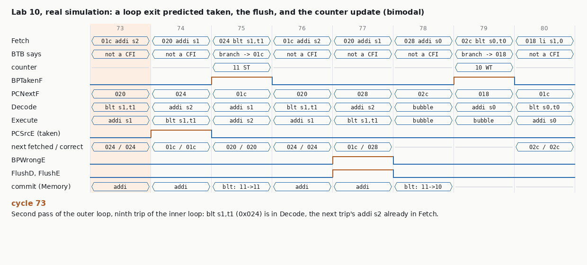

# Chapter 13 · Instruction Fetch Unit

@Abhishek

## At a glance

**One sentence:** the instruction fetch unit (IFU) has to choose the next PC every cycle, two cycles before the pipeline knows where a branch goes, so it guesses; this chapter is about guessing well, checking every guess, and paying as little as possible when the guess is wrong.

Why it matters, in the book's numbers: about 1 instruction in 5 is a branch. With "predict not taken" (Ch 7's pipeline), every taken branch flushes two instructions. In Example 13.1 (CoreMark) that alone turns CPI 1 into **1.14**, and on a 2-wide superscalar CPI 0.5 into **0.68** (36% slower), because a wider machine throws away more work per mistake. The Pentium 4, with a 20-cycle misprediction penalty and 4-wide issue, could flush 80 instructions per mistake: even 1% wrong is expensive.

The IFU's other parts look like the LSU's (Ch 12): an I-cache or instruction TIM, an IMMU (ITLB + PMA + PMP) whose misses are walked by the LSU's HPTW, a bus interface. What is new is the **PC logic** and the **branch predictor**:

&#91;embedded content: Branch prediction in the pipeline · guess in Fetch, check in Execute, train at commit\]

| Term | Meaning |
| --- | --- |
| direction | taken or not taken (not forward or backward) |
| BHT / PHT | branch / pattern history table: 2-bit saturating counters |
| GHR | global history register: outcomes of the last k branches |
| BTB | branch target buffer: last target (and, in Wally, the instruction class) per PC index |
| RAS | return address stack: predicts `ret` |
| IC | instruction class: branch, jump, call, return, or not a control-flow instruction (non-CFI) |
| BPWrongE | the PC fetched after this instruction is not PCCorrectE: flush and redirect |
| misprediction penalty | cycles lost per wrong guess: 2 in Wally's 5-stage pipeline |

## Theory, in the book's order

### 13.1 Why predict

A 5-stage pipeline resolves branches in Execute. By then Fetch has already fetched two more instructions. Predicting "not taken" makes a taken branch cost **3 cycles** (1 + 2 flushed); with \~20% of instructions being branches and \~40% of those taken, that is a 14% slowdown on a simple core and much more on wide or deep ones. A dynamic predictor needs three answers, all ready in Fetch, before the instruction is even decoded:

1. **Is this a control-flow instruction at all, and which kind?** (instruction class)
2. **If it is a branch, is it taken?** (direction: BHT/PHT)
3. **Where does it go?** (target: BTB, or RAS for returns)

Note on Example 13.1: the text quotes 22.2% branches and 41.9% taken, but the worked arithmetic uses 16.8% and 42.3%. With the text's numbers the answer is CPI 1.19 rather than 1.14; either way the point stands.

### 13.1.1 Static prediction

Decided at compile time, no state. "Always not taken" is free but wrong for every loop. **BTFN** (backward taken, forward not taken) uses the observation that backward branches (loops) are taken about 90% of the time and forward branches about 50%; ARM11 shipped with static prediction. It still needs the target in Fetch, so the instruction must be partly decoded there (Lab 10's type 1 does exactly that), and it can never predict `jalr`.

### 13.1.2 Simple dynamic prediction: 1-bit and 2-bit

A **1-bit** predictor remembers the last outcome per branch. On a loop that runs 10 times it is wrong twice per pass: on the exit, and again on the first trip of the next pass. A **2-bit saturating counter** (also called bimodal) needs two surprises in a row to flip, so the loop exit costs one misprediction and the next pass is still predicted taken.

&#91;embedded content: 2-bit saturating counter · book Fig. 13.2 and Code Example 13.1\]

The counters live in a **BHT**, indexed by low PC bits (bits \[b+1:2\] when instructions are 32-bit). It behaves like a **tagless direct-mapped cache**: two branches with the same index share a counter. That only costs accuracy, never correctness, because the worst case is a flush. Book Example 13.2: with b = 4, branch\_j (0x134) uses entry 13 and branch\_i (0x13C) entry 15; after the program both hold 10 (weakly taken) and every other entry its reset value 01. On SPEC89 a 4,096-entry 2-bit BHT is 82-99% accurate depending on the program; making it infinite gains under 1%. (A 4,096 x 2-bit SRAM has an absurd aspect ratio, so it is folded, for example into 128 x 64 bits with a mux on the low index bits.)

The BHT is read in Fetch (index from PCNextF, so a synchronous SRAM's output is ready at the start of Fetch) and written in Execute or later with the new counter value: a dual-port RAM.

### 13.1.3 Gshare: use the global history

Some branches depend on others. In the eqntott fragment (Code Example 13.2), if branch\_aa and branch\_bb both fall through, aa and bb become 0 and branch\_aabb is taken: the outcome is **correlated** with the two branches before it. Gshare keeps a **k-bit GHR** of the last k outcomes and indexes the counter table (now called the PHT) with **PC xor GHR**, so the same branch gets a different counter for each recent history. Empirically k = b works best.

- Gshare reaches about 96-97% on 4K entries (SPEC, Embench) once warmed up, where 2-bit stays lower.
- It needs **training time**: a branch is spread over many counters, one per history it is seen with.
- With **tiny tables** gshare is worse than 2-bit, because spreading each branch over many entries causes more conflicts.
- Both GHR and PHT are updated when the outcome is known. In a pipeline that is several branches after the prediction was made, which Wally fixes with forwarding (13.3).

Lab 10 measured exactly these effects. On its own nested loops, gshare mispredicts every trip of the first two passes (new histories), then predicts all of them **including the exit**, which no per-branch counter can do.

### 13.1.4 Branch target buffer

The direction alone is not enough: Fetch also needs the target in the same cycle. The **BTB** caches the last target per PC index (tagless in Wally, so it can alias). For a taken prediction the next PC is the BTB target, otherwise PC + 4. Every guess is checked the same way in Execute: was the instruction fetched after this one (PCD) at the correct next PC (PCCorrectE = taken ? target : PC + 4)? If not, BPWrongE flushes Decode and Execute and redirects. Direct branches and jal always have the same target, so a 256-entry BTB already finds the right target for 99% of Embench's control-flow instructions (Fig. 13.8). Small BTBs in low-end cores (4-256 entries) are usually associative.

### 13.1.5 Return address stack

A `ret` jumps to a different place depending on who called. A BTB remembers only the last one, but calls and returns nest, so a **stack** predicts them: push PC + 4 on a call, pop on a return. 3 to 16 entries cover most programs; on overflow the pointer wraps and overwrites the oldest entry, which only hurts the deepest returns. Book Fig. 13.10: jal at 0x105C pushes 0x1060, jal at 0x1140 pushes 0x1144, the first ret predicts 0x1144, the second 0x1060. A RAS can be wrong (a ret without a call, or software changing ra); the same PCD vs PCCorrectE check catches it.

### 13.1.6 TAGE

A **tournament** predictor runs several predictors and picks per branch the one that has been most accurate. **TAGE** (TAgged GEometric history) uses several gshare-like tables with history lengths in a geometric series (0, 2, 4, 8, 16, ...), each entry **tagged** so a long-history table only answers when it really has seen this pattern. Short histories warm up fast; long ones capture complex patterns. With enough storage it exceeds 99%. It is often too slow for one cycle, so it is used as a second-level predictor that overrides a fast first-level guess a cycle later (AMD Ryzen).

## 13.2 Test plan: correctness and performance

The book splits the IFU plan in two, and the split is the main lesson of the chapter for a verification engineer.

**Correctness.** riscv-arch-test exercises every branch and jump. When both caches exist, the Zifencei test stores a new instruction (it lands in the D-cache), runs fence.i, and fetches it: the I-cache must have been invalidated and the D-cache written back.

**Performance.** CoreMark and Embench fit in the caches, so they do not stress the memory system; Section 21.3 checks I-cache and predictor performance separately, by comparing Wally's measured accuracy with a **theoretical branch predictor model (CModel)** (Figs. 13.6 and 13.8 show them agreeing).

Why performance needs its own check: **a branch predictor cannot make the core compute a wrong answer, only a slow one**, *provided the recovery logic is right*. The book says it directly: "many types of bugs only result in lower prediction accuracy rather than incorrect processor behavior." So the predictor splits into two verification problems:

| Part | What a bug does | How you see it |
| --- | --- | --- |
| Recovery: BPWrongE, flush, PCNextF priority, PCCorrectE | executes wrong-path instructions: **wrong results** | lock-step with an ISS, self-checking tests, assertions such as "the PC after a committed instruction is its architectural next PC" |
| Prediction: tables, indexing, GHR, RAS, update policy, IC prediction | **only mispredictions**, every result still correct | performance counters vs a reference model, per-kernel CPI regressions, coverage of predictor states |

Coverage points worth listing in a predictor plan:

- outcome cross: each instruction class (branch, jal, jalr, call, return, non-CFI) x predicted class x predicted direction x actual direction x target right/wrong
- the misprediction arrives while another redirect is pending: a trap, mret or CSR-write flush from Memory in the same cycle (priority), or a predicted-taken instruction already in Fetch
- **tagless aliasing**: a non-CFI whose BTB entry says "taken jump"; two branches sharing a counter
- RAS: overflow and wraparound, return without a call, a call or return flushed after it acted, back-to-back returns
- tables trained by flushed or trapping instructions (must not happen), first use after reset, saturation at 00 and 11
- interaction with stalls: a misprediction detected while Execute is stalled (it must keep redirecting until the stall drops)
- **re-check old coverage after adding a predictor**: removing bubbles changes which hazards the old tests reach (Lab 10 lost coverage of an interrupt-on-bubble bug this way)

## 13.3 Wally's IFU

Wally's IFU is the LSU's mirror image without the write side. Instructions are always 32 bits (16 with C, Ch 14) and little-endian, so there is no subword or endian logic; Fetch-stage faults (page, access, misaligned) are pipelined down to Memory and trapped there. Configurations: rv32e fetches over the bus only; rv32i/rv64i from an IROM; rv32imc from an IROM plus external memory; rv32gc/rv64gc from an I-cache plus external memory.

### Instruction cache

The same cache module as the D-cache with READ\_ONLY\_CACHE = 1: no write path, no dirty bits, no writeback, no flush. The cachefsm loses its Writeback, Flush and FlushWriteback states. **fence.i** asserts InvalidateICacheM, which clears every valid bit, so the next fetch misses and gets the new instruction (after the D-cache has written it back).

### PC logic (Fig. 13.14), in priority order

1. reset: RESET\_VECTOR
2. trap or mret/sret from Memory: the trap vector (MTVEC/STVEC, vectored for interrupts) or EPC
3. CSR write or fence in Memory: reissue the next instruction, normally PCE, but **PCF if a misprediction already flushed Execute** (BPWrongM), because then PCF is the next valid instruction (NextValidPCE)
4. misprediction in Execute (BPWrongE): PCCorrectE = taken ? IEUAdrE : PCE + 4 (PCLinkE)
5. prediction in Fetch (BPPCSrcF): BPPCF = RAS top for a predicted return, else the BTB target
6. otherwise PCF + 4

### The predictor, bpred (Fig. 13.15)

Configured by BPRED\_SUPPORTED (0 = static not-taken), BPRED\_TYPE (BP\_GSHARE default, BP\_GSHARE\_BASIC, BP\_TWOBIT) and table sizes 2^BPRED\_SIZE and 2^BTB\_SIZE.

- **Instruction-class prediction.** The BTB stores {target, 4 class bits: branch, jump, call, return}. In Fetch the class tells bpred what the instruction probably is before decode. **icpred** decodes the real class in Decode and flags IClassWrong. Calls are `jal` with rd = x1 or x5 (x5 for millicode save/restore routines), returns are `jalr x0, (x1 or x5)`. A wrong class only matters if it changed the fetched PC; otherwise it is just counted.
- **Updates happen at the end of Memory**, when the instruction commits, so flushed branches never train anything and the GHR never needs repair.
- **Gshare forwarding** (Fig. 13.17): because updates are late, the Fetch-stage history is rebuilt from the committed GHR plus every branch in flight: Memory and Execute with their real outcome, Decode and Fetch with their predicted direction (Example 13.3: if all four stages hold branches and only Execute's is not taken, GHRNextF = {1, 1, 0, 1, GHRM\[k-4:4\]}). The predicted counter value is also forwarded when an in-flight branch has the same PHT index (Example 13.4: MatchE forwards NewBPDirE). BP\_GSHARE\_BASIC skips all of this.
- **BTB forwarding** (Fig. 13.18): if an in-flight instruction has the same PC as Fetch, its class and target are forwarded (Decode forwards its *predicted* target, later stages the real IEUAdr). The BTB is only written when the class or target was wrong, which saves power. Index trick with C: {PC\[b+1\] ^ PC\[1\], PC\[b:2\]}.
- **RAS** (Fig. 13.20): an asynchronous flop memory (read and write in the same cycle). A predicted return pops in Fetch, a call pushes PCLinkE in Execute. **Repairs**: a return flushed in Decode or Execute is un-popped; a wrongly predicted return is un-popped; an unpredicted return pops late.
- **Misprediction recovery** (Table 13.1): if PCD != PCCorrectE, flush two instructions and fetch PCCorrectE; otherwise continue with PCF + 4. Fig. 13.21 walks a branch at 0x100 predicted taken to 0x200 that turns out not taken: 0x200 and 0x204 are flushed, Fetch resumes at 0x104, and at commit the counter goes from 11 to 10 and the GHR shifts in a 0.

### ITLB misses, reset, stalls, hazards

- The ITLB raises ITLBMissF and sends PCF to the LSU's HPTW, which returns the PTE and page type and pulses ITLBWriteF. If both TLBs miss in the same cycle, the **DTLB goes first**.
- **Predictor SRAMs are not reset.** In silicon they power up random, so prediction (and therefore timing) can differ from boot to boot. In simulation they start at 0 because Wally declares them as `bit`, not `logic`.
- The IFU stalls the pipeline (IFUStallF) for cache misses, bus accesses and ITLB walks, and raises CommittedF so interrupts wait for an in-flight fetch.
- In the hazard unit **BPWrongE replaces PCSrcE**: Decode and Execute are flushed only when the predictor was wrong, not on every taken branch.

## Lab 10: a branch predictor for cpu-from-scratch

**Goal:** replace Ch 7's "predict not taken" with Wally's predictor structure: BTB with instruction class, 2-bit or gshare direction, RAS. Recovery is by comparing the fetched-next PC with PCCorrectE. Then verify it two ways (correctness and performance) and hunt five injected bugs.

```
make bp         # 84 tests at the default (gshare + forwarding); 44 each with static not-taken, BTFN, small bimodal
make bphunt     # 5 injected bugs vs self-check, lock-step and an exact predictor model
make bpperf     # predictor type, table sizes, BTB size, RAS depth
```

### What was built (rtl/pipe/bpred.sv)

| BP\_TYPE | Direction | Target |
| --- | --- | --- |
| 0 | always not taken (the old core) | none |
| 1 | static BTFN, decoded in Fetch | branch / jal immediate; jalr never predicted |
| 2 | bimodal: 1024 x 2-bit, PC-indexed | 1024-entry tagless BTB {target, class} + 4-entry RAS |
| 3 | gshare, history = committed branches (book's BP\_GSHARE\_BASIC) | same |
| 4 (default) | gshare, history also shifts in branches still in Memory, Execute (real) and Decode (predicted) | same |

As in Wally: classes branch / jump / call (`jal` or `jalr` writing x1 or x5) / return (`jalr x0, (x1 or x5)`); every table trains at commit; prediction arrays are not reset (they start at weakly-not-taken in simulation); the hazard unit flushes on **BPWrongE = fetched-next PC != PCCorrectE**, which catches wrong direction, wrong target, wrong class and aliased non-branches with one compare. Different from Wally: the RAS acts in **Decode** on the decoded class, each instruction carries a snapshot of the RAS pointer, and a flushed or trapping instruction restores it. Because wrong-path instructions are always killed before they leave Decode, the only repairs needed are for flushes from Memory (traps, CSR writes, mret). The BTB and PHT are not forwarded.

### Watch a misprediction, cycle by cycle



The inner loop of Code Example 13.1 (tests/bp/bp\_basic.S) on the bimodal predictor: the tenth `blt` is predicted taken from a strongly-taken counter, two wrong-path instructions are fetched, Execute finds PCCorrectE = 0x028, Decode and Execute are flushed, and the counter drops to 10 at commit. This is book Fig. 13.21 in this core.

### What it buys

&#91;embedded content: make bpperf · tests/bench, 41,119 instructions, RTL counters\]

| Table entries (bench + 5 random programs) | bimodal: wrong directions per 100 branches | gshare + forwarding |
| --- | --- | --- |
| 4 | 26.9 | 29.8 |
| 16 | 24.0 | 23.6 |
| 64 | 24.0 | 22.3 |
| 256 | 23.0 | 19.0 |
| 1024 | 23.4 | 18.6 |
| 4096 | 23.4 | 20.4 |

The random programs include deliberately unpredictable branches (on a xorshift value), hence the high floor. The shape is the book's Fig. 13.6: gshare loses with 4 entries (each branch is spread over many counters) and wins from 64 up; at 4096 entries (12 history bits) these short programs never finish training it.

| BTB entries | 4 | 16 | 64 | 256 | 1024 |
| --- | --- | --- | --- | --- | --- |
| control-flow instructions with the right target and class | 13.9% | 49.9% | 80.5% | 93.9% | 98.2% |

| RAS entries | 2 | 4 | 8 | 16 |
| --- | --- | --- | --- | --- |
| returns mispredicted in bp\_basic (195 returns, fib(10)) | 44 | 23 | 12 | 10 |

On Code Example 13.1 the ideal model gives exactly the book's 1-bit numbers, branch\_j 80% and branch\_i 60%. The 2-bit gives 88% rather than 90%, because the counter starts at weakly-not-taken and the very first trip is one extra miss.

### Tests and checks

- **tests/bp/bp\_basic.S**, 9 self-checks: nested loops (Code Example 13.1), correlated branches (Code Example 13.2), a 6-deep call chain and recursive fib(10), indirect calls whose target changes every time, an `addi` placed exactly 4 KiB after a trained jump (same BTB index), a loop exit while Fetch holds a predicted-taken jump, and `csrw` right before a call.
- **dv/genbp.py**: random structured control flow: nested counted loops, if/else on pseudo-random or loop-counter bits, a DAG of functions called directly or through a table, `csrw` placed in front of calls and returns.
- **Lock-step** with the ISS: correctness.
- **dv/bpsim.py**, an ideal predictor model run over the committed trace (the book's CModel idea). With GHR forwarding the RTL count equals it **exactly**: bp\_basic 158 = 158, the C benchmark 398 = 398, all ten random programs equal. So the check is equality, not a tolerance. (With a 16-entry BTB they differ by up to 7, because a BTB entry can change while the instruction that writes it is still in flight. Wally forwards in-flight BTB entries; this core doesn't, so tiny BTBs get 1% slack.)

### Bug hunt (10 random programs, two BTB sizes)

| Injected bug | bp\_basic: self / lock / model | random, 1024-entry BTB: lock / model | random, 16-entry BTB: lock / model |
| --- | --- | --- | --- |
| (none) | ok / ok / ok | 0/10, 0/10 | 0/10, 0/10 |
| PRIORITY: Fetch's prediction beats Execute's redirect | **ok** / FAIL / (n/a) | 10/10, (n/a) | 10/10, (n/a) |
| CFI\_ONLY: only branches and jumps are checked | FAIL / FAIL / (n/a) | **0/10**, 0/10 | 10/10, (n/a) |
| DIR\_ONLY: the target is never checked | FAIL / FAIL / (n/a) | 9/10, (n/a) | 10/10, (n/a) |
| RAS\_NO\_REPAIR: flushed calls/returns not undone | ok / ok / ok | 0/10, **7/10** | 0/10, 0/10 |
| PHT\_NO\_SAT: counters wrap 11 to 00 | ok / ok / **FAIL** | 0/10, 10/10 | 0/10, 10/10 |

(n/a: the model is not run once lock-step has already failed.)

What it teaches:

- **A passing self-check proved nothing for PRIORITY.** The wrong-path iterations of the nested loops ran and the final counts still came out right; lock-step failed on instruction 67.
- **CFI\_ONLY needs aliasing to fire.** It is invisible with a 1024-entry BTB on these programs. It fails every time with 16 entries, and the directed test plants the alias on purpose with `.org`. (That test needed `.option norelax`: the linker's relaxation shrank `call` and `la` sequences after `.org` had been computed, so the "alias" landed 0x20 bytes off. I caught it because the non-branch-flush counter read 0.)
- **DIR\_ONLY is caught mostly through returns**: the RAS hands back a stale address in a direction that happens to be "taken" either way.
- **Only the model sees the two performance bugs.** RAS\_NO\_REPAIR adds just 2 mispredictions in one 12,000-instruction program (700 vs 698). An exact model makes that a failure; a 15% tolerance made it 1/10 in my first version.

### Things the lab found that I did not plan

- **BTB aliasing first, predictor second.** My first build used a 64-entry BTB and was disappointing: 65 of 75 returns and 623 non-branch instructions mispredicted on the benchmark. The C benchmark's code is 1,915 bytes, about 480 instructions, on 64 tagless entries. With 1024 entries: 4 returns and 0 non-branches. Size the BTB to the code before tuning anything else.
- **Commit-time history costs 7%.** Gshare with committed history (type 3) mispredicts 426 times on the benchmark; with in-flight branches forwarded into the history, 398. Forwarding is what makes the RTL equal the ideal model.
- **The predictor removed coverage from an old test.** Re-running Lab 5's hunt: BUG\_INT\_BUBBLE (interrupt taken on a pipeline bubble) used to hang tests/priv/interrupts.S, and now passes it. That test's idle loop produced a bubble on every taken branch, which is the bug's trigger. With a predictor the loop has no bubbles. With BP\_TYPE=0 it fails again. Any microarchitecture change needs the old coverage re-measured, not just the old tests re-run.

## Recap, interview drill, companion

**Companion page:** [Branch Prediction Lab](https://claude.ai/artifact/XEewz6a93p8GJBAysBD5oC). It has a predictor playground with the book's patterns, a 2-bit counter stepper, the Example 13.1 CPI calculator and a return-stack simulator.

### Recap in ten lines

1. A branch is resolved in Execute, so every wrong guess costs 2 cycles on Wally (`(1-b) + b(3t + 1-t)` for "predict not taken"; Example 13.1 gives CPI 1.14). Deeper or wider cores lose much more.
2. Fetch must guess three things: **is it a CFI** (the class stored in the BTB), **which way** (the direction table) and **where to** (the BTB target or the RAS top).
3. 1-bit counters miss twice per loop pass. 2-bit saturating counters miss once, because the loop exit only moves 11 to 10.
4. gshare indexes by PC xor GHR, so it learns correlated branches (eqntott). It is worse than bimodal with tiny tables, because each branch is spread over many counters.
5. Wally's BTB is tagless. An aliased non-CFI can be predicted as a jump, so Execute must check **every** instruction: `BPWrongE = PC fetched next != PCCorrectE`.
6. The tables are updated at **commit** (end of Memory), so flushed branches never train them. GHR forwarding of in-flight outcomes (Fig 13.17) restores the accuracy that delay costs.
7. The RAS pushes PC+4 on a call and pops on a return. A call or return that acted speculatively and is then flushed must be undone, by repairing the pointer.
8. The PC mux priority is: trap/xRET/fence.i/CSR flush > misprediction redirect > prediction > PC+4.
9. The I$ is read-only and is invalidated by fence.i. An ITLB miss goes to the shared HPTW, where the DTLB has priority. The predictor SRAMs are not reset.
10. Lab 10 RTL with GHR forwarding matches an ideal model **exactly**: 398 flushes on the C benchmark (41k instructions), and CPI drops from 1.238 to 1.020.

### Ten questions with model answers

**Q1. How do you verify a branch predictor when a wrong prediction is functionally harmless?** Split the checks. *Functional* checking is lock-step or a scoreboard against an ISS: no wrong-path instruction may ever commit, through any recovery path (mispredict, trap, CSR flush, fence.i, an interrupt on a wrong-path instruction).

*Performance* checking is an event-exact reference model of the predictor. Compare misprediction counts, or even per-branch predictions, and set a CPI baseline on benchmarks.

In Lab 10, BUG\_PHT\_NO\_SAT doubled the flushes and passed every functional check. Only the model caught it.

**Q2. Why update at commit rather than in Execute?** Updating in Execute lets wrong-path or later-trapped branches train the tables and corrupt the GHR, which then needs a checkpoint and repair.

Updating at commit is simple and always correct. The cost is stale history in Fetch for tight loops; forwarding the in-flight outcomes into the GHR solves it (Lab 10: 426 → 398 flushes).

**Q3. The BTB is tagless. What can go wrong and how do you cover it?** A non-CFI that aliases a jump's entry is predicted taken. The core is correct as long as Execute compares the next-fetched PC for **every** instruction, not just for branches.

Cover it with:

- a directed alias test (`.org` an addi exactly 2^k bytes from a trained jump);
- random programs run with a tiny BTB (-GBTB\_BITS=4);
- coverage of "predicted class != actual class" for each pair of classes.

Lab 10's BUG\_BP\_CFI\_ONLY passed 10 of 10 random programs at 1024 entries and failed all 10 at 16 entries.

**Q4. Walk through the RAS on a misprediction.** A `call` in the wrong path pushes a return address, or a `ret` pops one. When the older branch resolves, the pointer must go back to its value at that branch. Do this with a snapshot carried down the pipe and restored on the kill.

The entry overwritten by the wrong-path push is lost, which costs accuracy but not correctness. Lab 10's BUG\_RAS\_NO\_REPAIR cost only +2 mispredictions in 12k instructions, so only the exact model saw it.

**Q5. What is the priority of the next-PC sources and why?** The order is: a trap or xRET from Memory, then a mispredict from Execute, then the Fetch prediction, then PC+4. The oldest instruction wins, because a younger instruction's redirect is on a path that the older event has already cancelled.

Lab 10's BUG\_BP\_PRIORITY, with the Execute redirect beating the trap, executed wrong-path code after an exception. The self-check stayed OK; lock-step caught it.

**Q6. gshare vs bimodal vs TAGE?**

- Bimodal captures each branch's bias.
- gshare adds correlation through global history, but it aliases more.
- TAGE uses several tagged tables with geometric history lengths and picks the longest matching history. Its accuracy is much higher, and it is the basis of modern high-end cores.

For verification, TAGE's allocation and useful-bit aging are a large state space. Use a C model of the predictor, compared at the per-prediction level.

**Q7. What coverage would you write for a predictor?**

- Every class (none/branch/jump/call/ret) × predicted class.
- Each direction × prediction, and each counter transition, including saturation at both ends.
- GHR forwarding cases (a branch in D, E and M at the same time).
- RAS full, empty, wrap and repair after a flush.
- A misprediction in the same cycle as a trap, an interrupt, a stall or an I$ miss.
- BTB alias.
- fence.i after self-modifying code.

**Q8. Your change made the predictor better and an old bug test stopped failing. Why?** Coverage depends on the microarchitecture. In Lab 10, BUG\_INT\_BUBBLE only fired when a taken branch flushed at the same moment as an interrupt, and better prediction removed most of those flushes.

So after a microarchitecture change, re-check that the coverage still closes and add directed scenarios that do not depend on mispredictions happening by chance (or force a predictor mode, e.g. BP\_TYPE=0).

**Q9. How does the I$ interact with fence.i and the ITLB?** The I$ is never written by stores. fence.i writes back the D$ and invalidates the I$, then the pipeline is flushed and fetch restarts at PC+4.

An ITLB miss stalls Fetch and uses the shared hardware page-table walker. Data walks have priority, and an instruction page fault is raised at the faulting fetch PC.

To test this: self-modifying code with and without fence.i, and page faults on a fetch that straddles a page (compressed instructions — Chapter 14).

**Q10. A 4-wide core with a 15-cycle penalty: is 95% branch accuracy good?** With 20% branches, each instruction loses 0.2 × 0.05 × 15 = 0.15 cycles. Against an ideal CPI of 0.25 that is a 60% slowdown. So no: wide, deep cores need about 98–99%. That is why they use TAGE plus loop and indirect predictors.

### The 60-second story to tell

"I built and verified a gshare predictor with a BTB and RAS in a 5-stage RISC-V core. The key insight was that predictor bugs come in two kinds:

- **functional** bugs in recovery, caught by lock-step against an ISS;
- **performance** bugs that never break correctness, caught only by an exact reference model.

With GHR forwarding the RTL matched my model to the exact misprediction count, so any difference was a bug. I seeded five bugs and each was caught. Two of them were visible only through the model or a deliberately tiny BTB."

## Book coverage check (Ch 13 audit)

This tab has been checked against all 17 sections of Chapter 13, Table 13.1 and Examples 13.1–13.4. It was already close to complete. These details from 13.3.3 were still missing.

- **When the GHR updates.** Only on a committed, valid branch: `BranchM & ~FlushW & ~StallW`. With `BP_GSHARE_BASIC` (no forwarding), the GHR used in Fetch **lags the PC by four cycles**, so it ignores branches still in flight. Accuracy drops, but the result is still correct. That is the reason full Gshare forwards the GHR.
- **Misprediction-rate formulas** (all from the Ch 8 counters). Know these to explain a benchmark table:

  | Rate | Formula |
  | --- | --- |
  | Direction | wrong direction ÷ branches |
  | Target | wrong target ÷ (branches + jumps) |
  | Instruction class | class wrong ÷ instructions retired |
  | RAS | RAS wrong address ÷ returns, where RAS wrong = `(RASPCE != IEUAdrE) & ReturnE` |
- **BTB layout.** It is a 2^b × (XLEN + 4)-bit **ram2p1r1w**: it reads with PCNextF and writes with PCM. The target address and the 4 class bits share one memory because one large array is denser than two small ones.
- **Instruction-class (IC) prediction can be turned off.** With `INSTR_CLASS_PRED = 0`, the class comes from a partial decode in Fetch, which makes Fetch longer. Fetch is not the critical path, so the cycle time doesn't change. The authors measured that the class predictor has negligible effect on accuracy. That is a nice example of using an A/B configuration to show a feature has no performance bug.
- **Millicode** (Waterman 2016). Shared register save/restore routines are called with `jal t0, …` so that `ra` is not overwritten. That is why icpred treats x5 as a link register: CallD = jal {ra, t0}, ReturnD = jalr x0, {ra, t0}.
- **RAS.** It is a circular buffer of RAS\_SIZE entries plus a Ptr up/down counter, built from **asynchronous** flip-flops with separate read and write ports, so it can push and pop in the same cycle.
  - A wrongly predicted return increments Ptr (undoing the pop).
  - A return the predictor missed decrements Ptr (catching up).
  - A return flushed in D or E (`FlushedRetDE`) increments Ptr.
  - **Coverpoint:** call/return depth beyond RAS\_SIZE (wrap-around), plus each repair case with a flush in the same cycle.
- The book notes Wally also has predictors not described in the text, and points to \[Yeh91\] (two-level adaptive prediction) for them.


---

Interactive companion page for this chapter: [`companion-pages/ch13-lab.html`](../companion-pages/ch13-lab.html) (download and open in a browser).
